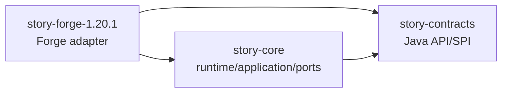

# Project Map

## Identity

- Root project: `echo-story-engine`
- Artifact: `echo-story-engine`
- Mod ID: `echo_story_engine`
- Display name: `Echo Story Engine`
- Maven group and base package: `io.github.kxyr0.echostoryengine`

## Dependency Diagram

## `story-contracts`

Purpose: stable Java-friendly public API and data contracts.

Layer: public contracts.

Production type count: 12.

Allowed dependencies: Java standard library only.

Forbidden dependencies: core implementation, Forge, Minecraft, logging frameworks, serialization frameworks,
filesystem, networking, GUI, third-party mod APIs.

Public entrypoints and types:

- `StoryEngineApi`
- `StoryRuntimeInput`
- `StoryRuntimeResult`
- `StoryExecutionState`
- `ExternalCommand`
- `StoryDiagnostic`
- `DiagnosticSubject`
- `DiagnosticSeverity`
- `StoryId`, `ExecutionId`, `NodeId`, `NamespacedId`

Threading model: contracts are immutable data or stateless interfaces.

Persistence responsibility: none; contracts are data boundaries only.

Diagnostic responsibility: define structured diagnostic data.

Status: implemented scaffold.

Related ADR: 0001, 0002, 0005, 0006, 0007.

## `story-core`

Purpose: story runtime use case, pure transition policy, ports, and diagnostic read model.

Layer: domain, application, ports.

Production type count: 6.

Allowed dependencies: `story-contracts`, Java standard library, test libraries in test source set.

Forbidden dependencies: Forge, Minecraft, filesystem, networking, logging frameworks, GUI, concrete game domains.

Important packages:

- `..story.core.domain`: `RuntimeTransitionPolicy`
- `..story.core.application`: `StoryRuntimeUseCase`
- `..story.core.port`: `DiagnosticSink`, `StoryClock`, `ExecutionStateRepository`
- `..story.core.diagnostic`: `InMemoryDiagnosticBuffer`

Threading model: application methods are called by the platform-owned authoritative context. Core does not start threads.

Persistence responsibility: define `ExecutionStateRepository` port, not storage technology.

Diagnostic responsibility: emit structured diagnostics and keep a bounded in-memory read model.

Status: implemented scaffold.

Related ADR: 0002, 0005, 0006, 0007, 0010.

## `story-forge-1.20.1`

Purpose: first platform implementation for Forge 1.20.1.

Layer: composition and infrastructure.

Production type count: 5.

Allowed dependencies: `story-core`, `story-contracts`, Forge/Minecraft dependencies.

Forbidden dependencies: concrete gameplay subsystems and third-party mod integrations.

Entrypoints and adapters:

- `EchoStoryEngineMod`: Forge `@Mod` entrypoint.
- `ForgeStoryCompositionRoot`: creates the minimal runtime object graph.
- `ForgeDiagnosticSink`: maps structured diagnostics to the standard Forge/Minecraft logging pipeline.
- `ForgeStoryClock`: supplies platform time.
- `VolatileExecutionStateRepository`: server-lifetime state adapter, not durable persistence.

Threading model: initial bootstrap call happens in Forge common setup. Future tick/event adapters must marshal inputs
into the server-authoritative execution context.

Persistence responsibility: no durable persistence yet. The volatile adapter proves the port boundary only.

Diagnostic responsibility: one logical logger namespace, no application-owned subsystem log files.

Status: implemented scaffold.

Related ADR: 0003, 0005, 0007, 0009, 0010.
