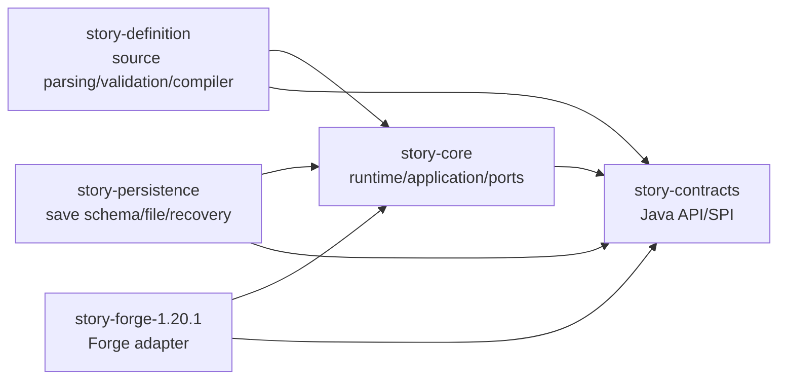

# Project Map

## Identity

- Root project: `echo-story-engine`
- Artifact: `echo-story-engine`
- Mod ID: `echo_story_engine`
- Display name: `Echo Story Engine`
- Maven group and base package: `io.github.kxyr0.echostoryengine`

## Dependency Diagram

## `story-contracts`

Purpose: stable Java-friendly public API and data contracts.

Layer: public contracts.

Production type count: 16.

Allowed dependencies: Java standard library only.

Forbidden dependencies: core implementation, Forge, Minecraft, logging frameworks, serialization frameworks,
filesystem, networking, GUI, third-party mod APIs.

Public entrypoints and types:

- `StoryEngineApi`
- `StoryRuntimeInput`
- `StoryRuntimeResult`
- `StoryExecutionState`
- `StoryExecutionPhase`
- `ExternalCommand`
- `ExternalActionResultCategory`
- `StoryDiagnostic`
- `DiagnosticSubject`
- `DiagnosticSeverity`
- `StoryId`, `ExecutionId`, `ActionExecutionId`, `NodeId`, `NamespacedId`, `CompiledStoryFingerprint`

Threading model: contracts are immutable data or stateless interfaces.

Persistence responsibility: none; contracts are data boundaries only.

Diagnostic responsibility: define structured diagnostic data.

Status: M3 adds `CompiledStoryFingerprint` as the neutral durable compatibility token.

Related ADR: 0001, 0002, 0005, 0006, 0007.

## `story-core`

Purpose: story runtime use case, pure transition policy, immutable compiled story definition model, ports,
and diagnostic read model.

Layer: domain, application, ports.

Production type count: 19.

Allowed dependencies: `story-contracts`, Java standard library, test libraries in test source set.

Forbidden dependencies: Forge, Minecraft, filesystem, networking, logging frameworks, GUI, concrete game domains.

Important packages:

- `..story.core.domain`: `StoryDefinition`, `StoryNode`, `StoryNodeKind`, `RuntimeTransitionPolicy`,
  `StoryDefinitionFingerprint`, `RuntimeDiagnostics`
- `..story.core.application`: `StoryRuntimeUseCase`, persistence result assembly
- `..story.core.port`: `DiagnosticSink`, `StoryClock`, `ExecutionStateRepository`, `ExecutionCheckpoint`,
  load/save result/status types, `PendingActionCheckpoint`
- `..story.core.diagnostic`: `InMemoryDiagnosticBuffer`

Threading model: application methods are called by the platform-owned authoritative context. Core does not start threads.

Persistence responsibility: define checkpoint repository port and save-before-dispatch application semantics,
not storage technology.

Diagnostic responsibility: emit structured diagnostics for runtime transitions, external action failures,
duplicate/unknown completions, and transition-budget failures; keep a bounded in-memory read model.

Status: M3 uses explicit load/save result contracts, optimistic revisions, bounded duplicate completion state, and
suppresses command dispatch when checkpoint save fails.

Related ADR: 0002, 0005, 0006, 0007, 0010, 0011.

## `story-definition`

Purpose: source definition parsing, validation, diagnostics, and compilation into the core compiled runtime model.

Layer: source processing.

Production type count: 16.

Allowed dependencies: `story-core`, `story-contracts`, Java standard library, Gson inside the strict JSON adapter,
test libraries in test source set.

Forbidden dependencies: Forge, Minecraft, filesystem I/O, networking, logging frameworks, GUI, concrete game domains,
third-party Minecraft mod APIs.

Important packages:

- `..story.definition.source`: `StorySourceInput`, `SourceStory`, `SourceNode`, `SourceNodeKind`, `SourceLocation`
- `..story.definition.parse`: `JsonStorySourceParser`, `StoryParseResult`
- `..story.definition.validation`: `StructuralStoryValidator`, `SemanticStoryValidator`, `StoryValidationResult`
- `..story.definition.compile`: `StorySourcePipeline`, `StorySourceCompiler`, `StoryCompilationResult`,
  `StoryCompileResult`
- `..story.definition.diagnostic`: `SourceDiagnosticCatalog`, `SourceDiagnosticContext`

Threading model: pure in-memory processing; callers own scheduling and lifecycle.

Persistence responsibility: none; M2 accepts source text supplied by tests or future adapters and does not load files.

Diagnostic responsibility: emit `ESE-SOURCE-*` diagnostics for syntax, structural validation, semantic validation,
and compilation invariant failures.

Status: M2 strict JSON source pipeline implemented and tested through normal JVM tests.

Related ADR: 0001, 0002, 0005, 0007, 0011.

## `story-persistence`

Purpose: durable checkpoint schema, strict JSON encoding, portable file repository, and recovery planning.

Layer: persistence adapter and recovery boundary.

Production type count: 19.

Allowed dependencies: `story-core`, `story-contracts`, Java standard library, Gson inside `..story.persistence.schema`,
test libraries in test source set.

Forbidden dependencies: `story-definition`, Forge, Minecraft, logging frameworks, networking, GUI, concrete game
domains, third-party Minecraft mod APIs.

Important packages:

- `..story.persistence.schema`: save schema V1 DTOs, strict JSON reader/writer, checkpoint translator
- `..story.persistence.file`: `FileExecutionStateRepository`, safe storage key, primary/backup/temp read/write helpers
- `..story.persistence.recovery`: `ExecutionRecoveryPlanner`, `CompiledStoryCatalog`, recovery result/status
- `..story.persistence.diagnostic`: `PersistenceDiagnosticCatalog`

Threading model: synchronous Java file operations; callers own scheduling.

Persistence responsibility: own schema V1, deterministic UTF-8 JSON, safe filenames, optimistic revision checks,
atomic move fallback, one backup, corrupt primary fallback, and stale temp ignore policy.

Diagnostic responsibility: emit `ESE-PERSISTENCE-*` diagnostics without absolute paths or snapshot dumps.

Status: M3 durable file persistence and recovery implemented; Forge world binding is deferred to M4.

Related ADR: 0012.

## `story-forge-1.20.1`

Purpose: first platform implementation for Forge 1.20.1.

Layer: composition and infrastructure.

Production type count: 5.

Allowed dependencies: `story-core`, `story-contracts`, Forge/Minecraft dependencies.

Forbidden dependencies: concrete gameplay subsystems and third-party mod integrations.

Entrypoints and adapters:

- `EchoStoryEngineMod`: Forge `@Mod` entrypoint.
- `ForgeStoryCompositionRoot`: creates the minimal runtime object graph.
- `ForgeDiagnosticSink`: maps structured diagnostics to the standard Forge/Minecraft logging pipeline.
- `ForgeStoryClock`: supplies platform time.
- `VolatileExecutionStateRepository`: server-lifetime state adapter, not durable persistence.

Threading model: initial bootstrap call happens in Forge common setup. Future tick/event adapters must marshal inputs
into the server-authoritative execution context.

Persistence responsibility: no durable Forge host yet. The volatile adapter implements the refined checkpoint port
for server-lifetime state only.

Diagnostic responsibility: one logical logger namespace, no application-owned subsystem log files.

Status: M1 composition wires the deterministic hello story and supported abstract action type. M2 does not add Forge
resource discovery or production source loading. M3 does not wire the durable file repository into Forge.

Related ADR: 0003, 0005, 0007, 0009, 0010.
