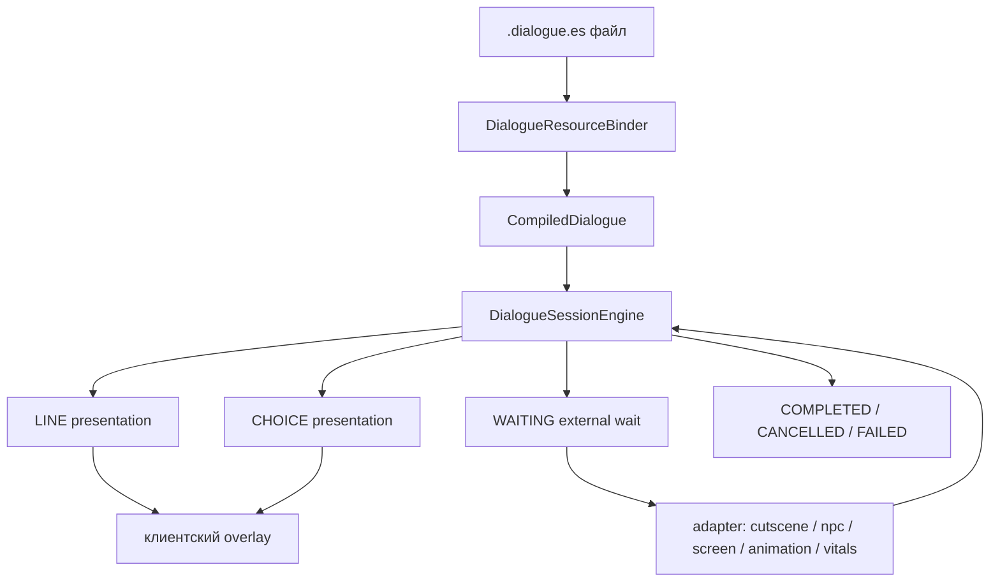

# Документация по диалогам Echo Dialogue для JDH

Дата среза: 2026-07-29.

Этот файл - единая русская документация по диалогам проекта JDH. Он сделан для разработчиков сюжета, сценаристов и тех, кто связывает сюжетные сцены с NPC, катсценами, затемнениями экрана, лицевыми анимациями, портретами, скинами, усталостью игрока и story-ресурсами.

Главная мысль: диалог в Echo Dialogue - это не просто текст. Это маленький граф сцен: ноды, реплики, выборы, результаты, переходы, внешние команды и визуальная презентация говорящего.

## Быстрый старт

Файлы диалогов кладутся в server data path:

```text
data/<namespace>/echo_dialogue/dialogues/<папки>/<имя>.dialogue.es
```

Для JDH в PrismLauncher основной runtime-пак находится здесь:

```text
C:\Users\kxyr0\AppData\Roaming\PrismLauncher\instances\Форма Мысли\minecraft\story\content-pack\jdh
```

Runtime-путь диалогов JDH:

```text
C:\Users\kxyr0\AppData\Roaming\PrismLauncher\instances\Форма Мысли\minecraft\story\content-pack\jdh\data\jdh\echo_dialogue\dialogues
```

Runtime-путь story-файлов, которые запускают диалоги:

```text
C:\Users\kxyr0\AppData\Roaming\PrismLauncher\instances\Форма Мысли\minecraft\story\content-pack\jdh\data\jdh\echo_story\stories
```

Runtime-путь клиентского конфига оверлея диалогов:

```text
C:\Users\kxyr0\AppData\Roaming\PrismLauncher\instances\Форма Мысли\minecraft\story\configs\jdh\echo_dialogue\client_overlay\dialogue_overlay.dialogue-overlay.es
```

В репозитории исходные ресурсы content pack лежат здесь:

```text
D:\JDHSeason\mods\echo-story-content-pack\src\main\resources
```

Документация, которую ты читаешь:

```text
D:\JDHSeason\docs\markdown\dialogue.md
```

Минимальный современный диалог:

```csharp
namespace JDH.Chapter1.Home;

class FirstQuestionDialogue : DialogueResource
{
    private void Init()
    {
        Id("jdh:first_question");
        Start(Question);

        Alias("father", "jdh:john_father", display: "Отец", visual: Portrait("jdh:john_father"));
        Alias("john", "jdh:john", display: "Лололошка", nameColor: nameColor("#FC9004"), visual: SkinHead("echo_content_player:player/base"));
    }

    private void Question()
    {
        Line("father", "Ты поздно вернулся.");
        Line("father", "Где ты был?");
        Choice("tell_truth", "Сказать правду.", TellTruth);
        Choice("lie", "Солгать.", Lie);
    }

    private void TellTruth()
    {
        Line("john", "Я был у старого моста.");
        Complete("jdh:told_truth");
    }

    private void Lie()
    {
        Line("john", "Я просто задержался во дворе.");
        Complete("jdh:lied");
    }
}
```

Story-ресурс, который запускает диалог:

```csharp
namespace JDH.Chapter1.Home;

class Chapter1DialogueTestStory : StoryResource
{
    public override StoryResourceDef Build()
    {
        return Story("jdh:chapter_1_dialogue_test", start: "start");
    }

    private void OnStart()
    {
        Story.Set("chapter_1.dialogue_test_started", true);

        Dialogue.Load("jdh:first_question", audienceId: "jdh:local_author", output: "dialogue");

        Story.Set("chapter_1.dialogue_test_completed", true);
    }
}
```

Команды проверки в игре:

```text
/reload
/echo_dialogue health
/echo_dialogue dialogues
/echo_dialogue diagnostics 20
/echo_dialogue providers
/echo_dialogue play jdh:first_question
/echo_dialogue play jdh:first_question <player>
/echo_dialogue active
/echo_dialogue cancel
```

## Ментальная модель

Диалог компилируется из `.dialogue.es` в `CompiledDialogue`.



Основные сущности:

| Сущность | Где задаётся | За что отвечает |
|---|---|---|
| `DialogueId` | `Id("jdh:...")` | Стабильный ID диалога в каталоге. По нему запускает story и команда `/echo_dialogue play`. |
| `DialogueNodeId` | имя метода или `NodeId("...")` | ID ноды внутри графа. На него ведут `Choice` и `Dialogue.GoTo`. |
| `SpeakerId` | второй аргумент `Alias(...)` | Стабильный ID говорящего. Для NPC обычно совпадает с NPC id. |
| alias | первый аргумент `Alias(...)` | Короткое имя для использования в `Line("alias", "...")` и командах вроде `Npc.Move(father, ...)`. |
| line | `Line(...)` | Реплика, которую увидит игрок. |
| choice | `Choice(...)` | Вариант выбора. |
| outcome | `Complete("jdh:...")` | Результат диалога, который можно вернуть в story. |
| cue | `.SetAnimationFace(...)`, `thought: true`, etc. | Дополнительная мета-информация строки для клиента и интеграций. |
| внешняя команда | `Npc.Move`, `Cutscene.Start`, `Screen.SetBlack`, `SetFaceAnimation` | Команда внешнему модулю, которая может поставить диалог в `WAITING`. |

## Где сейчас лежат реальные диалоги JDH

В Prism runtime найдены такие диалоги:

```text
data\jdh\echo_dialogue\dialogues\chapter_1\home\start_story.dialogue.es
data\jdh\echo_dialogue\dialogues\chapter_1\home\start_story_no_cutscene.dialogue.es
data\jdh\echo_dialogue\dialogues\chapter_1\home\home_arrival.dialogue.es
data\jdh\echo_dialogue\dialogues\chapter_1\home\father_leaves.dialogue.es
data\jdh\echo_dialogue\dialogues\tests\all_npc_speaker_check.dialogue.es
```

В репозитории content pack найдены:

```text
D:\JDHSeason\mods\echo-story-content-pack\src\main\resources\data\jdh\echo_dialogue\dialogues\chapter_1\home\start_story.dialogue.es
D:\JDHSeason\mods\echo-story-content-pack\src\main\resources\data\jdh\echo_dialogue\dialogues\chapter_1\home\home_arrival.dialogue.es
D:\JDHSeason\mods\echo-story-content-pack\src\main\resources\data\jdh\echo_dialogue\dialogues\chapter_1\home\father_leaves.dialogue.es
```

В runtime Prism есть дополнительный `start_story_no_cutscene.dialogue.es`, которого может не быть в исходном ресурсе репозитория. Если правишь контент, всегда уточняй, какую копию нужно считать главной: исходник мода или runtime-пак Prism.

## Стиль файлов

Рекомендуемый современный стиль:

```csharp
namespace JDH.Chapter1.Home;

class HomeArrivalDialogue : DialogueResource
{
    private FaceAnimationId FatherAngryBrows = "jdh:john_father/angry_brows";
    private FaceAnimationId PlayerLookLeft = "jdh:player/look_left";

    private void Init()
    {
        Id("jdh:chapter_1_home_arrival");
        Start(Greeting);

        Alias("father", "jdh:john_father", display: "Отец", visual: Portrait("jdh:john_father"));
        Alias("john", "jdh:john", display: "Лололошка", nameColor: nameColor("#FC9004"), visual: SkinHead("echo_content_player:player/base"));
    }

    private void Greeting()
    {
        Line("father", "Ты поздно вернулся.").SetAnimationFace(FatherAngryBrows);
        Line("john", "Я знаю.").SetAnimationFace(PlayerLookLeft);
        Choice("tell_truth", "Сказать правду.", ToldTruth);
        Choice("lie", "Солгать.", Lied);
    }

    private void ToldTruth()
    {
        Line("john", "Я был у старого моста.");
        Complete("jdh:told_truth");
    }

    private void Lied()
    {
        Line("john", "Я просто задержался во дворе.");
        Complete("jdh:lied");
    }
}
```

Старый совместимый стиль, который ещё встречается в текущих JDH-файлах:

```csharp
namespace JDH.Chapter1.Home;

class HomeArrivalDialogue : DialogueResource
{
    private NodeDef[] dialogueNodes = [ Greeting(), ToldTruth(), Lied() ];
    private FaceAnimationId FatherAngryBrows = "jdh:john_father/angry_brows";

    public override DialogueResourceDef Build()
    {
        return Dialogue("jdh:chapter_1_home_arrival");
    }

    private void Init()
    {
        Id("jdh:chapter_1_home_arrival");
        Start("greeting");
        Alias("father", "jdh:john_father", display: "Отец", visual: Portrait("jdh:john_father"));
        Alias("john", "jdh:john", display: "Лололошка", visual: SkinHead("echo_content_player:player/base"));
    }

    private NodeDef[] Nodes()
    {
        return dialogueNodes;
    }

    private NodeDef Greeting()
    {
        var node = new Node("greeting");
        Line("father", "Ты поздно вернулся.").SetAnimationFace(FatherAngryBrows);
        Choice("tell_truth", "Сказать правду.", next: "told_truth");
        Choice("lie", "Солгать.", next: "lied");
        return node;
    }

    private NodeDef ToldTruth()
    {
        var node = new Node("told_truth");
        Line("john", "Я был у старого моста.");
        Complete("jdh:told_truth");
        return node;
    }

    private NodeDef Lied()
    {
        var node = new Node("lied");
        Line("john", "Я просто задержался во дворе.");
        Complete("jdh:lied");
        return node;
    }
}
```

Старый стиль поддерживается, но выдаёт warning `DIALOGUE_LEGACY_AUTHORING_SYNTAX`. Для новых файлов лучше использовать современный стиль: меньше мусора, проще читать, легче переносить ноды.

## Обязательная структура DialogueResource

Файл должен содержать класс, наследующийся от `DialogueResource`:

```csharp
class SomeDialogue : DialogueResource
{
}
```

Внутри нужен `Init()`:

```csharp
private void Init()
{
    Id("jdh:some_dialogue");
    Start(StartNode);
    Alias("john", "jdh:john", display: "Лололошка");
}
```

Правила:

| Правило | Что будет при нарушении |
|---|---|
| Нет `class ... : DialogueResource` | Ошибка `EDLG-SEM-001`. |
| Нет `Id(...)` и нет legacy `Build()`/`Dialogue(...)` | Ошибка `EDLG-SEM-002`. |
| `Id(...)` без строки | Ошибка `EDLG-SEM-003`. |
| В `Init()` нет ровно одного `Start(...)` | Ошибка `EDLG-SEM-004`. |
| `Alias(...)` без alias или SpeakerId | Ошибка `EDLG-SEM-005`. |
| Один alias объявлен два раза | Ошибка `EDLG-SEM-006`. |
| Стартовая нода не найдена | Ошибка `EDLG-SEM-007`. |
| Нет `Init()` | Ошибка `EDLG-SEM-012`. |
| Неверный `DialogueId` | Ошибка `EDLG-SEM-013`. |
| `Start(...)` не указывает на метод или legacy node id | Ошибка `EDLG-SEM-014`. |

## DialogueId

`DialogueId` задаётся так:

```csharp
Id("jdh:chapter_1_home_arrival");
```

Формат:

```text
namespace:path
```

Для JDH почти всегда namespace:

```text
jdh
```

Хорошие ID:

```text
jdh:chapter_1_home_arrival
jdh:start_story
jdh:start_story_no_cutscene
jdh:father_leaves
jdh:chapter_1/work/molly_first_shift
```

Плохие ID:

```text
chapter_1_home_arrival
jdh:
JDH:Chapter1HomeArrival
jdh:home arrival
jdh:home_arrival.dialogue.es
```

Рекомендация для сюжета: ID должен описывать смысл сцены, а не техническое расположение файла. Если файл переехал по папкам, `Id(...)` лучше не менять, иначе можно сломать story, сохранения, recovery и переходы.

## Ноды

Современная нода - это private `void` method, кроме специальных методов `Init` и `CompleteEffects`:

```csharp
private void Greeting()
{
    Line("father", "Ты поздно вернулся.");
}
```

Имя метода автоматически превращается в `DialogueNodeId`:

| Метод | Node id |
|---|---|
| `Greeting` | `greeting` |
| `ToldTruth` | `told_truth` |
| `WakeUpNow` | `wake_up_now` |
| `StartStoryNoCutscene` | `start_story_no_cutscene` |

Если нужен старый стабильный id, первая команда ноды может быть `NodeId("...")`:

```csharp
private void WakeUpNow()
{
    NodeId("wake_up");
    Line("john", "Пора вставать.");
    Complete("jdh:woke_up");
}
```

`NodeId(...)` нужен только при миграции старых файлов или если старый id уже используется внешними инструментами.

Нода не может быть пустой:

```csharp
private void Empty()
{
}
```

Такой код даст `EDLG-SEM-018`: в ноде должны быть `Line`, `Choice`, `Complete` или transition.

## Порядок команд внутри ноды

Внутри ноды порядок имеет значение.

Правильный порядок:

```csharp
private void Greeting()
{
    Line("father", "Я проверю дорогу у ворот.");
    Npc.Move(father, 40, -4, 114);
    Line("father", "Дойду и расскажу по пути.");
    LineAfterMove("father", "Я на месте.");
    Line("john", "Хорошо.");
    Choice("go", "Подойти к воротам.", GoToGate);
}
```

Нельзя ставить `Line` после `Choice`, `Complete` или transition:

```csharp
private void Bad()
{
    Choice("go", "Идти.", Go);
    Line("john", "Эта строка уже недостижима.");
}
```

Нельзя смешивать `Choice` с `Complete` в одной ноде:

```csharp
private void Bad()
{
    Line("john", "Выбирай.");
    Choice("yes", "Да.", Yes);
    Complete("jdh:done");
}
```

Нельзя смешивать `Choice` и `Dialogue.GoTo`:

```csharp
private void Bad()
{
    Line("john", "Выбирай.");
    Choice("yes", "Да.", Yes);
    Dialogue.GoTo(OtherNode);
}
```

Нельзя ставить внешние команды после `Choice`, `Complete` или transition:

```csharp
private void Bad()
{
    Line("john", "Сейчас всё закончится.");
    Complete("jdh:done");
    Screen.SetBlack(1, 500);
}
```

Правило для сценаристов: сначала все действия сцены и реплики, потом развилка или завершение.

## Позиции внешних команд

`Npc.Move`, `Cutscene.Start`, `Screen.SetBlack`, `SetFaceAnimation`, `SetBlinkTiming`, `Player.SetFatigue` и другие внешние команды привязываются к позиции строки.

Позиция считается по количеству уже объявленных `Line(...)`.

```csharp
private void Example()
{
    Screen.SetBlack(1, 300);
    Line("john", "Эта реплика появится после затемнения.");

    Npc.Move(father, 40, -4, 114);
    Line("father", "Эта реплика может прозвучать во время ходьбы NPC.");
    LineAfterMove("father", "Эта реплика появится после прихода NPC.");

    Screen.SetBlack(0, 300);
    Complete("jdh:done");
}
```

Что произойдёт:

| Место команды | Позиция | Когда выполнится |
|---|---:|---|
| До первой `Line` | `0` | Перед первой репликой. |
| Между первой и второй `Line` | `1` | Перед второй репликой. |
| После последней `Line`, перед `Complete` | `lineCount` | Перед завершением ноды. |
| После последней `Line`, перед `Choice` | `lineCount` | Перед показом вариантов выбора. |

Если в ноде нет ни одной `Line`, внешняя команда невалидна: команда должна быть прикреплена к строковой позиции той же ноды.

Команды на одной позиции выполняются цепочкой. Следующая команда запускается после resume предыдущей.

```csharp
private void BeforeLineChain()
{
    Screen.SetBlack(1, 250);
    Cutscene.WaitPrepared("jdh:opening");
    SetFaceAnimation(sasha, "jdh:sasha/sleep");
    Line("john", "Теперь всё готово.");
}
```

## Alias и SpeakerId

`Alias` связывает короткое имя с говорящим:

```csharp
Alias("father", "jdh:john_father", display: "Отец", visual: Portrait("jdh:john_father"));
Alias("john", "jdh:john", display: "Лололошка", visual: SkinHead("echo_content_player:player/base"));
```

Первый аргумент - alias:

```text
father
john
sasha
molly
```

Второй аргумент - `SpeakerId`:

```text
jdh:john_father
jdh:john
jdh:sasha
jdh:molly
```

`Line("father", "...")` использует alias, а не `SpeakerId`.

```csharp
private void Greeting()
{
    Line("father", "Я проверил дорогу у ворот.");
}
```

Так нельзя, если alias не объявлен:

```csharp
private void Bad()
{
    Line("dad", "Я проверил дорогу у ворот.");
}
```

Это даст `EDLG-SEM-011`: неизвестный speaker alias.

## Динамическая презентация говорящих

`Alias(...)` задаёт authored fallback: имя, цвет имени и визуал, которые точно есть в самом диалоге.

```csharp
Alias("father", "jdh:john_father", display: "Отец", visual: SkinHead("jdh:john_father"));
```

Если подключён NPC presentation provider, для настоящего NPC может быть подставлена динамическая презентация:

| Источник | Что может переопределить |
|---|---|
| `Alias(...)` | fallback display name, fallback name color, fallback visual. |
| Echo NPC provider | display name из NPC actor, name color из NPC actor, skin id как `SkinHead(...)`. |

Если provider не обработал говорящего, временно недоступен, сломался или несколько provider одновременно заявили одного `SpeakerId`, система использует authored fallback из `Alias(...)`.

Практическое правило: в `Alias` всегда пиши нормальное имя и визуал. Не рассчитывай, что runtime provider всегда найдёт NPC.

## Цвет имени

Цвет имени задаётся на alias:

```csharp
Alias("john", "jdh:john", display: "Лололошка", nameColor: nameColor("#FC9004"));
```

Поддерживаются два intrinsic-имени:

```csharp
nameColor("#FC9004")
NameColor("#FC9004")
```

Формат цвета:

```text
#RRGGBB
```

Примеры:

```csharp
Alias("john", "jdh:john", display: "Лололошка", nameColor: nameColor("#FC9004"));
Alias("sasha", "jdh:sasha", display: "Саша", nameColor: nameColor("#FFB6D5"));
Alias("father", "jdh:john_father", display: "Отец", nameColor: nameColor("#D8C29A"));
```

Частые ошибки:

```csharp
Alias("john", "jdh:john", display: "Лололошка", nameColor: "#FC9004");
Alias("john", "jdh:john", display: "Лололошка", nameColor: color("#FC9004"));
Alias("john", "jdh:john", display: "Лололошка", nameColor: nameColor("FC9004"));
```

## Визуалы говорящего

Визуал задаётся только на `Alias(...)`:

```csharp
Alias("sasha", "jdh:sasha", display: "Саша", visual: Portrait("jdh:sasha"));
Alias("father", "jdh:john_father", display: "Отец", visual: SkinHead("jdh:john_father"));
Alias("john", "jdh:john", display: "Лололошка", visual: SkinHead("echo_content_player:player/base"));
```

Поддерживаются только:

```csharp
Portrait("namespace:path")
SkinHead("namespace:path")
```

Так нельзя:

```csharp
Line("father", "Текст.", visual: Portrait("jdh:john_father"));
Alias("father", "jdh:john_father", visual: "jdh:john_father");
Alias("father", "jdh:john_father", visual: Url("https://example.com/father.png"));
Alias("father", "jdh:john_father", visual: Portrait("assets/jdh/textures/father.png"));
```

`Line(..., visual: ...)` явно не поддерживается. Визуал принадлежит говорящему, а не отдельной реплике.

### Пути поиска Portrait

`Portrait("jdh:sasha")` ищется как:

```text
assets/jdh/textures/echo_dialogue/portraits/sasha.png
```

`Portrait("jdh:chapter_1/family/sasha")` ищется как:

```text
assets/jdh/textures/echo_dialogue/portraits/chapter_1/family/sasha.png
```

Рекомендации:

| Тип | Рекомендация |
|---|---|
| Формат | PNG. |
| Размер | 128x128 или 256x256 удобно для портретов. |
| Альфа | Поддерживается. |
| Прямоугольник | Можно, клиент сохраняет aspect ratio и центрирует внутри квадратной области. |

### Пути поиска SkinHead

`SkinHead("jdh:john_father")` пробует несколько путей:

```text
assets/jdh/textures/john_father.png
assets/jdh/textures/echo_dialogue/skins/john_father.png
assets/jdh/textures/echo_npc/skins/john_father.png
assets/jdh/textures/echo_player/skins/john_father.png
```

`SkinHead("echo_content_player:player/base")` пробует:

```text
assets/echo_content_player/textures/player/base.png
assets/echo_content_player/textures/echo_dialogue/skins/player/base.png
assets/echo_content_player/textures/echo_npc/skins/player/base.png
assets/echo_content_player/textures/echo_player/skins/player/base.png
```

Для `SkinHead` нужен современный Minecraft skin `64x64`. Legacy `64x32` будет отклонён, и визуал не отрисуется.

Рендер головы использует:

| Часть | UV |
|---|---|
| base head | `x=8, y=8, w=8, h=8` |
| outer head / hat layer | `x=40, y=8, w=8, h=8` |

## Реплики Line

Базовая форма:

```csharp
Line("father", "Ты поздно вернулся.");
```

С ключом строки:

```csharp
Line("father", "Ты поздно вернулся.", "chapter_1.home_arrival.father.late");
```

С named key:

```csharp
Line("father", "Ты поздно вернулся.", key: "chapter_1.home_arrival.father.late");
```

Лучше использовать третий positional аргумент, потому что `key:` - legacy-совместимость:

```csharp
Line("father", "Ты поздно вернулся.", "chapter_1.home_arrival.father.late");
```

Нельзя одновременно давать оба ключа:

```csharp
Line("father", "Ты поздно вернулся.", "line_1", key: "line_2");
```

Для внутренних мыслей:

```csharp
Line("john", "Надо выключить свет и уйти в свою комнату.", thought: true);
```

`thought: true` сохраняется в metadata строки. Клиент и будущие UI-адаптеры могут использовать это для другого стиля, прозрачности визуала или звука.

Дополнительные простые named properties тоже сохраняются как cues `property.<name>`:

```csharp
Line("john", "Я должен говорить тише.", mood: "nervous", volume: 40);
```

Смысл после компиляции:

```text
property.mood = nervous
property.volume = 40
```

Используй такие properties осторожно: если нет runtime-адаптера, они просто лежат в cue metadata.

## Цепочка анимаций у реплики

У строки можно вызвать цепочку:

```csharp
Line("father", "Ты поздно вернулся.").SetAnimationFace(FatherAngryBrows);
Line("john", "Я знаю.").SetAnimationFace(PlayerLookLeft);
Line("john", "Я могу объяснить.").SetAnimationFaceClear();
Line("father", "Без красивых историй.").StopFaceAnimation();
```

Поддержанные chain-методы:

| Метод | Аргумент | Cue |
|---|---|---|
| `.SetAnimation(BodyAnimationId)` | body animation id | `bodyAnimation` |
| `.SetAnimationFace(FaceAnimationId)` | face animation id | `faceAnimation` |
| `.SetAnimationFaceClear()` | без аргументов | `faceAnimationClear=true` |
| `.StopFaceAnimation()` | без аргументов | `faceAnimationStop=true` |

Пример с типизированными полями:

```csharp
class HomeArrivalDialogue : DialogueResource
{
    private BodyAnimationId FatherWave = "jdh:chapter_1/family/wave";
    private FaceAnimationId FatherAngryBrows = "jdh:john_father/angry_brows";
    private FaceAnimationId PlayerLookLeft = "jdh:player/look_left";

    private void Init()
    {
        Id("jdh:home_arrival_with_animation");
        Start(Greeting);
        Alias("father", "jdh:john_father", display: "Отец", visual: Portrait("jdh:john_father"));
        Alias("john", "jdh:john", display: "Лололошка", visual: SkinHead("echo_content_player:player/base"));
    }

    private void Greeting()
    {
        Line("father", "Стой.").SetAnimation(FatherWave).SetAnimationFace(FatherAngryBrows);
        Line("john", "Я не хотел будить дом.").SetAnimationFace(PlayerLookLeft);
        Line("john", "Я могу объяснить.").SetAnimationFaceClear();
        Complete("jdh:home_arrival_intro_done");
    }
}
```

Ограничения:

| Ограничение | Диагностика |
|---|---|
| У setter не ровно один аргумент | `EDLG-SEM-036`. |
| На одной строке два body animation setter | `DIALOGUE_DUPLICATE_BODY_ANIMATION`. |
| На одной строке два face animation setter | `DIALOGUE_DUPLICATE_FACE_ANIMATION`. |
| В `.SetAnimationFace(...)` передан `BodyAnimationId` | `DIALOGUE_WRONG_ANIMATION_ID_TYPE`. |
| В `.SetAnimation(...)` передан `FaceAnimationId` | `DIALOGUE_WRONG_ANIMATION_ID_TYPE`. |

Плохо:

```csharp
Line("father", "Стой.")
    .SetAnimationFace(FatherAngryBrows)
    .SetAnimationFace(FatherBrowsRaise);
```

Хорошо:

```csharp
Line("father", "Стой.").SetAnimationFace(FatherAngryBrows);
Line("father", "Посмотри на меня.").SetAnimationFace(FatherBrowsRaise);
```

## Выборы Choice

Современная форма:

```csharp
Choice("tell_truth", "Сказать правду.", ToldTruth);
Choice("lie", "Солгать.", Lied);
```

Legacy-форма:

```csharp
Choice("tell_truth", "Сказать правду.", next: "told_truth");
Choice("lie", "Солгать.", next: "lied");
```

Правила:

| Аргумент | Что это |
|---|---|
| `"tell_truth"` | `ChoiceId`, стабильный ID выбора. |
| `"Сказать правду."` | Текст в UI выбора. |
| `ToldTruth` | Method reference на ноду. |

`ChoiceId` должен быть уникальным во всём диалоге, а не только в текущей ноде.

Так плохо:

```csharp
private void FirstQuestion()
{
    Choice("yes", "Да.", FirstYes);
}

private void SecondQuestion()
{
    Choice("yes", "Да.", SecondYes);
}
```

Лучше:

```csharp
private void FirstQuestion()
{
    Choice("first_yes", "Да.", FirstYes);
}

private void SecondQuestion()
{
    Choice("second_yes", "Да.", SecondYes);
}
```

Нода с choices может иметь prompt-реплики перед выбором:

```csharp
private void Question()
{
    Line("father", "Скажи прямо, где ты был?");
    Line("father", "Без красивых историй.");
    Choice("tell_truth", "Сказать правду.", ToldTruth);
    Choice("lie", "Солгать.", Lied);
}
```

После последней строки ноды клиент покажет варианты. Prompt при choice presentation берётся из последней реплики ноды.

Нода может быть выбором без реплики:

```csharp
private void SilentChoice()
{
    Choice("left", "Пойти налево.", Left);
    Choice("right", "Пойти направо.", Right);
}
```

Это валидно, но для сюжета обычно лучше дать контекст игроку.

## Завершение Complete и результат outcome

`Complete(...)` завершает диалог:

```csharp
Complete("jdh:told_truth");
```

Если нода завершилась без explicit `Complete`, core может вернуть default outcome, но для сюжетных сцен лучше всегда писать явный outcome:

```csharp
private void Done()
{
    Line("john", "Хорошо.");
    Complete("jdh:done");
}
```

Outcome нужен story-ресурсу:

```csharp
Dialogue.Load("jdh:chapter_1_home_arrival", audienceId: "jdh:local_author", output: "dialogue");
```

После завершения bridge отдаёт в story output:

```text
outcome = jdh:told_truth
dialogue.sessionId = story-action/<actionExecutionId>
dialogue.status = COMPLETED
dialogue.terminalResult = ...
dialogue.cancellationReason = ...
dialogue.blockedReason = ...
```

При failure:

```text
dialogue.status = FAILED
dialogue.failureReason = <reason>
```

Практическое соглашение:

```text
jdh:told_truth
jdh:lied
jdh:start_story_opened
jdh:father_reached_gate
jdh:all_npc_speaker_check_done
```

Не называй outcome просто `done`, если story потом должен различать ветки. Outcome - это контракт между диалогом и сценарием.

## Переходы внутри и между диалогами

Переход внутри текущего диалога:

```csharp
private void Intro()
{
    Line("john", "Надо проверить ворота.");
    Dialogue.GoTo(CheckGate);
}

private void CheckGate()
{
    Line("father", "Я уже проверил.");
    Complete("jdh:gate_checked");
}
```

Загрузка другого диалога:

```csharp
private DialogueId NextDialogue = "jdh:father_leaves";

private void AfterArrival()
{
    Line("father", "Поговорим у ворот.");
    Dialogue.Load(NextDialogue);
}
```

Можно строкой:

```csharp
private void AfterArrival()
{
    Line("father", "Поговорим у ворот.");
    Dialogue.Load("jdh:father_leaves");
}
```

Правила:

| Команда | Что принимает |
|---|---|
| `Dialogue.GoTo(TargetMethod)` | method reference ноды в этом же классе. |
| `Dialogue.Load("jdh:...")` | `DialogueId` другого диалога. |
| `Dialogue.Load(NextDialogue)` | поле со строковым значением dialogue id. |

Так плохо:

```csharp
Dialogue.GoTo("check_gate");
```

Современный `Dialogue.GoTo` ждёт method reference, а не строку.

Так хорошо:

```csharp
Dialogue.GoTo(CheckGate);
```

## Катсцены в диалогах

Команды катсцен:

| DSL | Wait type | Поведение |
|---|---|---|
| `Cutscene.Start(...)` | `echo_cutscene:start` | Стартует катсцену и сразу продолжает диалог. |
| `Cutscene.Play(...)` | `echo_cutscene:play` | Стартует катсцену и ждёт её завершения. |
| `Cutscene.WaitPrepared(...)` | `echo_cutscene:wait_prepared` | Ждёт, пока катсцена подготовится. |
| `Cutscene.Wait(...)` | `echo_cutscene:wait` | Ждёт завершения уже запущенной катсцены. |
| `Cutscene.Stop(...)` | `echo_cutscene:stop` | Останавливает катсцену и продолжает диалог. |

Аргумент катсцены можно передать строкой:

```csharp
Cutscene.Start("jdh:story_telling_sister_005", holdLastFrame: true);
```

Или через поле:

```csharp
private CutsceneId Storytelling = "jdh:story_telling_sister_005";

private void StartStory()
{
    Cutscene.Start(Storytelling, holdLastFrame: true);
    Cutscene.WaitPrepared(Storytelling);
    Line("john", "В долине, скрытой за гребнем Вечных Гор, лежало королевство Мнемозия.");
    Cutscene.Stop(Storytelling);
    Complete("jdh:start_story_opened");
}
```

`holdLastFrame: true` или `hold: true` переводит end behavior в `HOLD_LAST_FRAME`. Без этого используется `AUTO_STOP`.

Шаблон для начала сцены с подготовкой катсцены:

```csharp
private CutsceneId Opening = "jdh:chapter_1/opening";

private void OpeningStory()
{
    Cutscene.Start(Opening, holdLastFrame: true);
    Cutscene.WaitPrepared(Opening);

    Screen.SetBlack(0, 300);
    Line("john", "Я проснулся от тихого шороха.");

    Cutscene.Wait(Opening);
    Line("john", "Комната снова стала обычной.");

    Cutscene.Stop(Opening);
    Complete("jdh:opening_dialogue_done");
}
```

Шаблон для катсцены, которую нужно полностью проиграть перед репликой:

```csharp
private void WatchDoor()
{
    Cutscene.Play("jdh:door_opens", holdLastFrame: false);
    Line("john", "Дверь открылась сама.");
    Complete("jdh:door_cutscene_done");
}
```

Если диалог завершится или будет отменён, pending wait катсцены чистится, а катсцена останавливается через command id `dialogue-terminal:<waitKey>`.

## Затемнение экрана

Команда:

```csharp
Screen.SetBlack(1, 300);
Screen.SetBlack(0, 300);
```

Смысл аргументов:

| Аргумент | Что означает |
|---|---|
| `canvasGroup` или `alpha` | Целевая чёрная заливка. Обычно `0` - прозрачно, `1` - чёрный экран. |
| `time`, `durationMillis` или `duration` | Длительность в миллисекундах. |

Позиционные формы:

```csharp
Screen.SetBlack(1, 300);
Screen.SetBlack(0, durationMillis: 500);
Screen.SetBlack(alpha: 1, duration: 250);
```

Пример сцены:

```csharp
private void LightsOut()
{
    Line("john", "Надо выключить свет.");
    Screen.SetBlack(1, 500);
    Line("john", "Теперь можно пройти незаметно.", thought: true);
    Screen.SetBlack(0, 500);
    Complete("jdh:lights_out_done");
}
```

Если `time <= 0`, команда применяется и сразу resume-ит диалог. Если `time > 0`, диалог ждёт окончание таймера.

## NPC-навигация в диалогах

Поддержанные команды:

```csharp
Npc.Move(father, 40, -4, 114);
Npc.Stop(father);
LineAfterMove("father", "Я на месте.");
```

`Npc.Move` компилируется в:

```text
echo_navigation:npc_move
```

`Npc.Stop` компилируется в:

```text
echo_navigation:npc_stop
```

`LineAfterMove` компилируется как обычная реплика `Line` плюс ожидание прихода NPC перед этой репликой:

```text
echo_navigation:npc_move_arrival
```

Аргументы `Npc.Move`:

| Аргумент | Обязателен | Что означает |
|---|---|---|
| `npc` | да | alias или actor id. |
| `x` | да | X блока назначения. |
| `y` | да | Y блока назначения. |
| `z` | да | Z блока назначения. |
| `dimension` | нет | По умолчанию `minecraft:overworld`. |

Пример из текущей логики `father_leaves`:

```csharp
private void FatherLeaves()
{
    Line("father", "Я проверю дорогу у ворот.");
    Npc.Move(father, 40, -4, 114);
    Line("father", "Дойду и осмотрю всё по пути.");
    LineAfterMove("father", "Я на месте. Подойди, когда будешь готов.");
    Line("john", "Хорошо, я скоро буду.");
    Complete("jdh:father_reached_gate");
}
```

`Line(...)` после `Npc.Move(...)` показывается даже во время ходьбы. Используй такие реплики, когда персонаж должен идти и говорить. `LineAfterMove(...)` показывается только после `ARRIVED`; это реплика "по приходу".

Когда в команде используется alias `father`, компилятор заменяет его на `SpeakerId` из `Alias(...)`:

```csharp
Alias("father", "jdh:john_father", display: "Отец");

Npc.Move(father, 40, -4, 114);
```

Скомпилированный payload будет примерно:

```text
npc=jdh:john_father
x=40
y=-4
z=114
dimension=minecraft:overworld
```

Можно писать явно:

```csharp
Npc.Move("jdh:john_father", 40, -4, 114, dimension: "minecraft:overworld");
```

Но для сценариев лучше alias: он читабельнее и меньше дублирует ID.

Семантика runtime:

| Команда | Поведение |
|---|---|
| `Npc.Move` | Ставит диалог в короткий `WAITING`, запускает навигацию, сохраняет движение и сразу продолжает диалог. Обычные `Line(...)` после команды могут идти, пока NPC ещё движется. |
| `LineAfterMove` | Перед показом реплики ждёт сохранённое движение этого speaker/NPC. Если движение уже завершилось `ARRIVED`, реплика появится сразу. Если движение завершилось не `ARRIVED` или для этого NPC нет активного движения из текущего диалога, диалог отменяется. |
| `Npc.Stop` | Останавливает NPC и сразу продолжает диалог. При ошибке отменяет диалог. |

Рекомендации:

```csharp
private void Good()
{
    Line("father", "Я подойду к воротам.");
    Npc.Move(father, 40, -4, 114);
    Line("father", "Пока иду, расскажу, что видел у дороги.");
    LineAfterMove("father", "Я на месте.");
}
```

Так сценарист явно разделяет реплики во время движения и реплику после прихода.

Не делай слишком длинные перемещения без fallback-сцены. Если NPC застрянет, диалог может быть отменён.

## Лицевые анимации как команды сцены

Есть два уровня лицевых анимаций:

| Уровень | Где пишется | Что делает |
|---|---|---|
| Cue на строке | `Line(...).SetAnimationFace(...)` | Анимация привязана к конкретной реплике/портрету. |
| Внешняя команда | `SetFaceAnimation(subject, animation)` | Сервер ставит persistent face animation для subject и продолжает диалог. |

Команда:

```csharp
SetFaceAnimation(sasha, "jdh:sasha/sleep");
```

С полем:

```csharp
private FaceAnimationId SisterSleep = "jdh:sasha/sleep";

private void StartStory()
{
    SetFaceAnimation(sasha, SisterSleep);
    Line("john", "И там она встретила своего принца.");
}
```

Аргументы можно писать разными именами:

```csharp
SetFaceAnimation(subject: sasha, animation: SisterSleep);
SetFaceAnimation(npc: sasha, animationId: SisterSleep);
SetFaceAnimation(actor: "jdh:sasha", faceAnimationId: "jdh:sasha/sleep");
```

После компиляции важны normalized ключи:

```text
subject = jdh:sasha
animation = jdh:sasha/sleep
```

`echo-animation` слушает `echo_animation:set_face_animation`, применяет состояние на сервере, отправляет его клиенту и сразу resume-ит диалог.

## Моргание и тайминги фонового моргания

Команды:

```csharp
SetBlinkTiming(sasha, periodTicks: 34, closeTicks: 5, holdTicks: 10, openTicks: 9);
ClearBlinkTiming(sasha);
```

Алиасы:

```csharp
SetIdleBlinkTiming(sasha, periodTicks: 34, closeTicks: 5, holdTicks: 10, openTicks: 9);
ClearIdleBlinkTiming(sasha);
```

Смысл:

| Параметр | Что означает |
|---|---|
| `periodTicks` | Период моргания в тиках. |
| `closeTicks` | Сколько тиков закрываются глаза. |
| `holdTicks` | Сколько тиков глаза остаются закрытыми. Может быть `0`. |
| `openTicks` | Сколько тиков глаза открываются. |

Валидация:

```text
periodTicks > 0
closeTicks > 0
holdTicks >= 0
openTicks > 0
periodTicks > closeTicks + holdTicks + openTicks
```

Пример:

```csharp
private FaceAnimationId SisterSleep = "jdh:sasha/sleep";

private void StartStory()
{
    SetBlinkTiming(sasha, periodTicks: 34, closeTicks: 5, holdTicks: 10, openTicks: 9);
    Line("john", "Она жила в своём прекрасном большом замке.");

    SetFaceAnimation(sasha, SisterSleep);
    Line("john", "И там она встретила своего принца.");

    ClearBlinkTiming(sasha);
    Line("john", "Она уже уснула.", thought: true);
    Complete("jdh:start_story_done");
}
```

Если тайминги неправильные, будет `EDLG-SEM-057`.

## Усталость игрока из диалога

Команды fatigue:

| DSL | Тип ожидания | Аргументы |
|---|---|---|
| `Player.SetFatigue(50)` | `echo_player_vitals:set_fatigue` | `value >= 0` |
| `SetFatigue(50)` | `echo_player_vitals:set_fatigue` | `value >= 0` |
| `Player.AddFatigue(10)` | `echo_player_vitals:add_fatigue` | `value >= 0` |
| `AddFatigue(10)` | `echo_player_vitals:add_fatigue` | `value >= 0` |
| `Player.ReduceFatigue(5)` | `echo_player_vitals:reduce_fatigue` | `value >= 0` |
| `ReduceFatigue(5)` | `echo_player_vitals:reduce_fatigue` | `value >= 0` |
| `Player.RestoreFatigue()` | `echo_player_vitals:restore_fatigue` | нет |
| `RestoreFatigue()` | `echo_player_vitals:restore_fatigue` | нет |

Пример:

```csharp
private void TiredWakeUp()
{
    Line("john", "Голова тяжёлая.", thought: true);
    Player.AddFatigue(15);
    Line("john", "Надо собраться.");
    Complete("jdh:woke_up_tired");
}
```

`SetFatigue` принимает reserve-like значение и внутри adapter пересчитывается через максимум fatigue игрока. `AddFatigue`, `ReduceFatigue`, `RestoreFatigue` работают через `EchoPlayerVitalsService`.

Если payload неправильный или сервис недоступен, adapter отменяет диалог.

## Команды управления игроком

Компилятор диалогов знает такие команды:

| DSL | Тип ожидания | Позиционные аргументы |
|---|---|---|
| `Player.SpawnAt(x, y, z, yaw, pitch)` | `echo_player_actor:spawn_at` | `x`, `y`, `z`, `yaw`, `pitch` |
| `Player.SetHotbarItem(slot, itemId)` | `echo_player_actor:set_hotbar_item` | `slot`, `itemId` |
| `Player.SelectHotbarSlot(slot)` | `echo_player_actor:select_hotbar_slot` | `slot` |
| `Player.SitAt(x, y, z)` | `echo_player_actor:sit_at` | `x`, `y`, `z` |
| `Player.Rotate(yaw, pitch)` | `echo_player_actor:rotate` | `yaw`, `pitch` |
| `Player.LookAt(x, y, z)` | `echo_player_actor:look_at` | `x`, `y`, `z` |
| `Player.Move(x, y, z)` | `echo_player_actor:move` | `x`, `y`, `z` |
| `Player.Stop()` | `echo_player_actor:stop` | нет |
| `Player.Interact(x, y, z)` | `echo_player_actor:interact` | `x`, `y`, `z` |
| `Player.StandUp()` | `echo_player_actor:stand_up` | нет |
| `Player.StopUsingItem()` | `echo_player_actor:stop_using_item` | нет |
| `Player.IsMoving()` | `echo_player_actor:is_moving` | predicate |
| `Player.IsSitting()` | `echo_player_actor:is_sitting` | predicate |
| `Player.SelectedHotbarSlot()` | `echo_player_actor:selected_hotbar_slot` | predicate |
| `Player.IsUsingItem()` | `echo_player_actor:is_using_item` | predicate |

Пример, который компилятор диалогов принимает:

```csharp
private void PlayerStaging()
{
    Player.LookAt(124, 65, 190);
    Line("john", "Что это там?");

    Player.Interact(124, 65, 190, face: WEST);
    Line("john", "Дверь не открывается.");

    Player.StandUp();
    Line("john", "Нужно идти.");
    Complete("jdh:player_staging_done");
}
```

Важный статус на 2026-07-29: в исходниках проекта есть story-адаптер для `echo_player_actor:*`, и компилятор диалогов умеет превращать `Player.*` в external wait. Но отдельный dialogue wait listener для `echo_player_actor:*` в просмотренных исходниках не найден. Поэтому перед использованием `Player.*` прямо в `DialogueResource` проверь текущую сборку: если нет adapter, который слушает `DialogueExternalWaitDispatchEvent` для `echo_player_actor:*`, диалог останется в `WAITING`.

Для надёжных сцен текущего JDH лучше делать player staging в `StoryResource`, а диалог запускать после:

```csharp
private void OnStart()
{
    Screen.SetBlack(0, 1);
    Player.SpawnAt(44.5868, -2.9375, 92.0620, yaw: -16, pitch: 24);
    Player.SetHotbarItem(1, "minecraft:book", count: 1);
    Player.SelectHotbarSlot(1);
    Player.SitAt(48, -3, 90, timeoutTicks: 40);

    Dialogue.Load("jdh:start_story", audienceId: "jdh:local_author", output: "dialogue");
}
```

## Интеграция со Story

Story DSL запускает диалог так:

```csharp
Dialogue.Load("jdh:start_story", audienceId: "jdh:local_author", output: "dialogue");
```

Под капотом это bridge action:

```text
echo_dialogue:play
```

Payload строгий:

```text
dialogueId = jdh:start_story
audienceId = jdh:local_author
```

Лишние поля отвергаются. Это важно: bridge не делает best effort.

Локальные audience aliases:

```text
jdh:local_author
local
self
@s
echo_content_player:self
echo_content_player:player
```

Локальная audience resolution требует ровно одного online player. Если игроков 0 или больше 1, запуск local audience будет rejected.

Шаблон story после диалога:

```csharp
namespace JDH.Chapter1.Home;

class HomeArrivalStory : StoryResource
{
    public override StoryResourceDef Build()
    {
        return Story("jdh:home_arrival_story", start: "start");
    }

    private void OnStart()
    {
        Story.Set("chapter_1.home_arrival_started", true);

        Dialogue.Load("jdh:chapter_1_home_arrival", audienceId: "jdh:local_author", output: "dialogue");

        Story.Set("chapter_1.home_arrival_completed", true);
    }
}
```

Если story DSL поддерживает чтение output-переменных и условия, ветвление должно опираться на `outcome`:

```csharp
private void OnStart()
{
    Dialogue.Load("jdh:chapter_1_home_arrival", audienceId: "jdh:local_author", output: "dialogue");

    // Псевдошаблон: точный синтаксис условия зависит от Story Engine DSL.
    // Смысл такой: outcome из диалога должен управлять следующими действиями story.
    if (dialogue.outcome == "jdh:told_truth")
    {
        Story.Set("chapter_1.john_told_truth", true);
    }

    if (dialogue.outcome == "jdh:lied")
    {
        Story.Set("chapter_1.john_lied", true);
    }
}
```

Если нужен полностью проверенный на текущем JDH стиль, используй простую последовательность как в `chapter1_opening.es`, а ветвления добавляй после проверки возможностей Story Engine DSL.

## Оверлей диалогов

Конфиг UI лежит в:

```text
story\configs\jdh\echo_dialogue\client_overlay\dialogue_overlay.dialogue-overlay.es
```

Runtime Prism полный путь:

```text
C:\Users\kxyr0\AppData\Roaming\PrismLauncher\instances\Форма Мысли\minecraft\story\configs\jdh\echo_dialogue\client_overlay\dialogue_overlay.dialogue-overlay.es
```

Шаблон:

```csharp
namespace JDH.Configs.EchoDialogue;

class DialogueOverlayStyle : DialogueOverlayStyleConfig
{
    public override DialogueOverlayStyleDef Build()
    {
        return DialogueOverlayStyle(
            textScale: "1.0",
            textShadow: true,
            textAppearDelayMs: 80,
            typewriterMsPerCharacter: 34,
            typewriterMinDurationMs: 450,
            typewriterMaxDurationMs: 5000,

            anchorX: "0.5",
            anchorY: "0.5",
            anchorOffsetX: 0,
            anchorOffsetY: 40,
            crosshairPaddingY: 10,
            screenMarginX: 8,
            screenMarginY: 8,

            minTextWidth: 30,
            maxTextWidth: 256,
            paddingX: 8,
            paddingY: 4,
            lineGap: 2,
            choiceSectionGap: 7,
            choicePaddingX: 6,
            choicePaddingY: 4,
            choiceGap: 4,
            visualSize: 12,
            visualGap: 8,
            visualTextOffsetY: 1,

            backgroundColor: "0xB0101010",
            choiceBackgroundColor: "0x80181818",
            choiceBorderColor: "0x806A6A6A",
            speakerColor: "0xFF6A00",
            textColor: "0xFFFFFF",
            choiceNumberColor: "0xFF6A00",
            choiceTextColor: "0xFFE6E6E6"
        );
    }
}
```

Поля:

| Поле | Значение |
|---|---|
| `textScale` | Масштаб текста и layout. Должен быть > 0. |
| `textShadow` | Включить тень текста. |
| `textAppearDelayMs` | Задержка перед появлением текста. |
| `typewriterMsPerCharacter` | Скорость typewriter-эффекта. |
| `typewriterMinDurationMs` | Минимальная длительность typewriter. |
| `typewriterMaxDurationMs` | Максимальная длительность typewriter. |
| `anchorX`, `anchorY` | Якорь на экране, обычно `0.5`, `0.5`. |
| `anchorOffsetX`, `anchorOffsetY` | Сдвиг от якоря. |
| `crosshairPaddingY` | Отступ от crosshair-зоны. |
| `screenMarginX`, `screenMarginY` | Минимальный отступ от краёв экрана. |
| `minTextWidth`, `maxTextWidth` | Минимальная и максимальная ширина текста. |
| `paddingX`, `paddingY` | Внутренние отступы панели. |
| `lineGap` | Расстояние между строками wrapped text. |
| `choiceSectionGap` | Отступ между prompt и choices. |
| `choicePaddingX`, `choicePaddingY` | Padding внутри choice row. |
| `choiceGap` | Отступ между вариантами. |
| `visualSize` | Размер портрета/головы. Должен быть > 0. |
| `visualGap` | Отступ между визуалом и текстом. |
| `visualTextOffsetY` | Вертикальная подгонка текста рядом с визуалом. |
| `backgroundColor` | Цвет панели в hex. |
| `choiceBackgroundColor` | Цвет фона choice. |
| `choiceBorderColor` | Цвет рамки choice. |
| `speakerColor` | Fallback цвет имени говорящего. |
| `textColor` | Цвет текста реплики. |
| `choiceNumberColor` | Цвет номера выбора. |
| `choiceTextColor` | Цвет текста выбора. |

Валидация:

```text
textScale > 0
typewriterMsPerCharacter > 0
typewriterMinDurationMs <= typewriterMaxDurationMs
minTextWidth <= maxTextWidth
visualSize > 0
неотрицательные отступы и gap-поля
```

Файлы `.dialogue-overlay.es` сканируются из `story\configs` примерно раз в 300 мс. Если несколько конфигов найдены, они применяются в сортированном порядке, каждый следующий может переопределить предыдущий.

## Жизненный цикл сессии

Публичные статусы:

| Статус | Значение |
|---|---|
| `ACTIVE` | Диалог показывает строку или choices и ждёт input игрока. |
| `WAITING` | Диалог ждёт внешний adapter: катсцену, экран, NPC, animation, vitals. |
| `COMPLETED` | Диалог завершён outcome-ом. |
| `CANCELLED` | Диалог отменён явно или adapter-ом. |
| `FAILED` | Нарушен runtime-инвариант или сессия не смогла стартовать. |
| `BLOCKED` | Snapshot восстановлен, но продолжение заблокировано, например из-за missing definition или incompatible fingerprint. |

Упрощённый порядок:

```text
start dialogue
  -> first line или first wait
  -> advance
  -> next line / choice / wait / complete / load another dialogue
  -> completed или cancelled
```

Правила:

| Правило | Значение |
|---|---|
| Start открывает первую строку start node с revision `0`. |
| Каждый валидный advance увеличивает revision на `1`. |
| Choice можно выбрать только в choice presentation. |
| Advance нельзя делать во время choice presentation. |
| Во время `WAITING` обычный input игрока rejected: сессия ждёт adapter. |
| Неверный session id не меняет state. |
| Stale или duplicate revision не меняет state. |
| Повторный advance после terminal state игнорируется. |
| Вторая active session для одной audience отклоняется. |

Для сценариста главное: если диалог “застыл”, часто он не сломан в UI, а ждёт внешний adapter. Проверяй `/echo_dialogue active` и логи по wait type.

## Восстановление и сохранения

Диалоговые сессии durable:

| Ситуация | Поведение |
|---|---|
| Игрок вышел во время active dialogue | Сессия не отменяется, presentation становится detached/offline. |
| Игрок зашёл обратно | Текущая строка или choice отправляется снова без увеличения revision. |
| `/reload` изменил исходники | Active sessions pinned к compiled definition, с которой стартовали. |
| Snapshot `ACTIVE` совместим с compiled fingerprint | Восстанавливается detached. |
| Snapshot `COMPLETED` или `CANCELLED` | Восстанавливается как retained terminal record, overlay не открывается. |
| Dialogue definition пропала | Snapshot становится blocked recovery state. |
| Fingerprint несовместим | Snapshot становится blocked recovery state. |
| Primary snapshot повреждён | Может восстановиться из backup. |
| Primary и backup повреждены | Failed load diagnostic. |
| Два active snapshot для одной audience | Один восстанавливается, остальные блокируются как duplicate active audience conflict. |

Что меняет fingerprint:

```text
start node
node ids
line order
line text
line key
speaker id/display/visual/nameColor
thought
cues
choice ids/text/targets
transitions
outcome
```

Что не должно менять fingerprint:

```text
комментарии
форматирование
LF/CRLF
source path
```

Практическое правило: не меняй ID, порядок и смысл активного диалога, если игрок может находиться внутри него в сохранении. Для крупных правок лучше делать новый `DialogueId`.

## Реальные JDH-паттерны

### start_story

Смысл: story запускает сцену, спавнит/садит персонажей, затем `Dialogue.Load("jdh:start_story", audienceId: "jdh:local_author", output: "outcome")`.

Внутри диалога:

```csharp
private CutsceneId Storytelling = "jdh:story_telling_sister_005";
private FaceAnimationId PlayerLookLeft = "jdh:player/look_left";
private FaceAnimationId SisterSleep = "jdh:sasha/sleep";

private void StartStory()
{
    Cutscene.Start(Storytelling, holdLastFrame: true);
    Cutscene.WaitPrepared(Storytelling);
    Screen.SetBlack(0, 300);

    Line("john", "В долине, скрытой за гребнем Вечных Гор, лежало королевство Мнемозия.");
    Line("sasha", "Эта скучная!");
    Line("john", "Но я вообще-то не сказки чит...").SetAnimationFace(PlayerLookLeft);

    SetBlinkTiming(sasha, periodTicks: 34, closeTicks: 5, holdTicks: 10, openTicks: 12);
    SetFaceAnimation(sasha, SisterSleep);

    Line("john", "И жили они долго и счастливо.");
    Cutscene.Stop(Storytelling);
    Complete("jdh:start_story_opened");
}
```

Для новых реплик в этой сцене важно:

| Нужно | Почему |
|---|---|
| Не ставить `Cutscene.Stop` до последней реплики, если визуал должен держаться. | Иначе катсцена завершится раньше текста. |
| Лицевые команды ставить до строки, где эффект должен уже быть виден. | External command привязывается к следующей строковой позиции. |
| `Screen.SetBlack(0, 300)` ставить до первой видимой строки после fade-in. | Иначе строка покажется под чёрным экраном. |

### start_story_no_cutscene

Смысл: вариант без катсцены, только текст, моргание и face animation.

Шаблон:

```csharp
private FaceAnimationId PlayerLookLeft = "jdh:player/look_left";
private FaceAnimationId SisterSleep = "jdh:sasha/sleep";

private void StartStory()
{
    Line("john", "В долине, скрытой за гребнем Вечных Гор, лежало королевство Мнемозия.");
    Line("sasha", "Хочу другую.");
    Line("john", "Но я вообще-то не сказки чит...").SetAnimationFace(PlayerLookLeft);

    SetBlinkTiming(sasha, periodTicks: 34, closeTicks: 5, holdTicks: 10, openTicks: 9);
    Line("john", "В одном королевстве жила маленькая принцесса...");

    SetFaceAnimation(sasha, SisterSleep);
    Line("john", "И там она встретила своего принца.");

    Line("john", "Надо выключить свет и пойти в свою комнату.", thought: true);
    Complete("jdh:start_story_no_cutscene_opened");
}
```

### home_arrival

Смысл: разговор с отцом и выбор правда/ложь.

Ключевые приёмы:

```csharp
Line("father", "Ты поздно вернулся.").SetAnimationFace(FatherAngryBrows);
Line("father", "Я ждал почти весь вечер.").StopFaceAnimation();
Line("john", "Я знаю.").SetAnimationFace(PlayerLookLeft);
Line("john", "Я не хотел будить дом.").StopFaceAnimation();
Line("father", "Скажи прямо, где ты был?").SetAnimationFace(FatherBrowsRaise);
Line("father", "Без красивых историй.").StopFaceAnimation();
Line("john", "Я могу объяснить.").SetAnimationFaceClear();

Choice("tell_truth", "Сказать правду.", ToldTruth);
Choice("lie", "Солгать.", Lied);
```

Важно: `.StopFaceAnimation()` и `.SetAnimationFaceClear()` решают разные задачи.

| Метод | Как читать сценарно |
|---|---|
| `.StopFaceAnimation()` | Остановить активную face animation на этой строке. |
| `.SetAnimationFaceClear()` | Явно очистить face animation cue/позу для строки. |

### father_leaves

Смысл: отец уходит к воротам, может говорить во время движения, а реплика "на месте" ждёт навигацию.

```csharp
private void FatherLeaves()
{
    Line("father", "Я проверю дорогу у ворот.");
    Npc.Move(father, 40, -4, 114);
    Line("father", "Дойду и осмотрю всё по пути.");
    LineAfterMove("father", "Я на месте. Подойди, когда будешь готов.");
    Line("john", "Хорошо, я скоро буду.");
    Complete("jdh:father_reached_gate");
}
```

Сценарно это означает: после `Npc.Move(...)` обычная `Line(...)` может прозвучать во время ходьбы. Если нужна реплика строго по приходу, используй `LineAfterMove(...)`:

```csharp
private void FatherLeavesBetterForPlayer()
{
    Line("father", "Я проверю дорогу у ворот.");
    Npc.Move(father, 40, -4, 114);
    Line("father", "Иду, осмотрюсь по пути.");
    LineAfterMove("father", "Я на месте.");
    Complete("jdh:father_reached_gate");
}
```

### all_npc_speaker_check

Тестовый диалог на проверку визуалов NPC:

```csharp
private void Init()
{
    Id("jdh:all_npc_speaker_check");
    Start(Check);

    Alias("father", "jdh:john_father", display: "Отец", visual: SkinHead("jdh:john_father"));
    Alias("sasha", "jdh:sasha", display: "Саша", visual: SkinHead("jdh:sasha"));
    Alias("sofa", "jdh:sofa", display: "Софа", visual: SkinHead("jdh:sofa"));
    Alias("natan", "jdh:natan", display: "Натан", visual: SkinHead("jdh:natan"));
    Alias("dinara", "jdh:dinara", display: "Динара", visual: SkinHead("jdh:dinara"));
    Alias("ben", "jdh:ben", display: "Бен", visual: SkinHead("jdh:ben"));
    Alias("molly", "jdh:molly", display: "Молли", visual: SkinHead("jdh:molly"));
}

private void Check()
{
    Line("father", "Проверка NPC: Отец говорит.");
    Line("sasha", "Проверка NPC: Саша говорит.");
    Line("sofa", "Проверка NPC: Софа говорит.");
    Line("natan", "Проверка NPC: Натан говорит.");
    Line("dinara", "Проверка NPC: Динара говорит.");
    Line("ben", "Проверка NPC: Бен говорит.");
    Line("molly", "Проверка NPC: Молли говорит.");
    Complete("jdh:all_npc_speaker_check_done");
}
```

Такой тест полезен после добавления новых skins/portraits.

## Полный шаблон диалога с развилкой, анимациями, NPC и затемнением

```csharp
namespace JDH.Chapter1.Home;

class GateConversationDialogue : DialogueResource
{
    private FaceAnimationId FatherAngryBrows = "jdh:john_father/angry_brows";
    private FaceAnimationId FatherBrowsRaise = "jdh:john_father/brows_raise";
    private FaceAnimationId PlayerLookLeft = "jdh:player/look_left";
    private FaceAnimationId PlayerBrowsRaise = "jdh:player/brows_raise";

    private void Init()
    {
        Id("jdh:gate_conversation");
        Start(Intro);

        Alias("father", "jdh:john_father", display: "Отец", visual: Portrait("jdh:john_father"));
        Alias("john", "jdh:john", display: "Лололошка", nameColor: nameColor("#FC9004"), visual: SkinHead("echo_content_player:player/base"));
    }

    private void Intro()
    {
        Screen.SetBlack(0, 250);
        Line("father", "Ты всё-таки пришёл.").SetAnimationFace(FatherBrowsRaise);
        Line("john", "Ты сказал подойти к воротам.").SetAnimationFace(PlayerLookLeft);

        Choice("ask_about_road", "Спросить о дороге.", AskAboutRoad);
        Choice("stay_silent", "Промолчать.", StaySilent);
    }

    private void AskAboutRoad()
    {
        Line("john", "Что ты увидел у дороги?").SetAnimationFace(PlayerBrowsRaise);
        Line("father", "Следы. И не только твои.").SetAnimationFace(FatherAngryBrows);
        Dialogue.GoTo(AfterQuestion);
    }

    private void StaySilent()
    {
        Line("john", "...", thought: true).SetAnimationFaceClear();
        Line("father", "Молчание не делает ночь безопаснее.").SetAnimationFace(FatherAngryBrows);
        Dialogue.GoTo(AfterQuestion);
    }

    private void AfterQuestion()
    {
        Line("father", "Я проверю тропу ещё раз.");
        Npc.Move(father, 40, -4, 114);
        LineAfterMove("father", "Я у ворот.");
        Screen.SetBlack(1, 500);
        Complete("jdh:gate_conversation_done");
    }
}
```

## Полный шаблон диалога с катсценой

```csharp
namespace JDH.Chapter1.Home;

class OpeningFairyTaleDialogue : DialogueResource
{
    private CutsceneId Storytelling = "jdh:story_telling_sister_005";
    private FaceAnimationId PlayerLookLeft = "jdh:player/look_left";
    private FaceAnimationId SisterSleep = "jdh:sasha/sleep";

    private void Init()
    {
        Id("jdh:opening_fairy_tale");
        Start(StartStory);

        Alias("sasha", "jdh:sasha", display: "Саша", visual: Portrait("jdh:sasha"));
        Alias("john", "jdh:john", display: "Лололошка", nameColor: nameColor("#FC9004"), visual: SkinHead("echo_content_player:player/base"));
    }

    private void StartStory()
    {
        Cutscene.Start(Storytelling, holdLastFrame: true);
        Cutscene.WaitPrepared(Storytelling);
        Screen.SetBlack(0, 300);

        Line("john", "В одном королевстве жила маленькая принцесса...");
        Line("sasha", "А она умела летать?");
        Line("john", "Конечно. Иначе это была бы слишком обычная сказка.").SetAnimationFace(PlayerLookLeft);

        SetBlinkTiming(sasha, periodTicks: 34, closeTicks: 5, holdTicks: 10, openTicks: 9);
        Line("john", "Она поднялась над башнями и увидела море тумана.");

        SetFaceAnimation(sasha, SisterSleep);
        Line("john", "А потом уснула прямо перед самым интересным местом.");

        Cutscene.Stop(Storytelling);
        Complete("jdh:opening_fairy_tale_done");
    }
}
```

## Полный шаблон StoryResource, который готовит сцену и запускает диалог

```csharp
namespace JDH.Chapter1.Home;

class OpeningFairyTaleStory : StoryResource
{
    public override StoryResourceDef Build()
    {
        return Story("jdh:opening_fairy_tale_story", start: "start");
    }

    private void OnStart()
    {
        Story.Set("chapter_1.opening_fairy_tale_started", true);

        Screen.SetBlack(1, 1);

        Npc.SpawnAt("jdh:sasha", 44, -2, 92, yaw: 180, pitch: 0);
        Player.SpawnAt(44.5868, -2.9375, 92.0620, yaw: -16, pitch: 24);
        Npc.SleepAt("jdh:sasha", 48, -3, 92);

        Player.SetHotbarItem(1, "minecraft:book", count: 1);
        Player.SelectHotbarSlot(1);
        Player.SitAt(48, -3, 90, timeoutTicks: 40);

        Dialogue.Load("jdh:opening_fairy_tale", audienceId: "jdh:local_author", output: "dialogue");

        Story.Set("chapter_1.opening_fairy_tale_completed", true);
    }
}
```

## Соглашения об именах

Рекомендуемая схема имён:

| Что | Формат | Пример |
|---|---|---|
| Dialogue class | PascalCase + `Dialogue` | `HomeArrivalDialogue` |
| Story class | PascalCase + `Story` | `Chapter1OpeningStory` |
| DialogueId | `jdh:<chapter>_<scene>_<purpose>` или path-like | `jdh:chapter_1_home_arrival` |
| Node method | PascalCase | `Greeting`, `ToldTruth`, `AfterQuestion` |
| ChoiceId | snake_case с контекстом | `tell_truth`, `ask_about_road` |
| OutcomeId | `jdh:<result>` | `jdh:told_truth` |
| Alias | short snake/lower | `john`, `father`, `sasha` |
| SpeakerId | namespaced actor id | `jdh:john_father` |
| Line key | dotted semantic key | `chapter_1.home.arrival.father.late` |

Для больших сцен:

```text
jdh:chapter_1_home_start_story
jdh:chapter_1_home_arrival
jdh:chapter_1_home_father_leaves
jdh:chapter_1_work_molly_intro
```

Для outcomes:

```text
jdh:chapter_1_home_arrival_told_truth
jdh:chapter_1_home_arrival_lied
jdh:chapter_1_home_arrival_cancelled_by_timeout
```

Если outcome используется только внутри одного диалога, можно короче:

```text
jdh:told_truth
jdh:lied
```

Но чем больше сюжет, тем полезнее namespace-подобные outcome.

## Текст и реплики

Практические правила для сценаристов:

| Правило | Почему |
|---|---|
| Одна `Line` - одна мысль или одна фраза. | Так typewriter и advance ощущаются естественно. |
| Не делай строки слишком длинными. | Overlay имеет `maxTextWidth`, текст переносится, но темп может стать тяжёлым. |
| Вопрос перед `Choice` лучше держать последней репликой. | Именно она станет prompt для choices. |
| Для мыслей используй `thought: true`. | Это даёт UI и будущим системам явный сигнал. |
| Не кодируй эмоцию только текстом, если есть face animation. | Анимация помогает режиссуре сцены. |
| Не меняй line key после релиза без причины. | Ключ может использоваться инструментами локализации/аналитики. |

Пример плохого pacing:

```csharp
Line("father", "Ты поздно вернулся, я ждал почти весь вечер, скажи прямо, где ты был, без красивых историй, потому что я всё равно вижу, когда ты недоговариваешь.");
```

Лучше:

```csharp
Line("father", "Ты поздно вернулся.");
Line("father", "Я ждал почти весь вечер.");
Line("father", "Скажи прямо, где ты был?");
Line("father", "Без красивых историй.");
```

Пример внутренней мысли:

```csharp
Line("john", "Он уже всё понял.", thought: true);
Line("john", "Я могу объяснить.");
```

## Диагностика компиляции

Частые ошибки:

| Код | Причина | Как исправить |
|---|---|---|
| `EDLG-SEM-001` | Класс не наследуется от `DialogueResource`. | `class X : DialogueResource`. |
| `EDLG-SEM-002` | Нет `Id(...)` и нет legacy `Build()`. | Добавить `Id("jdh:...")`. |
| `EDLG-SEM-004` | Нет ровно одного `Start(...)`. | Оставить один `Start(NodeMethod)`. |
| `EDLG-SEM-005` | `Alias` без alias или SpeakerId. | `Alias("john", "jdh:john")`. |
| `EDLG-SEM-006` | Дублируется alias. | Переименовать один alias. |
| `EDLG-SEM-010` | `Line` без alias или text. | `Line("john", "Текст.")`. |
| `EDLG-SEM-011` | `Line` с неизвестным alias. | Добавить `Alias` или исправить имя. |
| `EDLG-SEM-018` | Пустая нода. | Добавить `Line`, `Choice`, `Complete` или transition. |
| `EDLG-SEM-019` | `Line` после `Choice`/`Complete`/transition. | Переставить строку выше. |
| `EDLG-SEM-020` | `Choice` после `Complete`/transition. | Разнести по нодам. |
| `EDLG-SEM-021` | `Choice` без id/text/target. | Дать все 3 аргумента. |
| `EDLG-SEM-023` | `Complete` смешан с `Choice`, другим `Complete` или transition. | Разнести по нодам. |
| `EDLG-SEM-026` | Дублируется `ChoiceId`. | Сделать уникальные IDs. |
| `EDLG-SEM-027` | Choice target node not found. | Исправить target method/node id. |
| `EDLG-SEM-028` | Несколько `visual` у alias. | Оставить один. |
| `EDLG-SEM-029` | `visual` не intrinsic. | Использовать `Portrait(...)` или `SkinHead(...)`. |
| `EDLG-SEM-031` | Неизвестный visual intrinsic. | Использовать только `Portrait`/`SkinHead`. |
| `EDLG-SEM-033` | В `Init` несколько `Id(...)`. | Оставить один. |
| `EDLG-SEM-034` | `Start` указывает не на dialogue node. | Исправить method reference. |
| `EDLG-SEM-035` | `Dialogue.GoTo` target not found. | Исправить target method. |
| `EDLG-SEM-036` | Animation setter с неправильным числом аргументов. | Один аргумент для setter, ноль для clear/stop. |
| `EDLG-SEM-037` | `Choice` target method не является нодой. | Указать private void node method. |
| `EDLG-SEM-038` | `Dialogue.GoTo` без method reference. | `Dialogue.GoTo(TargetMethod)`. |
| `EDLG-SEM-039` | `Dialogue.Load` без dialogue id. | `Dialogue.Load("jdh:...")`. |
| `EDLG-SEM-040` | Неверный target dialogue id. | Исправить формат `namespace:path`. |
| `EDLG-SEM-041` | Transition смешан с `Choice`/`Complete`/другим transition. | Разнести по нодам. |
| `EDLG-SEM-042` | `Npc.Move` без `npc`, `x`, `y`, `z`. | Передать все аргументы. |
| `EDLG-SEM-043` | `Npc.Stop` без `npc`. | Передать alias или id. |
| `EDLG-SEM-044` | NPC command после terminal части ноды. | Переставить до `Choice`/`Complete`/transition. |
| `EDLG-SEM-045` | External command не прикреплена к line position. | Добавить `Line` в ноду или переставить команду. |
| `EDLG-SEM-046` | Ошибка alias `nameColor` или cutscene id. | Проверить контекст diagnostics. |
| `EDLG-SEM-047` | Cutscene command после terminal части или неверный `nameColor`. | Проверить строку диагностики. |
| `EDLG-SEM-048` | Player command после terminal части или неверный `nameColor` intrinsic. | Проверить строку диагностики. |
| `EDLG-SEM-049` | Player command validation или неверный hex color. | Проверить аргументы. |
| `EDLG-SEM-050` | `Screen.SetBlack` без `canvasGroup/time`. | `Screen.SetBlack(1, 300)`. |
| `EDLG-SEM-051` | Screen command после terminal части. | Переставить выше. |
| `EDLG-SEM-052` | `SetFaceAnimation` после terminal части. | Переставить выше. |
| `EDLG-SEM-053` | `SetFaceAnimation` без subject/animation. | Передать оба аргумента. |
| `EDLG-SEM-054` | Blink timing после terminal части. | Переставить выше. |
| `EDLG-SEM-055` | Blink timing command без subject. | Передать alias/id. |
| `EDLG-SEM-056` | `SetBlinkTiming` без одного из timing-полей. | Передать все 4 поля. |
| `EDLG-SEM-057` | Невалидные значения blink timing. | Сделать ticks положительными и period достаточно большим. |
| `DIALOGUE_DUPLICATE_LINE_KEY` | У `Line` есть positional key и named key. | Оставить один. |
| `DIALOGUE_WRONG_ANIMATION_ID_TYPE` | Перепутан `BodyAnimationId` и `FaceAnimationId`. | Исправить тип поля. |
| `DIALOGUE_DUPLICATE_BODY_ANIMATION` | Два body animation cue на строке. | Оставить один. |
| `DIALOGUE_DUPLICATE_FACE_ANIMATION` | Два face animation cue на строке. | Оставить один. |
| `DIALOGUE_LEGACY_AUTHORING_SYNTAX` | Используется старый стиль. | Для новых файлов перейти на modern style. |

## Проверка в игре

После изменения `.dialogue.es`:

```text
/reload
/echo_dialogue diagnostics 20
/echo_dialogue dialogues
```

Если диалог есть в каталоге:

```text
/echo_dialogue play jdh:chapter_1_home_arrival
```

Если нужно запустить на конкретного игрока:

```text
/echo_dialogue play jdh:chapter_1_home_arrival <player>
```

Если диалог завис:

```text
/echo_dialogue active
/echo_dialogue cancel
```

Если нужно проверить provider-ы презентации говорящих:

```text
/echo_dialogue providers
/echo_dialogue provider <providerId>
```

Например:

```text
/echo_dialogue provider echo_dialogue_npc_adapter:npc
```

Точный `providerId` смотри через `/echo_dialogue providers`, потому что id принадлежит provider descriptor.

## Проверка файлами через PowerShell

Переменная на Prism content pack:

```powershell
$JdhPack = 'C:\Users\kxyr0\AppData\Roaming\PrismLauncher\instances\Форма Мысли\minecraft\story\content-pack\jdh'
```

Найти все диалоги:

```powershell
rg --files $JdhPack | rg '\.dialogue\.es$'
```

Найти все `DialogueId`:

```powershell
rg -n 'Id\("' $JdhPack
```

Найти все реплики:

```powershell
rg -n 'Line\(' $JdhPack
```

Найти все choices:

```powershell
rg -n 'Choice\(' $JdhPack
```

Найти все outcomes:

```powershell
rg -n 'Complete\(' $JdhPack
```

Найти все лицевые анимации в диалогах:

```powershell
rg -n 'SetAnimationFace|SetFaceAnimation|SetBlinkTiming|ClearBlinkTiming|StopFaceAnimation' $JdhPack
```

Найти все команды катсцен и экрана:

```powershell
rg -n 'Cutscene\.|Screen\.' $JdhPack
```

Найти все движения NPC:

```powershell
rg -n 'Npc\.Move|Npc\.Stop' $JdhPack
```

Найти все story-запуски диалогов:

```powershell
rg -n 'Dialogue\.Load' $JdhPack
```

Проверить, где лежит оверлей:

```powershell
Get-ChildItem 'C:\Users\kxyr0\AppData\Roaming\PrismLauncher\instances\Форма Мысли\minecraft\story\configs' -Recurse -Filter '*.dialogue-overlay.es'
```

## Практический процесс добавления нового диалога

1. Создай `.dialogue.es` в:

```text
data\jdh\echo_dialogue\dialogues\<chapter>\<scene>\<name>.dialogue.es
```

2. Выбери стабильный `DialogueId`:

```csharp
Id("jdh:chapter_1_new_scene");
```

3. Опиши aliases:

```csharp
Alias("john", "jdh:john", display: "Лололошка", nameColor: nameColor("#FC9004"), visual: SkinHead("echo_content_player:player/base"));
Alias("molly", "jdh:molly", display: "Молли", visual: SkinHead("jdh:molly"));
```

4. Напиши start node:

```csharp
Start(Intro);
```

5. Напиши реплики и choices:

```csharp
private void Intro()
{
    Line("molly", "Ты опять опоздал?");
    Choice("apologize", "Извиниться.", Apologize);
    Choice("deflect", "Перевести тему.", Deflect);
}
```

6. Для каждой ветки дай explicit outcome:

```csharp
private void Apologize()
{
    Line("john", "Извини. Я постараюсь быстрее.");
    Complete("jdh:molly_intro_apologized");
}
```

7. Запусти `/reload`.

8. Проверь:

```text
/echo_dialogue diagnostics 20
/echo_dialogue play jdh:chapter_1_new_scene
```

9. Если запускается из story, добавь `Dialogue.Load(...)` в `.es` story-файл.

10. Проверь story целиком, потому что диалог может быть валиден сам по себе, но сломать story contract через outcome/audience.

## Миграция старого диалога на современный стиль

Было:

```csharp
private NodeDef[] dialogueNodes = [ Greeting(), Done() ];

public override DialogueResourceDef Build()
{
    return Dialogue("jdh:sample");
}

private void Init()
{
    Id("jdh:sample");
    Start("greeting");
    Alias("john", "jdh:john", display: "Лололошка");
}

private NodeDef Greeting()
{
    var node = new Node("greeting");
    Line("john", "Привет.");
    Choice("done", "Закончить.", next: "done");
    return node;
}

private NodeDef Done()
{
    var node = new Node("done");
    Complete("jdh:done");
    return node;
}
```

Стало:

```csharp
private void Init()
{
    Id("jdh:sample");
    Start(Greeting);
    Alias("john", "jdh:john", display: "Лололошка");
}

private void Greeting()
{
    Line("john", "Привет.");
    Choice("done", "Закончить.", Done);
}

private void Done()
{
    Complete("jdh:done");
}
```

Если старый node id не совпадает с auto id, используй `NodeId`:

```csharp
private void FirstQuestionAfterIntro()
{
    NodeId("question");
    Line("john", "Что делать?");
    Choice("go", "Идти.", Go);
}
```

## Антипаттерны

### Нестабильные ID

Плохо:

```csharp
Id("jdh:test");
Complete("jdh:done");
Choice("choice1", "Да.", Yes);
```

Лучше:

```csharp
Id("jdh:chapter_1_home_arrival");
Complete("jdh:chapter_1_home_arrival_told_truth");
Choice("tell_truth", "Сказать правду.", ToldTruth);
```

### Слишком много логики в одном узле

Плохо:

```csharp
private void Everything()
{
    Line("john", "Начало.");
    Line("father", "Середина.");
    Line("john", "Ещё середина.");
    Line("father", "Почти выбор.");
    Choice("a", "A.", A);
    Choice("b", "B.", B);
}
```

Лучше разбить:

```csharp
private void Intro()
{
    Line("john", "Начало.");
    Dialogue.GoTo(Question);
}

private void Question()
{
    Line("father", "Что ты выберешь?");
    Choice("a", "A.", A);
    Choice("b", "B.", B);
}
```

### Внешняя команда без понимания wait

Плохо:

```csharp
Npc.Move(father, 500, 80, -300);
Line("father", "Я пришёл.");
```

`Line(...)` после `Npc.Move(...)` может быть сказана во время ходьбы. Это не реплика "по приходу".

Лучше:

```csharp
Npc.Move(father, 500, 80, -300);
Line("father", "Пока иду, расскажу, что видел у дороги.");
LineAfterMove("father", "Я пришёл.");
```

Для длинных движений без нужных реплик можно вынести движение в story, где проще обработать failure.

### Дублирование SpeakerId вместо alias

Плохо:

```csharp
Npc.Move("jdh:john_father", 40, -4, 114);
Line("father", "Я на месте.");
```

Лучше:

```csharp
Alias("father", "jdh:john_father", display: "Отец");

Npc.Move(father, 40, -4, 114);
LineAfterMove("father", "Я на месте.");
```

### Портрет как путь к PNG

Плохо:

```csharp
Alias("sasha", "jdh:sasha", display: "Саша", visual: Portrait("assets/jdh/textures/echo_dialogue/portraits/sasha.png"));
```

Лучше:

```csharp
Alias("sasha", "jdh:sasha", display: "Саша", visual: Portrait("jdh:sasha"));
```

## Для разработчиков кода

Ключевые модули:

| Модуль | Зачем нужен |
|---|---|
| `echo-dialogue` | Core, contracts, Forge host, compiler adapter, UI overlay. |
| `echo-story-dialogue-adapter` | Мост `Dialogue.Load(...)` из Story Engine в Echo Dialogue. |
| `echo-dialogue-cutscene-adapter` | Мост внешнего ожидания для `Cutscene.*` и `Screen.SetBlack`. |
| `echo-dialogue-npc-adapter` | Провайдер динамической презентации говорящих для NPC. |
| `echo-npc-navigation-adapter` | Обработчик ожиданий диалога для `Npc.Move`/`Npc.Stop`. |
| `echo-animation` | Face animation dialogue command bridge и portrait face layer. |
| `echo-player-vitals-dialogue-adapter` | Обработчик ожиданий диалога для команд усталости. |
| `echo-player-actor` | Команды управления игроком и story adapter; поддержку со стороны диалога нужно проверять по сборке. |

Ключевые классы компилятора:

| Класс | Ответственность |
|---|---|
| `DialogueResourceDiscovery` | Ищет `echo_dialogue/dialogues/**/*.dialogue.es` в resources. |
| `DialogueResourceBinder` | Превращает EchoScript class в `CompiledDialogue`. |
| `InitMethodReader` | Читает `Id`, `Start`, `Alias` из `Init()`. |
| `MethodCatalog` | Находит node methods, поля и node ids. |
| `AliasTable` | Валидирует aliases, `nameColor`, `visual`. |
| `NodeContentReader` | Читает `Line`, `Choice`, `Complete`, transitions и внешние команды. |
| `NodeLineReader` | Читает line keys, `thought`, properties и animation chain. |
| `NodeCommandReader` | Нормализует payload внешних команд. |

Ключевые runtime-классы:

| Класс | Ответственность |
|---|---|
| `DialogueSessionEngine` | Применяет start/advance/select/cancel/wait/resume. |
| `DialogueSessionState` | Immutable состояние сессии. |
| `DialogueTransition` | Результат изменения state и optional presentation. |
| `DialoguePresentationFactory` | Делает `LINE`/`CHOICE` presentation из compiled dialogue. |
| `ForgeDialogueHost` | Forge runtime host, active sessions, persistence, network. |
| `ForgeDialogueExternalWaitDispatcher` | Публикует `DialogueExternalWaitDispatchEvent`. |
| `ForgeSpeakerPresentationCatalog` | Применяет dynamic speaker presentation providers или fallback. |
| `ClientDialogueRenderer` | Рендерит overlay. |
| `ClientSpeakerVisualResolver` | Ищет PNG визуалов. |
| `ClientSpeakerVisualRenderer` | Рисует portrait или skin head. |

Ключевые contracts:

```java
public enum DialogueSessionStatus {
    ACTIVE,
    WAITING,
    COMPLETED,
    CANCELLED,
    FAILED,
    BLOCKED
}
```

```java
public record DialogueExternalWait(
        String waitType,
        String waitKey,
        String payload,
        DialogueNodeId continuationNodeId,
        int commandPosition
) {
}
```

```java
public record CompiledDialogueCommand(
        String type,
        int position,
        Map<String, String> arguments
) {
}
```

Суть external wait:

```text
CompiledDialogueCommand
  -> DialogueExternalWait
  -> DialogueExternalWaitDispatchEvent
  -> adapter выполняет действие
  -> DialogueService.resumeExternal(...)
  -> DialogueSessionEngine продолжает сессию
```

## Таблица всех DSL-команд DialogueResource

| DSL | Где разрешено | Что делает |
|---|---|---|
| `Id("jdh:...")` | `Init()` | Задаёт `DialogueId`. |
| `Start(NodeMethod)` | `Init()` | Задаёт start node. |
| `Start("node_id")` | `Init()` legacy | Задаёт start node строкой, даёт warning. |
| `Alias(...)` | `Init()` | Задаёт speaker fallback. |
| `NodeId("node_id")` | первой командой node method | Фиксирует node id вручную. |
| `Line("alias", "text")` | node | Добавляет реплику. |
| `Line("alias", "text", "key")` | node | Реплика с line key. |
| `Line(..., thought: true)` | node | Реплика как мысль. |
| `LineAfterMove("alias", "text")` | node | Реплика после прихода NPC, начатого через `Npc.Move(...)`. |
| `Line(...).SetAnimation(...)` | line chain | Body animation cue. |
| `Line(...).SetAnimationFace(...)` | line chain | Face animation cue. |
| `Line(...).SetAnimationFaceClear()` | line chain | Clear face animation cue. |
| `Line(...).StopFaceAnimation()` | line chain | Stop face animation cue. |
| `Choice("id", "text", NodeMethod)` | node | Добавляет вариант выбора. |
| `Choice("id", "text", next: "node")` | node legacy | Вариант выбора строкой. |
| `Complete("jdh:outcome")` | node terminal | Завершает диалог. |
| `Dialogue.GoTo(NodeMethod)` | node terminal | Переход к ноде этого диалога. |
| `Dialogue.Load("jdh:dialogue")` | node terminal | Переход к другому диалогу. |
| `Cutscene.Start(...)` | внешняя команда ноды | Старт катсцены без ожидания конца. |
| `Cutscene.Play(...)` | внешняя команда ноды | Старт катсцены и ожидание конца. |
| `Cutscene.WaitPrepared(...)` | внешняя команда ноды | Ожидание prepared-состояния. |
| `Cutscene.Wait(...)` | внешняя команда ноды | Ожидание завершения. |
| `Cutscene.Stop(...)` | внешняя команда ноды | Остановка катсцены. |
| `Screen.SetBlack(...)` | внешняя команда ноды | Затемнение или проявление чёрного экрана. |
| `Npc.Move(...)` | внешняя команда ноды | Запускает движение NPC и сразу продолжает обычные `Line(...)`. |
| `LineAfterMove(...)` | node + внешняя команда ноды | Ждёт `ARRIVED` перед показом этой реплики. |
| `Npc.Stop(...)` | внешняя команда ноды | Остановка NPC. |
| `SetFaceAnimation(...)` | внешняя команда ноды | Постоянная лицевая анимация для subject. |
| `SetBlinkTiming(...)` | внешняя команда ноды | Переопределение таймингов фонового моргания. |
| `SetIdleBlinkTiming(...)` | внешняя команда ноды | Alias для `SetBlinkTiming`. |
| `ClearBlinkTiming(...)` | внешняя команда ноды | Очистка таймингов моргания. |
| `ClearIdleBlinkTiming(...)` | внешняя команда ноды | Alias для `ClearBlinkTiming`. |
| `Player.SetFatigue(...)` | внешняя команда ноды | Установить усталость через vitals adapter. |
| `SetFatigue(...)` | внешняя команда ноды | Alias без `Player.`. |
| `Player.AddFatigue(...)` | внешняя команда ноды | Добавить усталость. |
| `AddFatigue(...)` | внешняя команда ноды | Alias без `Player.`. |
| `Player.ReduceFatigue(...)` | внешняя команда ноды | Уменьшить усталость. |
| `ReduceFatigue(...)` | внешняя команда ноды | Alias без `Player.`. |
| `Player.RestoreFatigue()` | внешняя команда ноды | Восстановить усталость. |
| `RestoreFatigue()` | внешняя команда ноды | Alias без `Player.`. |
| `Player.* actor commands` | внешняя команда ноды | Компилируются, runtime listener надо проверить. |

## Мини-шпаргалка для ревью диалога

Перед `/reload` проверь:

```text
[ ] Файл лежит в data/jdh/echo_dialogue/dialogues/**/*.dialogue.es
[ ] Есть class ... : DialogueResource
[ ] Есть Init()
[ ] Есть ровно один Id("jdh:...")
[ ] Есть ровно один Start(...)
[ ] Все Line используют объявленные aliases
[ ] У каждого важного speaker есть display
[ ] У NPC есть Portrait или SkinHead fallback
[ ] ChoiceId уникальны во всём диалоге
[ ] Choice targets существуют
[ ] Complete outcomes осмысленные и стабильные
[ ] Нет Line после Choice/Complete/Dialogue.GoTo/Dialogue.Load
[ ] Нет внешних команд после terminal части ноды
[ ] Npc.Move имеет fallback на случай, если NPC не сможет дойти
[ ] Cutscene.Stop стоит после нужных реплик
[ ] SetBlinkTiming валиден: period > close + hold + open
[ ] Player.* внутри DialogueResource не используется без runtime listener
[ ] Story запускает правильный DialogueId
[ ] audienceId подходит для количества игроков
[ ] /echo_dialogue diagnostics 20 чистый после /reload
```

## Готовые фрагменты кода

### Реплика с эмоцией

```csharp
private FaceAnimationId MollyBrowsRaise = "jdh:molly/brows_raise";

private void Greeting()
{
    Line("molly", "Ты правда думал, что я не замечу?").SetAnimationFace(MollyBrowsRaise);
    Complete("jdh:molly_noticed");
}
```

### Внутренняя мысль игрока

```csharp
private void Thought()
{
    Line("john", "Лучше промолчать.", thought: true);
    Complete("jdh:john_stayed_silent");
}
```

### Выбор без немедленного завершения

```csharp
private void Question()
{
    Line("father", "Ты пойдёшь со мной?");
    Choice("go_with_father", "Пойти с отцом.", GoWithFather);
    Choice("stay_home", "Остаться дома.", StayHome);
}

private void GoWithFather()
{
    Line("john", "Да. Пойдём.");
    Dialogue.GoTo(AfterDecision);
}

private void StayHome()
{
    Line("john", "Я останусь.");
    Dialogue.GoTo(AfterDecision);
}

private void AfterDecision()
{
    Line("father", "Хорошо.");
    Complete("jdh:decision_made");
}
```

### Загрузка следующего диалога

```csharp
private void EndOfPartOne()
{
    Line("john", "А потом всё стало тихо.");
    Dialogue.Load("jdh:chapter_1_next_dialogue");
}
```

### Затемнение перед последним outcome

```csharp
private void EndScene()
{
    Line("john", "Пора спать.", thought: true);
    Screen.SetBlack(1, 800);
    Complete("jdh:went_to_sleep");
}
```

### NPC говорит после прихода

```csharp
private void MeetAtGate()
{
    Line("father", "Встретимся у ворот.");
    Npc.Move(father, 40, -4, 114);
    LineAfterMove("father", "Я уже здесь.");
    Complete("jdh:met_at_gate");
}
```

### Анимация сна для лица

```csharp
private FaceAnimationId SashaSleep = "jdh:sasha/sleep";

private void SisterFallsAsleep()
{
    Line("sasha", "Расскажи ещё чуть-чуть...");
    SetFaceAnimation(sasha, SashaSleep);
    Line("john", "Она уснула.", thought: true);
    Complete("jdh:sasha_asleep");
}
```

### Медленное моргание

```csharp
private void SleepyBlink()
{
    SetBlinkTiming(sasha, periodTicks: 60, closeTicks: 8, holdTicks: 18, openTicks: 10);
    Line("sasha", "Я совсем не хочу спать.");
    ClearBlinkTiming(sasha);
    Complete("jdh:sasha_blink_done");
}
```

### Усталость после тяжёлого выбора

```csharp
private void HardChoiceResult()
{
    Line("john", "Это было тяжелее, чем я думал.", thought: true);
    Player.AddFatigue(20);
    Line("john", "Нужно передохнуть.");
    Complete("jdh:hard_choice_tired");
}
```

## Что искать, если что-то не работает

Диалог не появился в `/echo_dialogue dialogues`:

```text
1. Проверь путь: data/jdh/echo_dialogue/dialogues/**/*.dialogue.es
2. Проверь расширение: именно .dialogue.es
3. Выполни /reload
4. Выполни /echo_dialogue diagnostics 20
5. Проверь, что Id("jdh:...") валидный
```

Портрет не показывается:

```text
1. Проверь visual: Portrait("jdh:name") или SkinHead("jdh:name")
2. Проверь PNG path
3. Для SkinHead проверь размер 64x64
4. Проверь client logs на EDLG-CLIENT-VISUAL-001/002/003
```

Choice не работает:

```text
1. Проверь, что Choice target существует
2. Проверь уникальность ChoiceId во всём диалоге
3. Проверь, что Choice стоит после всех Line
4. Проверь diagnostics
```

Диалог завис:

```text
1. /echo_dialogue active
2. Найди wait type в логах
3. Если это Npc.Move, проверь, дошёл ли NPC
4. Если это Cutscene.Wait, проверь, завершилась ли катсцена
5. Если это Player.* actor command, проверь наличие dialogue listener
6. Если нужно снять зависание: /echo_dialogue cancel
```

Story не продолжился после диалога:

```text
1. Проверь, завершился ли диалог: /echo_dialogue active
2. Проверь outcome в логах/story output
3. Проверь audienceId
4. Для jdh:local_author должен быть ровно один online player
5. Проверь, что диалог не отменён adapter-ом
```

## Мини-справочник ID текущего JDH

Диалоги:

```text
jdh:start_story
jdh:start_story_no_cutscene
jdh:chapter_1_home_arrival
jdh:father_leaves
jdh:all_npc_speaker_check
```

NPC / speakers:

```text
jdh:john_father
jdh:sasha
jdh:sofa
jdh:natan
jdh:dinara
jdh:ben
jdh:molly
jdh:john
```

Player visual:

```text
echo_content_player:player/base
```

Face animations, которые встречаются или доступны по runtime-паку:

```text
jdh:player/look_left
jdh:player/brows_raise
jdh:john_father/angry_brows
jdh:john_father/brows_raise
jdh:john_father/full_face_hold
jdh:john_father/look_left
jdh:sasha/sleep
jdh:molly/angry_brows
jdh:molly/brows_raise
jdh:molly/full_face_hold
jdh:molly/look_left
jdh:shared/blink
```

Катсцена:

```text
jdh:story_telling_sister_005
```

## Итоговая формула хорошего диалога

Хороший JDH-диалог:

```text
стабильный Id
+ понятные aliases
+ короткие реплики
+ явные face cues
+ предсказуемые choices
+ explicit Complete outcome
+ внешние команды только там, где пауза нужна сцене
+ проверка через /reload и /echo_dialogue diagnostics
```

Если диалог станет частью story, outcome должен быть таким же важным, как текст. Текст видит игрок, outcome видит сюжетная машина.

## F.A.Q. по диалогам

Этот раздел сделан как быстрый поиск по живым вопросам. Если что-то сломалось, проще найти похожую формулировку здесь, чем перечитывать весь документ сверху.

### 1. Где физически лежат диалоги JDH в PrismLauncher?

В runtime-паке:

```text
C:\Users\kxyr0\AppData\Roaming\PrismLauncher\instances\Форма Мысли\minecraft\story\content-pack\jdh\data\jdh\echo_dialogue\dialogues
```

Файл должен заканчиваться на:

```text
.dialogue.es
```

### 2. Где лежат исходники диалогов в репозитории?

В content-pack ресурсах мода:

```text
D:\JDHSeason\mods\echo-story-content-pack\src\main\resources\data\jdh\echo_dialogue\dialogues
```

Важно не путать исходники репозитория и runtime-копию Prism. Если правка должна попасть в сборку, правь источник в репозитории. Если нужно быстро проверить в игре, часто правят runtime-копию Prism.

### 3. Как понять, какую копию диалога сейчас читает игра?

Игра читает ресурсы, которые доступны текущему Minecraft runtime. Для Prism-пака JDH это обычно:

```text
C:\Users\kxyr0\AppData\Roaming\PrismLauncher\instances\Форма Мысли\minecraft\story\content-pack\jdh
```

Проверь наличие файла командой:

```powershell
$JdhPack = 'C:\Users\kxyr0\AppData\Roaming\PrismLauncher\instances\Форма Мысли\minecraft\story\content-pack\jdh'
rg --files $JdhPack | rg '\.dialogue\.es$'
```

### 4. Почему я добавил файл, но `/echo_dialogue dialogues` его не показывает?

Чаще всего причина одна из этих:

```text
1. Файл не в data/<namespace>/echo_dialogue/dialogues.
2. Расширение не .dialogue.es.
3. Внутри нет class ... : DialogueResource.
4. Нет Init().
5. Нет Id("namespace:path").
6. Нет Start(...).
7. Есть compile error, и reload отклонён.
```

Проверка:

```text
/reload
/echo_dialogue diagnostics 20
/echo_dialogue dialogues
```

### 5. Почему после `/reload` старый диалог всё ещё работает, хотя я сломал новый файл?

Reload может отклонить новую версию каталога и оставить последнюю валидную. Это сделано, чтобы один сломанный `.dialogue.es` не убивал весь runtime.

Проверяй:

```text
/echo_dialogue diagnostics 20
```

Если там есть ошибка, игра могла оставить предыдущую рабочую версию.

### 6. Как минимально запустить диалог руками?

```text
/echo_dialogue play jdh:start_story
```

Для конкретного игрока:

```text
/echo_dialogue play jdh:start_story <player>
```

### 7. Чем `DialogueId` отличается от имени файла?

Имя файла - это путь ресурса. `DialogueId` - публичный стабильный ID, по которому диалог запускается.

Файл может называться:

```text
home_arrival.dialogue.es
```

А внутри:

```csharp
Id("jdh:chapter_1_home_arrival");
```

Story и команды используют именно `jdh:chapter_1_home_arrival`, а не имя файла.

### 8. Можно ли переименовать файл без смены `Id(...)`?

Да. Если `Id(...)` остался тем же, story-ссылки и `/echo_dialogue play` продолжат работать.

Но после переноса файла всё равно нужен:

```text
/reload
/echo_dialogue diagnostics 20
```

### 9. Можно ли менять `Id(...)` существующего диалога?

Можно технически, но сценарно это опасно. Все ссылки вида:

```csharp
Dialogue.Load("jdh:old_id", audienceId: "jdh:local_author", output: "dialogue");
```

сломаются. Также recovery старых сессий может заблокироваться, потому что сохранение ожидает старую compiled definition.

Для крупной переделки лучше создать новый ID:

```csharp
Id("jdh:chapter_1_home_arrival_v2");
```

### 10. Что обязательно должно быть в каждом современном диалоге?

Минимум:

```csharp
class MyDialogue : DialogueResource
{
    private void Init()
    {
        Id("jdh:my_dialogue");
        Start(StartNode);
        Alias("john", "jdh:john", display: "Лололошка");
    }

    private void StartNode()
    {
        Line("john", "Текст.");
        Complete("jdh:my_dialogue_done");
    }
}
```

### 11. Почему `Start(Greeting)` лучше, чем `Start("greeting")`?

`Start(Greeting)` проверяется как ссылка на метод. Если метода нет, компилятор скажет об этом.

`Start("greeting")` - legacy-форма, она поддерживается, но даёт warning `DIALOGUE_LEGACY_AUTHORING_SYNTAX`.

### 12. Как из имени метода получается node id?

Метод превращается в snake_case:

```text
Greeting -> greeting
ToldTruth -> told_truth
StartStoryNoCutscene -> start_story_no_cutscene
```

Если нужен другой стабильный id:

```csharp
private void StartStoryNoCutscene()
{
    NodeId("start_story");
    Line("john", "Текст.");
}
```

### 13. Когда нужен `NodeId("...")`?

Только когда автоматический id не подходит или ты мигрируешь legacy-ноду.

Например, раньше было:

```csharp
var node = new Node("start_story");
```

А новый метод называется:

```csharp
private void StartStoryNoCutscene()
{
    NodeId("start_story");
    Line("john", "Текст.");
}
```

### 14. Можно ли сделать ноду без реплик, только с выбором?

Да:

```csharp
private void ChoosePath()
{
    Choice("left", "Налево.", Left);
    Choice("right", "Направо.", Right);
}
```

Но игроку обычно нужен контекст. Лучше так:

```csharp
private void ChoosePath()
{
    Line("john", "Куда идти?", thought: true);
    Choice("left", "Налево.", Left);
    Choice("right", "Направо.", Right);
}
```

### 15. Можно ли сделать ноду только с `Complete(...)`?

Да:

```csharp
private void Done()
{
    Complete("jdh:done");
}
```

Это полезно для технических веток, но для сюжетных веток чаще лучше дать хотя бы одну финальную реплику.

### 16. Почему нельзя писать `Line` после `Choice`?

Потому что после `Choice` управление уходит в одну из target-нод. Строка ниже choices уже не имеет понятного момента показа.

Плохо:

```csharp
Choice("yes", "Да.", Yes);
Line("john", "Эта строка не должна быть тут.");
```

Хорошо:

```csharp
Line("john", "Выбирай.");
Choice("yes", "Да.", Yes);
```

### 17. Почему нельзя смешивать `Choice` и `Complete` в одной ноде?

Нода должна иметь один тип финала: либо выбор, либо завершение, либо переход.

Плохо:

```csharp
Choice("yes", "Да.", Yes);
Complete("jdh:done");
```

Хорошо:

```csharp
Choice("yes", "Да.", Yes);
```

А `Complete(...)` ставь в target-ноду:

```csharp
private void Yes()
{
    Complete("jdh:yes");
}
```

### 18. Как правильно сделать выбор “правда или ложь”?

```csharp
private void Question()
{
    Line("father", "Скажи прямо, где ты был?");
    Choice("tell_truth", "Сказать правду.", ToldTruth);
    Choice("lie", "Солгать.", Lied);
}

private void ToldTruth()
{
    Line("john", "Я был у старого моста.");
    Complete("jdh:told_truth");
}

private void Lied()
{
    Line("john", "Я просто задержался во дворе.");
    Complete("jdh:lied");
}
```

### 19. Должен ли `ChoiceId` быть уникальным только внутри ноды?

Нет. В текущей компиляции `ChoiceId` должен быть уникальным во всём диалоге.

Плохо:

```csharp
Choice("yes", "Да.", FirstYes);
Choice("yes", "Да.", SecondYes);
```

Лучше:

```csharp
Choice("first_yes", "Да.", FirstYes);
Choice("second_yes", "Да.", SecondYes);
```

### 20. Зачем нужен `Complete("jdh:...")`, если можно просто закончить строки?

`Complete(...)` даёт story понятный результат. Без явного outcome сюжетной машине сложнее понять, что произошло.

Лучше всегда писать:

```csharp
Complete("jdh:father_reached_gate");
```

### 21. Что такое `outcome`?

Это результат диалога. Story bridge отдаёт его в output:

```text
outcome = jdh:told_truth
dialogue.status = COMPLETED
```

По outcome можно ветвить следующий сюжет.

### 22. Почему outcome лучше делать подробным?

Потому что `jdh:done` ничего не объясняет.

Плохо:

```csharp
Complete("jdh:done");
```

Лучше:

```csharp
Complete("jdh:chapter_1_home_arrival_told_truth");
Complete("jdh:chapter_1_home_arrival_lied");
```

### 23. Что писать в `Alias(...)`: alias или полный ID?

И то, и другое, но в разных местах:

```csharp
Alias("father", "jdh:john_father", display: "Отец");
```

`father` - короткий alias для сценария.

`jdh:john_father` - стабильный `SpeakerId`.

В репликах используешь alias:

```csharp
Line("father", "Текст.");
```

### 24. Можно ли в `Line` писать `SpeakerId` вместо alias?

Нет, если ты не объявил такой alias.

Плохо:

```csharp
Line("jdh:john_father", "Текст.");
```

Хорошо:

```csharp
Alias("father", "jdh:john_father", display: "Отец");
Line("father", "Текст.");
```

### 25. Почему `Line("dad", "...")` выдаёт ошибку?

Потому что alias `dad` не объявлен в `Init()`.

Исправь:

```csharp
Alias("dad", "jdh:john_father", display: "Отец");
```

Или используй существующий alias:

```csharp
Line("father", "Текст.");
```

### 26. Где задаётся имя говорящего на экране?

В `display`:

```csharp
Alias("sasha", "jdh:sasha", display: "Саша");
```

Если `display` не указан, fallback display будет равен alias.

### 27. Где задаётся цвет имени?

В `nameColor`:

```csharp
Alias("john", "jdh:john", display: "Лололошка", nameColor: nameColor("#FC9004"));
```

Формат:

```text
#RRGGBB
```

### 28. Почему `nameColor: "#FC9004"` не работает?

Потому что нужен intrinsic:

```csharp
nameColor: nameColor("#FC9004")
```

Или:

```csharp
nameColor: NameColor("#FC9004")
```

### 29. Где задаётся портрет?

В `visual` на alias:

```csharp
Alias("sasha", "jdh:sasha", display: "Саша", visual: Portrait("jdh:sasha"));
```

### 30. Можно ли менять портрет на отдельной реплике?

Нет через `Line(..., visual: ...)`. Это не поддерживается.

Если нужен другой визуал, обычно делают отдельный speaker alias:

```csharp
Alias("sasha", "jdh:sasha", display: "Саша", visual: Portrait("jdh:sasha"));
Alias("sasha_sleepy", "jdh:sasha", display: "Саша", visual: Portrait("jdh:sasha_sleepy"));

Line("sasha", "Я не сплю.");
Line("sasha_sleepy", "Я просто закрыла глаза.");
```

Но для эмоций лучше использовать face animation, а не плодить портреты.

### 31. Где должен лежать `Portrait("jdh:sasha")`?

```text
assets/jdh/textures/echo_dialogue/portraits/sasha.png
```

### 32. Где должен лежать `SkinHead("jdh:sasha")`?

Клиент пробует несколько путей, самые важные:

```text
assets/jdh/textures/echo_dialogue/skins/sasha.png
assets/jdh/textures/echo_npc/skins/sasha.png
assets/jdh/textures/echo_player/skins/sasha.png
```

### 33. Почему `SkinHead` не показывается?

Проверь:

```text
1. PNG существует.
2. Размер PNG ровно 64x64.
3. ID написан без .png.
4. Namespace и path совпадают.
5. В логах нет EDLG-CLIENT-VISUAL-001/002/003.
```

### 34. Можно ли использовать старый skin 64x32?

Нет для `SkinHead`. Поддерживается только `64x64`.

### 35. Как показать голову игрока Лололошки?

В текущем JDH используется:

```csharp
Alias("john", "jdh:john", display: "Лололошка", visual: SkinHead("echo_content_player:player/base"));
```

### 36. Что лучше: `Portrait` или `SkinHead`?

Для NPC с обычным Minecraft skin удобно `SkinHead`. Для сюжетных крупных портретов, эмоций и рисованных лиц удобнее `Portrait`.

Практически:

```text
NPC проверка/быстрый fallback -> SkinHead
Крупная сценическая подача -> Portrait
Игрок из content-player -> SkinHead("echo_content_player:player/base")
```

### 37. Как сделать внутреннюю мысль игрока?

```csharp
Line("john", "Надо уйти, пока отец не спросил ещё раз.", thought: true);
```

### 38. Что делает `thought: true`?

Это metadata строки. UI и интеграции могут использовать её для другой подачи мысли. Даже если текущий overlay почти не меняет стиль, это важный сценарный сигнал.

### 39. Можно ли добавлять свои properties в `Line`?

Да, простые named properties сохраняются как cues:

```csharp
Line("john", "Тише.", mood: "nervous", volume: 30);
```

Но если нет runtime-обработчика для `property.mood` или `property.volume`, они ничего не изменят визуально.

### 40. Как поставить лицевую анимацию на реплику?

```csharp
private FaceAnimationId FatherAngryBrows = "jdh:john_father/angry_brows";

private void Greeting()
{
    Line("father", "Ты поздно вернулся.").SetAnimationFace(FatherAngryBrows);
}
```

### 41. Чем отличается `.SetAnimationFace(...)` от `SetFaceAnimation(...)`?

`.SetAnimationFace(...)` - cue конкретной реплики:

```csharp
Line("father", "Стой.").SetAnimationFace(FatherAngryBrows);
```

`SetFaceAnimation(...)` - внешняя команда, которая меняет persistent face animation subject:

```csharp
SetFaceAnimation(father, FatherAngryBrows);
Line("father", "Стой.");
```

### 42. Когда использовать `.StopFaceAnimation()`?

Когда после эмоциональной реплики нужно явно остановить face animation:

```csharp
Line("father", "Ты поздно вернулся.").SetAnimationFace(FatherAngryBrows);
Line("father", "Я ждал почти весь вечер.").StopFaceAnimation();
```

### 43. Когда использовать `.SetAnimationFaceClear()`?

Когда нужно явно очистить лицевую позу/анимационный cue на строке:

```csharp
Line("john", "Я могу объяснить.").SetAnimationFaceClear();
```

### 44. Можно ли на одну строку поставить две лицевые анимации?

Нет. Это даст `DIALOGUE_DUPLICATE_FACE_ANIMATION`.

Плохо:

```csharp
Line("father", "Стой.").SetAnimationFace(A).SetAnimationFace(B);
```

### 45. Можно ли на одну строку поставить body и face animation одновременно?

Да:

```csharp
Line("father", "Стой.").SetAnimation(Wave).SetAnimationFace(AngryBrows);
```

Body cue и face cue независимы.

### 46. Почему компилятор ругается на тип анимации?

Поля должны быть правильного типа:

```csharp
private BodyAnimationId Wave = "jdh:chapter_1/family/wave";
private FaceAnimationId AngryBrows = "jdh:john_father/angry_brows";
```

Так нельзя:

```csharp
Line("father", "Стой.").SetAnimationFace(Wave);
```

`SetAnimationFace` ждёт `FaceAnimationId`, а не `BodyAnimationId`.

### 47. Как заставить NPC сонно моргать?

```csharp
SetBlinkTiming(sasha, periodTicks: 60, closeTicks: 8, holdTicks: 18, openTicks: 10);
Line("sasha", "Я совсем не хочу спать.");
```

### 48. Как вернуть обычное моргание?

```csharp
ClearBlinkTiming(sasha);
Line("john", "Она снова открыла глаза.");
```

### 49. Почему `SetBlinkTiming` не компилируется?

Проверь все четыре аргумента:

```csharp
SetBlinkTiming(sasha, periodTicks: 34, closeTicks: 5, holdTicks: 10, openTicks: 9);
```

И правило:

```text
periodTicks > closeTicks + holdTicks + openTicks
```

### 50. Как начать катсцену из диалога?

```csharp
private CutsceneId Storytelling = "jdh:story_telling_sister_005";

private void StartStory()
{
    Cutscene.Start(Storytelling, holdLastFrame: true);
    Cutscene.WaitPrepared(Storytelling);
    Line("john", "В одном королевстве...");
}
```

### 51. Чем `Cutscene.Start` отличается от `Cutscene.Play`?

`Cutscene.Start` стартует и сразу продолжает диалог.

`Cutscene.Play` стартует и ждёт завершения катсцены.

```csharp
Cutscene.Start("jdh:intro");
Line("john", "Эта реплика может идти во время катсцены.");

Cutscene.Play("jdh:intro");
Line("john", "Эта реплика будет после завершения катсцены.");
```

### 52. Зачем нужен `Cutscene.WaitPrepared`?

Чтобы не показывать реплику до готовности катсцены:

```csharp
Cutscene.Start(Storytelling, holdLastFrame: true);
Cutscene.WaitPrepared(Storytelling);
Line("john", "Теперь кадр готов.");
```

### 53. Когда ставить `Cutscene.Stop`?

После последней реплики, где катсцена ещё нужна:

```csharp
Line("john", "И жили они долго и счастливо.");
Cutscene.Stop(Storytelling);
Complete("jdh:start_story_opened");
```

### 54. Как сделать fade-in перед первой репликой?

```csharp
Screen.SetBlack(0, 300);
Line("john", "Комната медленно проявилась.");
```

### 55. Как сделать fade-out перед завершением?

```csharp
Line("john", "Пора спать.", thought: true);
Screen.SetBlack(1, 800);
Complete("jdh:went_to_sleep");
```

### 56. Что означает `Screen.SetBlack(1, 300)`?

`1` - целевая чёрная заливка, `300` - длительность в миллисекундах.

```csharp
Screen.SetBlack(1, 300); // затемнить
Screen.SetBlack(0, 300); // проявить
```

### 57. Почему после `Screen.SetBlack` диалог ждёт?

Если duration больше 0, команда ставит сессию в `WAITING` до завершения таймера. Это нормально.

### 58. Как заставить NPC дойти до точки перед репликой?

```csharp
Npc.Move(father, 40, -4, 114);
LineAfterMove("father", "Я на месте.");
```

Обычная `Line(...)` после `Npc.Move(...)` может быть сказана во время ходьбы. `LineAfterMove(...)` ждёт `ARRIVED` перед показом строки.

### 59. Как сделать, чтобы NPC говорил во время ходьбы?

```csharp
Line("father", "Я проверю дорогу у ворот.");
Npc.Move(father, 40, -4, 114);
Line("father", "Иду, осмотрюсь по пути.");
LineAfterMove("father", "Я на месте.");
```

### 60. Что будет, если NPC не сможет дойти?

`echo-npc-navigation-adapter` отменит диалог, если movement terminal status не `ARRIVED`.

Для длинных или рискованных движений лучше выносить логику в story или делать более короткие точки маршрута.

### 61. Можно ли в `Npc.Move` писать alias без кавычек?

Да:

```csharp
Npc.Move(father, 40, -4, 114);
```

Если alias `father` объявлен, компилятор заменит его на `jdh:john_father`.

### 62. Можно ли в `Npc.Move` писать полный ID строкой?

Да:

```csharp
Npc.Move("jdh:john_father", 40, -4, 114);
```

Но alias обычно читабельнее.

### 63. Как остановить NPC из диалога?

```csharp
Npc.Stop(father);
Line("father", "Я остановился.");
```

`Npc.Stop` обычно быстро resume-ит диалог.

### 64. Как запустить диалог из StoryResource?

```csharp
Dialogue.Load("jdh:start_story", audienceId: "jdh:local_author", output: "dialogue");
```

### 65. Что такое `audienceId`?

Это адресат диалога. Для локальной одиночной проверки JDH используется:

```text
jdh:local_author
```

Он требует ровно одного online player.

### 66. Почему `jdh:local_author` не работает на сервере с двумя игроками?

Потому что local audience aliases требуют ровно одного online player. Если игроков больше одного, bridge не может понять, кому открыть диалог.

В таком случае нужно передавать конкретный audience id игрока или запускать командой на конкретного игрока:

```text
/echo_dialogue play jdh:start_story <player>
```

### 67. Что bridge `Dialogue.Load` передаёт в story output?

Основные ключи:

```text
outcome
dialogue.sessionId
dialogue.status
dialogue.terminalResult
dialogue.cancellationReason
dialogue.blockedReason
dialogue.failureReason
```

Самый важный для сюжета:

```text
outcome
```

### 68. Можно ли в `Dialogue.Load` передавать дополнительные параметры?

В story bridge payload строгий: только `dialogueId` и `audienceId`. Лишние поля rejected.

Правильно:

```csharp
Dialogue.Load("jdh:start_story", audienceId: "jdh:local_author", output: "dialogue");
```

Не рассчитывай, что произвольные named args будут молча проигнорированы.

### 69. Как сделать постановку игрока перед диалогом?

Надёжнее делать это в story:

```csharp
Player.SpawnAt(44.5868, -2.9375, 92.0620, yaw: -16, pitch: 24);
Player.SetHotbarItem(1, "minecraft:book", count: 1);
Player.SelectHotbarSlot(1);
Player.SitAt(48, -3, 90, timeoutTicks: 40);
Dialogue.Load("jdh:start_story", audienceId: "jdh:local_author", output: "dialogue");
```

### 70. Можно ли использовать `Player.*` прямо в диалоге?

Компилятор это понимает, но на 2026-07-29 в просмотренных исходниках не найден отдельный dialogue wait listener для `echo_player_actor:*`.

Поэтому правило:

```text
Player.* в StoryResource - нормально.
Player.* в DialogueResource - только после проверки runtime listener.
```

### 71. Почему диалог завис на `WAITING`?

Он ждёт внешний adapter. Возможные причины:

```text
Cutscene.Wait ждёт завершения катсцены.
Cutscene.WaitPrepared ждёт prepared-состояния.
Screen.SetBlack ждёт таймер.
Npc.Move запускает движение и продолжает диалог; LineAfterMove ждёт прибытия NPC.
SetFaceAnimation/SetBlinkTiming ждут echo-animation bridge, обычно быстро.
Player.* может ждать listener, которого нет в сборке.
```

Проверяй:

```text
/echo_dialogue active
```

### 72. Как снять зависший диалог?

```text
/echo_dialogue cancel
```

После этого проверь логи и `diagnostics`.

### 73. Почему диалог отменился после `Npc.Move`?

Потому что movement завершился не `ARRIVED`: NPC мог застрять, цель недоступна, сервис навигации вернул failure.

Исправления:

```text
1. Выбрать более близкую точку.
2. Проверить высоту Y.
3. Проверить dimension.
4. Убедиться, что NPC заспавнен.
5. Разбить путь на несколько коротких move.
```

### 74. Как проверить все диалоги через поиск?

```powershell
$JdhPack = 'C:\Users\kxyr0\AppData\Roaming\PrismLauncher\instances\Форма Мысли\minecraft\story\content-pack\jdh'
rg --files $JdhPack | rg '\.dialogue\.es$'
```

### 75. Как найти все `Complete(...)`?

```powershell
rg -n 'Complete\(' $JdhPack
```

Это полезно, чтобы составить список outcomes.

### 76. Как найти все choices?

```powershell
rg -n 'Choice\(' $JdhPack
```

### 77. Как найти все внешние команды?

```powershell
rg -n 'Cutscene\.|Screen\.|Npc\.Move|Npc\.Stop|SetFaceAnimation|SetBlinkTiming|ClearBlinkTiming|Player\.' $JdhPack
```

### 78. Как найти все story-запуски диалогов?

```powershell
rg -n 'Dialogue\.Load' $JdhPack
```

### 79. Где настраивается размер портрета в UI?

В overlay config:

```text
story\configs\jdh\echo_dialogue\client_overlay\dialogue_overlay.dialogue-overlay.es
```

Поле:

```csharp
visualSize: 12
```

### 80. Где настраивается скорость появления текста?

В overlay config:

```csharp
typewriterMsPerCharacter: 34,
typewriterMinDurationMs: 450,
typewriterMaxDurationMs: 5000,
```

### 81. Почему текст слишком медленный?

Уменьши:

```csharp
typewriterMsPerCharacter: 20
```

Или лимиты:

```csharp
typewriterMinDurationMs: 250,
typewriterMaxDurationMs: 2500,
```

### 82. Почему окно диалога стоит не там?

Проверь:

```csharp
anchorX: "0.5",
anchorY: "0.5",
anchorOffsetX: 0,
anchorOffsetY: 40,
screenMarginX: 8,
screenMarginY: 8,
```

`anchorOffsetY` сдвигает панель по вертикали.

### 83. Почему цвет имени не такой, как в `Alias`?

Динамический provider NPC может переопределить name color. Если provider отдаёт цвет из NPC actor, он победит authored fallback.

Если нужно проверить authored fallback, временно проверь диалог с speaker, который не обрабатывается NPC provider.

### 84. Почему имя NPC не такое, как `display`?

По той же причине: dynamic speaker presentation provider может подставить display name из NPC actor.

`display` в `Alias(...)` - fallback, а не всегда финальное имя.

### 85. Что будет, если provider NPC сломан?

Система должна использовать authored fallback из `Alias(...)` и записать diagnostic/fallback warning. Поэтому в `Alias` всегда должно быть нормальное имя и визуал.

### 86. Что делать, если после `/reload` в diagnostics много legacy warning?

Это значит, что файлы используют старый стиль:

```csharp
Build()
dialogueNodes
Nodes()
new Node("...")
Start("node")
Choice(..., next: "node")
```

Это не обязательно ломает игру, но новые файлы лучше писать modern style.

### 87. Нужно ли срочно переписывать все legacy-диалоги?

Не обязательно. Если они работают, можно мигрировать постепенно. Но новые диалоги лучше сразу писать через:

```csharp
Start(Greeting);
private void Greeting()
Choice("id", "Текст.", TargetMethod);
```

### 88. Что делать, если русские буквы превратились в кракозябры?

Проверь кодировку файла. `.dialogue.es` должен быть UTF-8.

Важное замечание: иногда PowerShell-вывод может показывать mojibake, хотя сам файл сохранён нормально. Проверяй в редакторе и в игре.

### 89. Почему нельзя писать `.png` в `Portrait("...")`?

Потому что `Portrait` принимает namespaced id, а не путь файла:

```csharp
Portrait("jdh:sasha")
```

Клиент сам построит путь:

```text
assets/jdh/textures/echo_dialogue/portraits/sasha.png
```

### 90. Как сделать тестовый диалог на нового NPC?

```csharp
namespace JDH.Tests;

class NewNpcSpeakerCheckDialogue : DialogueResource
{
    private void Init()
    {
        Id("jdh:new_npc_speaker_check");
        Start(Check);
        Alias("new_npc", "jdh:new_npc", display: "Новый NPC", visual: SkinHead("jdh:new_npc"));
    }

    private void Check()
    {
        Line("new_npc", "Проверка нового NPC.");
        Complete("jdh:new_npc_speaker_check_done");
    }
}
```

Запуск:

```text
/reload
/echo_dialogue play jdh:new_npc_speaker_check
```

### 91. Как быстро понять, есть ли в диалоге катсцены?

```powershell
rg -n 'Cutscene\.' $JdhPack
```

### 92. Как быстро понять, есть ли в диалоге управление экраном?

```powershell
rg -n 'Screen\.SetBlack' $JdhPack
```

### 93. Как быстро понять, есть ли в диалоге движение NPC?

```powershell
rg -n 'Npc\.Move|Npc\.Stop' $JdhPack
```

### 94. Как быстро понять, какие face animations используются?

```powershell
rg -n 'FaceAnimationId|SetAnimationFace|SetFaceAnimation' $JdhPack
```

### 95. Можно ли сделать несколько реплик одного говорящего подряд?

Да:

```csharp
Line("father", "Ты поздно вернулся.");
Line("father", "Я ждал почти весь вечер.");
Line("father", "Скажи прямо, где ты был?");
```

Это нормальный стиль для драматического pacing.

### 96. Как лучше писать длинный монолог?

Разбивай на несколько `Line`, особенно если есть смысловые паузы:

```csharp
Line("john", "В долине лежало королевство Мнемозия.");
Line("john", "Башни из белого камня тянулись к небу.");
Line("john", "Но над королевством всегда висел молочно-белый туман.");
```

### 97. Как сделать переход без выбора?

```csharp
private void Intro()
{
    Line("john", "Сначала я осмотрюсь.");
    Dialogue.GoTo(AfterLook);
}

private void AfterLook()
{
    Line("john", "Теперь понятно, куда идти.");
    Complete("jdh:looked_around");
}
```

### 98. Когда использовать `Dialogue.Load`, а не `Dialogue.GoTo`?

`Dialogue.GoTo` - переход внутри этого же файла/диалога.

`Dialogue.Load` - переход в другой `DialogueId`.

Если это одна сцена с общими aliases, чаще `GoTo`. Если это другая сцена, другой файл или другой контракт, чаще `Load`.

### 99. Можно ли хранить `DialogueId` в поле?

Да:

```csharp
private DialogueId Next = "jdh:next_dialogue";

private void Done()
{
    Dialogue.Load(Next);
}
```

### 100. Почему `Dialogue.GoTo("node")` плохой вариант?

Современный DSL ожидает method reference:

```csharp
Dialogue.GoTo(TargetNode);
```

Строковые node ids лучше оставить legacy-коду.

### 101. Как понять, что ошибка именно в диалоге, а не в story?

Сначала запусти диалог напрямую:

```text
/echo_dialogue play jdh:your_dialogue
```

Если напрямую работает, проблема вероятнее в story: audience, порядок действий, output, условия, внешний action до диалога.

Если напрямую не работает, проблема в `.dialogue.es`, визуалах или adapter-ожиданиях.

### 102. Почему story продолжает выполнение не так, как я ожидал?

Проверь outcome:

```csharp
Complete("jdh:told_truth");
```

И проверь, что story читает именно `outcome`, а не выдуманный ключ.

Bridge отдаёт короткий ключ:

```text
outcome
```

### 103. Как назвать outcome для отказа?

Хорошие варианты:

```text
jdh:refused
jdh:quest_refused
jdh:molly_intro_refused
jdh:chapter_1_molly_intro_refused
```

Выбирай детализацию по масштабу сцены.

### 104. Как назвать outcome для отмены или провала?

Если это сценарный провал, делай explicit:

```csharp
Complete("jdh:gate_conversation_failed");
```

Если это runtime cancellation, bridge сам отдаст status `CANCELLED`. Не путай сюжетный failure и техническую отмену.

### 105. Как сделать выбор, который позже влияет на story?

В диалоге:

```csharp
Choice("tell_truth", "Сказать правду.", ToldTruth);
Choice("lie", "Солгать.", Lied);

private void ToldTruth()
{
    Complete("jdh:told_truth");
}

private void Lied()
{
    Complete("jdh:lied");
}
```

В story после `Dialogue.Load(...)` нужно читать output `outcome` и выставлять флаги. Точный синтаксис условия зависит от Story Engine DSL.

### 106. Почему на выборы лучше не ставить одинаковый текст?

Игрок может видеть два одинаковых варианта, а сценарист потом не поймёт, какой outcome был выбран.

Плохо:

```csharp
Choice("accept_soft", "Хорошо.", AcceptSoft);
Choice("accept_hard", "Хорошо.", AcceptHard);
```

Лучше:

```csharp
Choice("accept_soft", "Хорошо, я помогу.", AcceptSoft);
Choice("accept_hard", "Ладно, но это в последний раз.", AcceptHard);
```

### 107. Можно ли использовать мат или черновой текст в диалоге?

Технически да, это обычная строка. Сценарно лучше помечать такие места комментарием или заменять перед релизом, потому что диалоговые файлы напрямую попадают в runtime.

Пример пометки:

```csharp
// TODO: заменить черновую реплику перед сборкой.
Line("sasha", "Черновой текст.");
```

### 108. Можно ли добавлять комментарии в `.dialogue.es`?

Да, если синтаксис EchoScript это принимает. Комментарии не должны менять compiled fingerprint.

```csharp
// Отец злится, но ещё не кричит.
Line("father", "Ты поздно вернулся.").SetAnimationFace(FatherAngryBrows);
```

### 109. Что делать, если после правки active session стала blocked?

Вероятно, changed fingerprint несовместим с сохранённой active session или диалог пропал из каталога.

Проверь:

```text
/echo_dialogue health
/echo_dialogue active
/echo_dialogue diagnostics 20
```

Для разработки проще отменить сессию и запустить заново. Для релиза - не менять активные контракты без миграции.

### 110. Как правильно проверять правку перед коммитом?

Минимум:

```text
1. /reload
2. /echo_dialogue diagnostics 20
3. /echo_dialogue dialogues
4. /echo_dialogue play <id>
5. Пройти все choices
6. Проверить outcome в story, если диалог запускается из story
7. Проверить визуалы и face animations
8. Проверить, что нет зависания WAITING
```

### 111. Какой самый быстрый шаблон для нового простого разговора?

```csharp
namespace JDH.Chapter1.Home;

class SimpleTalkDialogue : DialogueResource
{
    private void Init()
    {
        Id("jdh:simple_talk");
        Start(StartTalk);

        Alias("john", "jdh:john", display: "Лололошка", visual: SkinHead("echo_content_player:player/base"));
        Alias("father", "jdh:john_father", display: "Отец", visual: SkinHead("jdh:john_father"));
    }

    private void StartTalk()
    {
        Line("father", "Ты готов?");
        Line("john", "Да.");
        Complete("jdh:simple_talk_done");
    }
}
```

### 112. Какой самый быстрый шаблон для разговора с выбором?

```csharp
namespace JDH.Chapter1.Home;

class SimpleChoiceDialogue : DialogueResource
{
    private void Init()
    {
        Id("jdh:simple_choice");
        Start(Question);

        Alias("john", "jdh:john", display: "Лололошка", visual: SkinHead("echo_content_player:player/base"));
        Alias("father", "jdh:john_father", display: "Отец", visual: SkinHead("jdh:john_father"));
    }

    private void Question()
    {
        Line("father", "Пойдёшь со мной?");
        Choice("go", "Пойти.", Go);
        Choice("stay", "Остаться.", Stay);
    }

    private void Go()
    {
        Line("john", "Пойдём.");
        Complete("jdh:simple_choice_go");
    }

    private void Stay()
    {
        Line("john", "Я останусь.");
        Complete("jdh:simple_choice_stay");
    }
}
```

### 113. Какой самый важный совет по диалогам?

Не думай о `.dialogue.es` как о тексте. Думай о нём как о контракте:

```text
DialogueId запускает story.
Alias связывает текст с персонажем.
ChoiceId фиксирует выбор.
Outcome сообщает результат.
External commands управляют сценой.
```

Если эти контракты стабильны, диалоги легче писать, тестировать и чинить.
