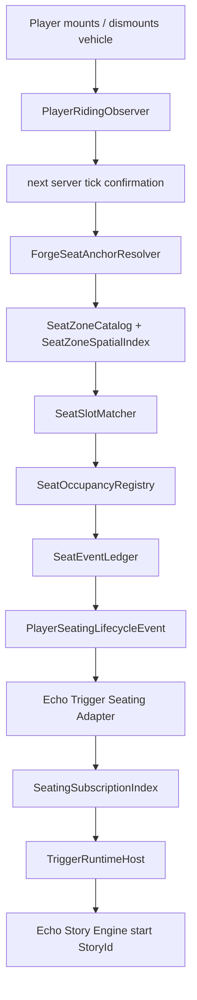

# Echo Seating + Trigger Seating DSL

Документ описывает, как писать зоны посадки `SeatZoneResource` и как запускать story через `Player.SeatedIn`, `Player.SeatedAt`, `Player.StoodUpIn`, `Player.StoodUpFrom`, `Player.ChangedSeatIn`.

Главная идея: посадка не привязана к конкретному furniture-моду. Echo Seating смотрит server-side riding/mount transition, берёт позицию vehicle entity как seat anchor, проверяет её против authored зон и публикует typed событие посадки. Echo Trigger Seating Adapter слушает это событие и запускает story по подписке.

## Что уже лежит в Prism

В Prism instance `Форма Мысли` должны лежать эти три новых/обновлённых файла:

```text
C:\Users\kxyr0\AppData\Roaming\PrismLauncher\instances\Форма Мысли\minecraft\mods\echo-trigger-0.4.0-all.jar
C:\Users\kxyr0\AppData\Roaming\PrismLauncher\instances\Форма Мысли\minecraft\mods\echo-seating-forge-1.20.1-0.1.0-all.jar
C:\Users\kxyr0\AppData\Roaming\PrismLauncher\instances\Форма Мысли\minecraft\mods\echo-trigger-seating-adapter-0.1.0.jar
```

Для story-запуска также нужен уже существующий `echo-story-engine` и adapters, которые реально исполняют команды story/dialogue/cutscene.

## Быстрый старт

1. В мире выбери стол/диван/скамейку, где игрок реально садится через riding vehicle.
2. Запиши координаты блока/позиции vehicle entity после посадки. Для обычного теста достаточно координат блока, где стоит seat vehicle.
3. Создай `.es` файл зоны в `story/content-pack/<namespace>/echo_seating/zones/...`.
4. Опиши `SeatZoneResource`: `Id`, `Dimension`, `Area`, `Detect`, `UnknownSeats`, `Slot`, `MatchRadius`.
5. Создай `.trigger.es` файл в `story/triggers/...`.
6. В trigger подпишись на `Player.SeatedIn(zone)`, `Player.SeatedAt(slot)` или `Player.SeatedAt(zone, slot)`.
7. Для короткой реакции укажи `StartDialogue(...)`; для основного сюжета укажи `StartStory(...)`.
8. В игре выполни `/echo_seating reload` и `/echo_trigger reload`.
9. Проверь `/echo_seating zones`, `/echo_seating diagnostics`, `/echo_trigger subscriptions sleep`.
10. Сядь в зоне и проверь, что dialogue/story стартует.

## Пути файлов

### Зоны посадки

Текущая реализация Echo Seating читает зоны из world root:

```text
<worldRoot>/story/content-pack/<namespace>/echo_seating/zones/**/*.es
```

Пример для мира:

```text
<worldRoot>/story/content-pack/jdh/echo_seating/zones/home/breakfast_table.es
```

Важно: это именно `worldRoot`, который Forge отдаёт через `server.getWorldPath(LevelResource.ROOT)`. В одиночной игре это папка конкретного save.

### Trigger subscriptions

Текущая реализация Echo Trigger authoring на старте сервера и по `/echo_trigger reload` читает canonical root:

```text
<gameDirectory>/story/triggers/**/*.trigger.es
```

Пример для Prism instance:

```text
C:\Users\kxyr0\AppData\Roaming\PrismLauncher\instances\Форма Мысли\minecraft\story\triggers\chapter_1\breakfast_seat.trigger.es
```

В коде есть задел под `story/content-pack/<namespace>/echo_trigger/triggers`, но текущий reload использует `story/triggers`.

## Минимальная зона

```csharp
namespace JDH.Home.Seats;

class BreakfastTableSeats : SeatZoneResource
{
    private SeatZoneId BreakfastTable = "jdh:home/breakfast_table";

    private void Init()
    {
        Id(BreakfastTable);
        Dimension("minecraft:overworld");
        Area(Box(Position(100, 64, 100), Position(104, 66, 104)));
        Detect(RIDING_ANCHOR);
        UnknownSeats(ALLOW);
        MatchRadius(0.85);
    }
}
```

Эта зона разрешит `Player.SeatedIn(BreakfastTable)` для любого riding anchor внутри box. Но `Player.SeatedAt(...)` не сработает, потому что нет named slots.

## Полная зона на четыре места

```csharp
namespace JDH.Home.Seats;

class BreakfastTableSeats : SeatZoneResource
{
    private SeatZoneId BreakfastTable = "jdh:home/breakfast_table";
    private SeatSlotId JohnSeat = "jdh:home/breakfast_table/john";
    private SeatSlotId SashaSeat = "jdh:home/breakfast_table/sasha";
    private SeatSlotId MothersSeat = "jdh:home/breakfast_table/mother";
    private SeatSlotId GuestSeat = "jdh:home/breakfast_table/guest";

    private void Init()
    {
        Id(BreakfastTable);
        Dimension("minecraft:overworld");
        Area(Box(Position(100, 64, 100), Position(104, 66, 104)));
        Detect(RIDING_ANCHOR);
        UnknownSeats(REJECT);

        Slot(JohnSeat, Position(101, 65, 101));
        Slot(SashaSeat, Position(103, 65, 101));
        Slot(MothersSeat, Position(103, 65, 103));
        Slot(GuestSeat, Position(101, 65, 103));

        MatchRadius(0.85);
    }
}
```

Здесь событие публикуется только если anchor попал в один из четырёх slots. `UnknownSeats(REJECT)` полезен для сюжетных сцен, где нельзя случайно триггерить зону с соседней табуретки.

## SeatZoneResource: справочник вызовов

| DSL | Где | Что делает |
| --- | --- | --- |
| `Id(BreakfastTable);` | `Init()` | Задаёт стабильный `SeatZoneId`. Можно передать поле `SeatZoneId` или строку `"namespace:path"`. |
| `Dimension("minecraft:overworld");` | `Init()` | Ограничивает зону точным dimension id. Без этого зона невалидна. |
| `Area(Box(Position(min), Position(max)));` | `Init()` | Axis-aligned box зоны. Anchor должен попасть внутрь этого box. |
| `Detect(RIDING_ANCHOR);` | `Init()` | Использует позицию riding vehicle entity как seat anchor. |
| `Detect(EXACT_SLOT_ONLY);` | `Init()` | Тот же riding anchor, но unnamed seat не публикуется. Работает как строгий режим named slots. |
| `UnknownSeats(ALLOW);` | `Init()` | Если anchor внутри зоны, но не попал в slot, публикуется zone-level событие без `seat.slot`. |
| `UnknownSeats(REJECT);` | `Init()` | Если anchor не попал в slot, событие не публикуется, пишется diagnostic. |
| `Slot(MothersSeat, Position(103, 65, 103));` | `Init()` | Объявляет named seat внутри зоны. Первый аргумент `SeatSlotId`/строка, второй - позиция anchor. |
| `MatchRadius(0.85);` | `Init()` | Радиус в блоках, в котором anchor считается совпавшим со slot. Должен быть больше `0`. |

`SeatZoneResource` сейчас Init-only: не пиши `Build()`, `Nodes()`, callbacks, ручной `return`. Binder ожидает класс `class ... : SeatZoneResource` и метод `private void Init()`.

## ID и имена

`SeatZoneId`, `SeatSlotId`, `StoryId`, `TriggerId` должны быть в формате:

```text
namespace:path
```

Разрешены нижний регистр, цифры, `_`, `.`, `-`, `/`. Пиши ID стабильно и не переименовывай после того, как на них сослались story/trigger.

Хорошо:

```csharp
private SeatZoneId BreakfastTable = "jdh:home/breakfast_table";
private SeatSlotId MothersSeat = "jdh:home/breakfast_table/mother";
```

Плохо:

```csharp
private SeatSlotId Seat5 = "seat_5";            // нет namespace:path
private SeatSlotId Tmp = "JDH:Home/Table";      // верхний регистр в id
private SeatSlotId Dynamic = "jdh:seat/" + id;  // DSL не для динамической генерации id
```

## Area и Position

`Area(Box(Position(a), Position(b)))` задаёт inclusive block box. `a` должен быть минимальным углом, `b` - максимальным углом.

```csharp
Area(Box(Position(100, 64, 100), Position(104, 66, 104)));
```

Это покрывает X `100..104`, Y `64..66`, Z `100..104`.

Практически:

- Делай box чуть больше стола/скамейки, чтобы riding vehicle anchor точно попадал внутрь.
- Не делай огромные пересекающиеся зоны. Если две зоны в одном dimension пересеклись, будет `SEATING_ZONE_OVERLAP_CONFLICT`.
- `Slot(Position(...))` может быть дробным, потому что matcher сравнивает distance до `SeatAnchor.worldPosition`.

Пример дробной позиции:

```csharp
Slot(MothersSeat, Position(103.5, 65.0, 103.5));
MatchRadius(0.75);
```

## MatchRadius

`MatchRadius` сравнивается с расстоянием от `SeatAnchor.worldPosition` до позиции slot.

Малый радиус:

```csharp
MatchRadius(0.35);
```

Подходит, если vehicle всегда появляется почти в одной точке.

Обычный радиус:

```csharp
MatchRadius(0.85);
```

Хороший старт для seat vehicle около центра блока.

Большой радиус:

```csharp
MatchRadius(1.25);
```

Используй осторожно. Если anchor окажется на одинаковом расстоянии от двух slots, событие отклонится с `SEATING_SLOT_MATCH_CONFLICT`.

## UnknownSeats

`UnknownSeats(ALLOW)`:

```csharp
UnknownSeats(ALLOW);
```

Если игрок сел внутри зоны, но anchor не попал в authored slot, Echo Seating публикует событие без `slotId`. Это сработает:

```csharp
Subscribe(Player.SeatedIn(BreakfastTable));
```

Это не сработает:

```csharp
Subscribe(Player.SeatedAt(MothersSeat));
```

`UnknownSeats(REJECT)`:

```csharp
UnknownSeats(REJECT);
```

Если anchor внутри зоны, но не попал в slot, событие не публикуется. Используй для точных сюжетных мест.

`Detect(EXACT_SLOT_ONLY)` тоже запрещает unnamed seat, даже если случайно написан `UnknownSeats(ALLOW)`.

## Trigger: запуск story при посадке в любую точку зоны

Файл:

```text
<gameDirectory>/story/triggers/chapter_1/breakfast_any_seat.trigger.es
```

Код:

```csharp
namespace JDH.Triggers.Chapter1;

class BreakfastAnySeatTrigger : TriggerResource
{
    private SeatZoneId BreakfastTable = "jdh:home/breakfast_table";
    private StoryId BreakfastStory = "jdh:chapter_1/breakfast_any_seat";

    private void Init()
    {
        Id("jdh:trigger/breakfast_any_seat");
        Subscribe(Player.SeatedIn(BreakfastTable));
        StartStory(BreakfastStory);
        FireOnlyOncePerPlayer();
    }
}
```

`Player.SeatedIn(zone)` значит: игрок подтвердил посадку в zone. Slot может быть named или unnamed. Если хочешь точное кресло/стул, используй `Player.SeatedAt`.

## Trigger: запуск story только на конкретном месте

```csharp
namespace JDH.Triggers.Chapter1;

class MothersSeatTrigger : TriggerResource
{
    private SeatSlotId MothersSeat = "jdh:home/breakfast_table/mother";

    private void Init()
    {
        Id("jdh:trigger/mothers_seat");
        Subscribe(Player.SeatedAt(MothersSeat));
        StartStory("jdh:chapter_1/mothers_seat");
        FireOnlyOncePerPlayer();
    }
}
```

`Player.SeatedAt(slot)` требует exact authored `SeatSlotId` и не требует указывать зону. Если matched slot отсутствует, такой trigger не сработает.
`Player.SeatedAt(zone, slot)` оставлен для случаев, где автору важно явно ограничить и зону, и slot.

## Trigger: прямой запуск диалога без story

Если тебе не нужна `StoryResource`, можно запускать Echo Dialogue напрямую из seating subscription:

```csharp
namespace JDH.Triggers.Chapter1;

class SatOnMothersSeatTrigger : TriggerResource
{
    private SeatSlotId MothersSeat = "jdh:home/breakfast_table/mother";
    private DialogueId WrongSeatDialogue = "jdh:dialogue/wrong_mothers_seat";

    private void Init()
    {
        Id("jdh:trigger/sat_on_mothers_seat");
        Subscribe(Player.SeatedAt(MothersSeat));
        StartDialogue(WrongSeatDialogue);
    }
}
```

То же самое строкой:

```csharp
Subscribe(Player.SeatedAt(MothersSeat));
StartDialogue("jdh:dialogue/wrong_mothers_seat");
```

Такой trigger не запускает Story Engine. Seating adapter ищет Echo Dialogue service и стартует dialogue session на игрока, который сел. Audience берётся из UUID игрока seating event.

Используй `StartDialogue(...)`, когда нужна простая реакция: "Это место мамы", "Сядь на своё место", "Не туда". Используй `StartStory(...)`, когда после посадки надо выполнить несколько действий: выставить флаги, подвигать NPC, запустить cutscene, выдать предмет, затем открыть диалог.

## Trigger: вставание

Любое вставание из зоны:

```csharp
class BreakfastStoodUpTrigger : TriggerResource
{
    private SeatZoneId BreakfastTable = "jdh:home/breakfast_table";

    private void Init()
    {
        Id("jdh:trigger/breakfast_stood_up");
        Subscribe(Player.StoodUpIn(BreakfastTable));
        StartStory("jdh:chapter_1/breakfast_stood_up");
    }
}
```

Вставание с конкретного места:

```csharp
class MothersSeatStoodUpTrigger : TriggerResource
{
    private SeatSlotId MothersSeat = "jdh:home/breakfast_table/mother";

    private void Init()
    {
        Id("jdh:trigger/mothers_seat_stood_up");
        Subscribe(Player.StoodUpFrom(MothersSeat));
        StartStory("jdh:chapter_1/mother_left_table");
    }
}
```

`StoodUpFrom` смотрит на previous named slot из occupancy. Для unnamed seat он не сработает.

## Trigger: смена места

```csharp
class BreakfastChangedSeatTrigger : TriggerResource
{
    private SeatZoneId BreakfastTable = "jdh:home/breakfast_table";

    private void Init()
    {
        Id("jdh:trigger/breakfast_changed_seat");
        Subscribe(Player.ChangedSeatIn(BreakfastTable));
        StartStory("jdh:chapter_1/breakfast_changed_seat");
    }
}
```

`Player.ChangedSeatIn(zone)` срабатывает, когда у игрока уже была active occupancy и новая посадка отличается по zone/slot/vehicle/anchor. В текущем DSL у `ChangedSeatIn` нет slot argument. Если нужна точная реакция на конкретное новое место, используй `Player.SeatedAt(slot)` как событие входа в это место.

## Все seating selectors

| Selector | Аргументы | Event kind | Когда срабатывает |
| --- | --- | --- | --- |
| `Player.SeatedIn(zone)` | `SeatZoneId` или string | `SEATED` | Любая publishable посадка внутри зоны. |
| `Player.SeatedAt(slot)` | `SeatSlotId` | `SEATED` | Посадка в exact named slot без явного указания зоны. |
| `Player.SeatedAt(zone, slot)` | `SeatZoneId`, `SeatSlotId` | `SEATED` | Посадка в exact named slot с явным ограничением зоны. |
| `Player.StoodUpIn(zone)` | `SeatZoneId` или string | `STOOD_UP` | Игрок встал из occupancy в зоне. |
| `Player.StoodUpFrom(slot)` | `SeatSlotId` | `STOOD_UP` | Игрок встал с exact named slot без явного указания зоны. |
| `Player.StoodUpFrom(zone, slot)` | `SeatZoneId`, `SeatSlotId` | `STOOD_UP` | Игрок встал с exact named slot с явным ограничением зоны. |
| `Player.ChangedSeatIn(zone)` | `SeatZoneId` или string | `CHANGED_SEAT` | Игрок пересел с уже активной occupancy на другое место в зоне. |

Можно писать аргументы строками:

```csharp
Subscribe(Player.SeatedAt("jdh:home/breakfast_table/mother"));
```

Но для больших сцен лучше поля:

```csharp
private SeatZoneId BreakfastTable = "jdh:home/breakfast_table";
private SeatSlotId MothersSeat = "jdh:home/breakfast_table/mother";

Subscribe(Player.SeatedAt(MothersSeat));
```

## TriggerResource: правила subscription mode

В одном `TriggerResource` сейчас допускается только одна subscription:

```csharp
Subscribe(Player.SeatedIn(BreakfastTable));
StartStory("jdh:chapter_1/breakfast");
```

Или одна dialogue subscription:

```csharp
Subscribe(Player.SeatedAt(MothersSeat));
StartDialogue("jdh:dialogue/wrong_mothers_seat");
```

`Subscribe(...)` и target должны идти парой. Target - это ровно один из вызовов:

```csharp
StartStory("jdh:chapter_1/breakfast");
StartDialogue("jdh:dialogue/wrong_mothers_seat");
```

Нельзя написать только `Subscribe`, только target, или оба target сразу.

`StartDialogue(...)` сейчас поддержан только для `Player.*` seating subscriptions. Для `PlayerSleep.*` оставляй `StartStory(...)`.

Для seating story routing нельзя писать ручные callbacks:

```csharp
private void OnPlayerSeated(PlayerSeatEvent event)
{
}
```

Такой стиль отклоняется diagnostic: seating routing должен идти через `Subscribe(...)`, не через callbacks.

`FireOnlyOncePerPlayer()` - alias для `FireOnlyOnce()`:

```csharp
FireOnlyOncePerPlayer();
```

Для seating adapter owner = `player:<uuid>`. Поэтому `FireOnlyOncePerPlayer` означает: этот trigger не стартует повторно для этого игрока, если runtime уже видел успешный запуск.

Если не поставить `FireOnlyOncePerPlayer`, adapter вызывает reset/start-поведение для подписки, то есть повторная посадка может снова стартовать dialogue/story.

## StoryResource, который запускается из trigger

Trigger может стартовать либо dialogue напрямую, либо `StoryId`. Если выбран `StartStory(...)`, саму сцену пиши обычным `StoryResource`.

```csharp
namespace JDH.Stories.Chapter1;

class BreakfastAnySeatStory : StoryResource
{
    public override StoryResourceDef Build()
    {
        return Story("jdh:chapter_1/breakfast_any_seat", start: "start");
    }

    private void OnStart()
    {
        Story.Set("chapter_1.breakfast_started", true);
        Dialogue.Load("jdh:dialogue/breakfast_intro", audienceId: "jdh:local_author", output: "dialogue");
        Story.Set("chapter_1.breakfast_intro_seen", true);
    }
}
```

Story может запускать dialogue, cutscene, player commands, NPC staging и другие уже существующие adapters. Seating adapter только доставляет стартовый контекст и запускает story.

## Контекст, который получает story

Echo Trigger Seating Adapter перед запуском story кладёт значения в `SeatingStoryContextBridge` для `story.execution`.

Ключи:

| Key | Значение |
| --- | --- |
| `player` | UUID игрока. |
| `owner` | `player:<uuid>`. |
| `seat.zone` | `SeatZoneId`, например `jdh:home/breakfast_table`. |
| `seat.slot` | `SeatSlotId`, только если seating event matched named slot. |
| `seat.event` | Stable id события, например `seat-event:...`. |
| `seat.anchor` | Block position anchor, например `BlockPosition[x=103, y=65, z=103]`. |
| `seat.vehicle` | UUID riding vehicle. |
| `seat.vehicleType` | Entity type id riding vehicle. |
| `seat.revision` | Revision occupancy. |
| `trigger.subscription` | `TriggerSubscriptionId`, например `jdh:trigger/mothers_seat#story`. |
| `trigger.execution` | Execution id trigger runtime. |
| `story.execution` | Execution id started story. |

Важно: это bridge-level контекст. Обычный Trigger DSL не даёт тебе `event` object и не вызывает `OnPlayerSeated`. Конкретное чтение этих ключей зависит от story/adapters, которые будут использовать `SeatingStoryContextBridge.merge/find`.

## Runtime flow



## Что за что отвечает

| Компонент | Ответственность |
| --- | --- |
| `SeatZoneResource` | DSL-файл зоны посадки. Authoring surface для координат и named slots. |
| `SeatZoneDefinitionBinder` | Превращает EchoScript class в `SeatZoneDefinition`. |
| `SeatZoneDefinitionRules` | Проверяет `MatchRadius`, duplicate slots, slots outside zone, overlaps. |
| `SeatZoneCatalog` | Хранит активные зоны, revision и diagnostics. |
| `SeatZoneSpatialIndex` | Индексирует зоны по chunk cells, чтобы не проверять все зоны на каждый anchor. |
| `PlayerRidingObserver` | Слушает `EntityMountEvent`, подтверждает mount/dismount на конце server tick. |
| `ForgeSeatAnchorResolver` | Берёт dimension, vehicle world position, block position, uuid и entity type. |
| `SeatSlotMatcher` | Находит ближайший slot в `MatchRadius`, отклоняет equal-distance conflicts. |
| `SeatOccupancyRegistry` | Хранит текущую occupancy по игроку, ловит конфликт двух игроков в одном exact slot. |
| `SeatEventLedger` | Дедуплицирует события и хранит последние 2048 событий. |
| `PlayerSeatingTransitionEngine` | Решает, это `SEATED`, `STOOD_UP` или `CHANGED_SEAT`. |
| `PlayerSeatingLifecycleEvent` | Forge event, который публикует Echo Seating. |
| `TriggerEventSelector` | Typed selector в Echo Trigger: provider, event kind, zone, optional slot. |
| `TriggerSeatingSubscriptionCalls` | Binder для `Player.SeatedIn/At`, `StoodUpIn/From`, `ChangedSeatIn`. |
| `SeatingSubscriptionIndex` | Сопоставляет seating event с trigger subscriptions. |
| `SeatingTriggerEventProvider` | Создаёт trigger event, стартует trigger runtime и запускает story. |
| `SeatingStoryContextInheritance` | Кладёт `seat.*` и `trigger.*` ключи в story context. |

## Команды в игре

### Echo Seating

```text
/echo_seating zones
/echo_seating zone inspect <zone_id>
/echo_seating occupancy
/echo_seating diagnostics
/echo_seating reload
/echo_seating debug zone <zone_id>
/echo_seating debug off
/echo_seating slot inspect <zone_id> <slot_id>
/echo_seating player inspect <player>
```

Что реально делает текущая сборка:

| Команда | Текущее поведение |
| --- | --- |
| `/echo_seating zones` | Пишет `zones=<count>, revision=<revision>`. |
| `/echo_seating zone inspect <zone_id>` | Пишет `zoneId slots=<count>` или `zone not found`. |
| `/echo_seating occupancy` | Пишет количество active occupancies. |
| `/echo_seating diagnostics` | Выводит первые 8 diagnostics. |
| `/echo_seating reload` | Перечитывает `story/content-pack/**/echo_seating/zones/**/*.es`. |
| `/echo_seating debug zone <zone_id>` | Сейчас использует inspect zone. Полного визуального debug overlay пока нет. |
| `/echo_seating debug off` | Пишет `debug off`. |
| `/echo_seating slot inspect ...` | Сейчас placeholder: `slot inspect ready`. |
| `/echo_seating player inspect ...` | Сейчас placeholder: `player inspect ready`. |

### Echo Trigger

```text
/echo_trigger reload
/echo_trigger diagnostics
/echo_trigger subscriptions sleep
/echo_trigger subscriptions inspect <subscription_id>
/echo_trigger subscriptions conflicts
```

Название `subscriptions sleep` осталось от sleep integration, но команда печатает story subscriptions из общего catalog. Seating subscriptions там тоже видны как selector вида:

```text
echo_seating:events|SEATED|jdh:home/breakfast_table|slot=jdh:home/breakfast_table/mother
```

## Diagnostics

Основные seating diagnostics:

| Code | Что значит |
| --- | --- |
| `SEATING_ZONE_INVALID` | Неподдержанный DSL вызов, плохой `Id`, нет `Init()` или не `SeatZoneResource`. |
| `SEATING_ZONE_DIMENSION_MISSING` | Нет `Dimension("namespace:path")`. |
| `SEATING_ZONE_BOUNDS_INVALID` | Нет или неправильный `Area(Box(...))`. |
| `SEATING_ZONE_OVERLAP_CONFLICT` | Две зоны пересеклись в одном dimension, или anchor попал сразу в несколько зон. |
| `SEATING_SLOT_INVALID` | Неверный slot или `MatchRadius <= 0`. |
| `SEATING_SLOT_OUTSIDE_ZONE` | `Slot(...)` находится вне `Area(...)`. |
| `SEATING_SLOT_DUPLICATE` | Один `SeatSlotId` объявлен повторно в зоне. |
| `SEATING_SLOT_MATCH_CONFLICT` | Anchor одинаково подходит нескольким slots. |
| `SEATING_SLOT_OCCUPANCY_CONFLICT` | Два игрока заняли один exact `SeatSlotId`. |
| `SEATING_ANCHOR_OUTSIDE_ZONE` | Riding anchor не попал ни в одну зону. |
| `SEATING_UNKNOWN_SEAT_REJECTED` | Anchor внутри зоны, но не matched slot, а policy запрещает unnamed. |

Основные trigger seating diagnostics:

| Code | Что значит |
| --- | --- |
| `TRIGGER_SEATING_SELECTOR_INVALID` | Неправильный selector: например `Player.SeatedAt()` без slot или `Player.ChangedSeatIn(zone, slot)` со slot. |
| `TRIGGER_STORY_SUBSCRIPTION_INVALID` | Нет пары `Subscribe + StartStory/StartDialogue`, больше одной подписки, оба target сразу, `StartDialogue` не на seating selector, или ручной seating callback. |
| `TRIGGER_SEATING_PROVIDER_UNAVAILABLE` | Adapter не смог получить Echo Trigger service. Код зарезервирован; текущий provider в основном пишет warn в лог. |
| `TRIGGER_SEATING_CONTEXT_INHERITANCE_FAILED` | Ошибка передачи context. Код зарезервирован. |
| `TRIGGER_SEATING_EXECUTION_DUPLICATE` | Дубликат execution. Код зарезервирован. |

## Типовой сценарий проверки в Prism

1. Запусти instance `Форма Мысли`.
2. Открой нужный мир.
3. Проверь, что команды существуют:

```text
/echo_seating zones
/echo_trigger diagnostics
```

4. Создай или положи zone file в save:

```text
<worldRoot>/story/content-pack/jdh/echo_seating/zones/home/breakfast_table.es
```

5. Создай trigger file:

```text
<gameDirectory>/story/triggers/chapter_1/breakfast_any_seat.trigger.es
```

6. Выполни:

```text
/echo_seating reload
/echo_trigger reload
/echo_seating diagnostics
/echo_trigger subscriptions sleep
```

7. Если `/echo_seating zones` показывает `zones=1`, садись в seat vehicle внутри box.
8. Если dialogue/story не стартовал, проверь по порядку:

- anchor реально внутри `Area`.
- `Dimension` совпадает с миром.
- `UnknownSeats(REJECT)` не отклоняет unmatched anchor.
- `MatchRadius` достаточно большой для `Slot`.
- `Player.SeatedAt(slot)` использует тот же `SeatSlotId`, что и `Slot`.
- `/echo_trigger subscriptions sleep` показывает selector `echo_seating:events|...`.
- В Prism mods лежит `echo-trigger-seating-adapter-0.1.0.jar`.

## Частые ошибки

### `Player.SeatedAt` не срабатывает, а `Player.SeatedIn` срабатывает

Значит зона найдена, но slot не matched. Проверь `Slot(... Position(...))` и `MatchRadius`.

Временно поставь:

```csharp
UnknownSeats(ALLOW);
Subscribe(Player.SeatedIn(BreakfastTable));
```

Если generic trigger работает, значит проблема именно в exact slot.

### После `/echo_seating reload` зон 0

Проверь путь. Зоны должны быть в world root, а не в game directory:

```text
<worldRoot>/story/content-pack/<namespace>/echo_seating/zones/**/*.es
```

Проверь, что файл заканчивается на `.es`.

### После `/echo_trigger reload` подписок 0

Проверь путь:

```text
<gameDirectory>/story/triggers/**/*.trigger.es
```

Проверь, что файл заканчивается на `.trigger.es`.

Проверь, что в `Init()` есть `Subscribe(...)` и один target:

```csharp
Subscribe(Player.SeatedIn(BreakfastTable));
StartStory("jdh:chapter_1/breakfast");
```

или:

```csharp
Subscribe(Player.SeatedAt(MothersSeat));
StartDialogue("jdh:dialogue/wrong_mothers_seat");
```

### `TRIGGER_SEATING_SELECTOR_INVALID`

Проверь сигнатуры:

```csharp
Subscribe(Player.SeatedIn(BreakfastTable));                // ok
Subscribe(Player.SeatedAt(MothersSeat));                   // ok
Subscribe(Player.StoodUpIn(BreakfastTable));               // ok
Subscribe(Player.StoodUpFrom(MothersSeat));                // ok
Subscribe(Player.ChangedSeatIn(BreakfastTable));           // ok
```

Нельзя:

```csharp
Subscribe(Player.SeatedAt());                              // нужен slot
Subscribe(Player.SeatedIn(BreakfastTable, MothersSeat));   // slot запрещён
Subscribe(Player.ChangedSeatIn(BreakfastTable, MothersSeat)); // slot запрещён
```

### `SEATING_SLOT_MATCH_CONFLICT`

Anchor оказался на одинаковом расстоянии от двух slots. Разнеси positions или уменьши `MatchRadius`.

Плохо:

```csharp
Slot(LeftSeat, Position(100, 65, 100));
Slot(RightSeat, Position(102, 65, 100));
// vehicle anchor = 101,65,100: ровно посередине
```

Лучше:

```csharp
Slot(LeftSeat, Position(100.35, 65, 100));
Slot(RightSeat, Position(102.35, 65, 100));
```

## Хороший рабочий шаблон

Zone:

```csharp
namespace JDH.Home.Seats;

class SofaSeats : SeatZoneResource
{
    private SeatZoneId Sofa = "jdh:home/living_room_sofa";
    private SeatSlotId Left = "jdh:home/living_room_sofa/left";
    private SeatSlotId Right = "jdh:home/living_room_sofa/right";

    private void Init()
    {
        Id(Sofa);
        Dimension("minecraft:overworld");
        Area(Box(Position(210, 64, 80), Position(214, 66, 83)));
        Detect(RIDING_ANCHOR);
        UnknownSeats(REJECT);
        Slot(Left, Position(211.5, 65, 81.5));
        Slot(Right, Position(213.5, 65, 81.5));
        MatchRadius(0.9);
    }
}
```

Trigger:

```csharp
namespace JDH.Triggers.Chapter1;

class SofaRightSeatTrigger : TriggerResource
{
    private SeatZoneId Sofa = "jdh:home/living_room_sofa";
    private SeatSlotId Right = "jdh:home/living_room_sofa/right";
    private StoryId Story = "jdh:chapter_1/sofa_right_seat";

    private void Init()
    {
        Id("jdh:trigger/sofa_right_seat");
        Subscribe(Player.SeatedAt(Right));
        StartStory(Story);
        FireOnlyOncePerPlayer();
    }
}
```

Прямой dialogue trigger для "не то место":

```csharp
namespace JDH.Triggers.Chapter1;

class SofaLeftWrongSeatTrigger : TriggerResource
{
    private SeatZoneId Sofa = "jdh:home/living_room_sofa";
    private SeatSlotId Left = "jdh:home/living_room_sofa/left";

    private void Init()
    {
        Id("jdh:trigger/sofa_left_wrong_seat");
        Subscribe(Player.SeatedAt(Left));
        StartDialogue("jdh:dialogue/wrong_sofa_seat");
    }
}
```

Story:

```csharp
namespace JDH.Stories.Chapter1;

class SofaRightSeatStory : StoryResource
{
    public override StoryResourceDef Build()
    {
        return Story("jdh:chapter_1/sofa_right_seat", start: "start");
    }

    private void OnStart()
    {
        Player.SetHotbarItem(1, "minecraft:book", count: 1);
        Dialogue.Load("jdh:dialogue/sofa_memory", audienceId: "jdh:local_author", output: "dialogue");
        Story.Set("chapter_1.sofa_memory_seen", true);
    }
}
```

## Чего не надо делать

- Не сканируй блоки мебели каждый tick. Seating работает от riding transition.
- Не завязывай story на `BlockId` стула. Зона описывает authored place, а не тип мебели.
- Не делай reflection/adapters к конкретному furniture-моду, пока нет явного API.
- Не используй client pose/animation как источник истины. Истина - server mount/dismount.
- Не пиши `OnPlayerSeated(...)` callbacks в `TriggerResource`.
- Не делай временные ID вроде `jdh:tmp/seat_5`, если на них будет ссылаться story.
- Не делай пересекающиеся `Area` в одном dimension.
- Не ставь слишком большой `MatchRadius`, если рядом несколько slots.

## Текущие ограничения

- Occupancy сейчас runtime-only. Полное восстановление occupancy после restart/reconnect через SavedData не реализовано.
- Если игрок уже сидел до старта сервера/мода, система может узнать о посадке только после следующего mount transition.
- `/echo_seating slot inspect` и `/echo_seating player inspect` пока placeholders.
- Визуальный debug overlay для зоны пока не реализован.
- `ChangedSeatIn` сейчас только zone-level, без exact slot selector.
- Реальная проверка в запущенном Minecraft зависит от конкретного furniture/seat vehicle, потому что anchor берётся из vehicle entity position.

## Мини-чеклист перед коммитом контента

```text
[ ] Zone file лежит в <worldRoot>/story/content-pack/<namespace>/echo_seating/zones/**/*.es
[ ] Trigger file лежит в <gameDirectory>/story/triggers/**/*.trigger.es
[ ] Все ID в формате namespace:path и в нижнем регистре
[ ] SeatZoneResource имеет class ... : SeatZoneResource и private void Init()
[ ] Есть Id, Dimension, Area
[ ] Slots находятся внутри Area
[ ] MatchRadius > 0 и не создаёт equal-distance conflict
[ ] TriggerResource имеет Subscribe(...) + один target: StartStory(...) или StartDialogue(...)
[ ] Для exact seat используется Player.SeatedAt(slot)
[ ] Для unnamed seats не используется Player.SeatedAt
[ ] /echo_seating diagnostics чистый или понятный
[ ] /echo_trigger subscriptions sleep показывает нужный selector
```
