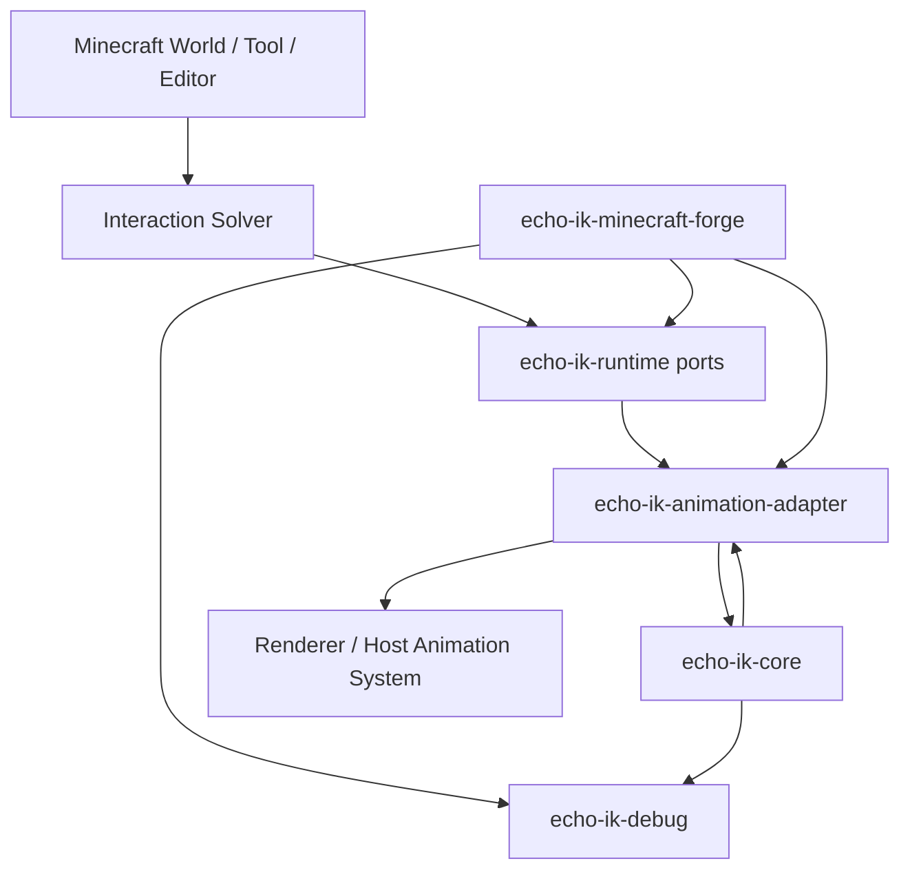

# Echo IK

`echo-ik` - независимая Java-библиотека Inverse Kinematics для игровых ригов.

Библиотека не является частью системы анимаций. Она получает только:

- описание скелета;
- текущую позу;
- уже вычисленную цель;
- настройки solver pass.

На выходе она возвращает новую позу. Входная animation pose не мутируется.

## Главный принцип

IK работает поверх текущей позы, но не владеет анимацией.

```text
Rest Pose
    ↓
Animation
    ↓
IK
    ↓
Result Pose
    ↓
Attachment / Renderer / другой post-process
```

Core не знает, откуда пришла поза: из Minecraft renderer, Blender preview, теста, сети или любого другого рантайма.

## Модули

| Модуль | Назначение |
| --- | --- |
| `echo-ik-core` | Чистая математика, skeleton/pose model и solver-ы. |
| `echo-ik-runtime` | Порты выполнения: providers, consumers, target resolving. |
| `echo-ik-animation-adapter` | Anti-Corruption Layer между public Echo Animation pose contracts и IK. |
| `echo-ik-debug` | Платформенно-независимые debug draw commands. |
| `echo-ik-minecraft-forge` | Минимальный Forge 1.20.1 runtime-срез с командами world target. |

## Архитектура



### `echo-ik-core`

Core полностью платформенно-независим.

Содержит:

- `SkeletonDefinition`;
- `Bone`;
- `Pose`;
- `Transform`;
- `IkTarget`;
- `IkResult`;
- `SolverContext`;
- `TwoBoneSolver`;
- `Vec3`;
- `Quat`.

Core не импортирует Minecraft API, Echo Animation, EchoScript, NPC API или любые runtime-системы.

### `echo-ik-runtime`

Runtime определяет порты, через которые внешние системы подключают данные:

- `PoseProvider` - отдает текущую позу subject;
- `PoseConsumer` - принимает итоговую позу после IK;
- `InteractionTargetProvider` - отдает уже подготовленный interaction target;
- `TargetResolver` - превращает interaction target в конкретный `IkTarget`;
- `InteractionTarget` - типы целей: world, bone, surface, socket.

### `echo-ik-animation-adapter`

Adapter - это Anti-Corruption Layer между Echo Animation и IK.

Он:

1. читает public `AnimationRigDefinition` и local `EulerTransform`;
2. строит solver-space `Pose`;
3. добавляет socket end effector, например `main_hand`;
4. возвращает IK result как local render overlay;
5. не мутирует authored animation clip и rest pose.

Core и runtime не знают об Echo Animation. Этот модуль имеет право зависеть только от public Echo Animation contracts.

### `echo-ik-debug`

Debug-модуль не рисует напрямую в Minecraft. Он строит платформенно-независимые primitives:

- кости;
- цели;
- оси;
- длины;
- локти;
- pole targets;
- текстовые diagnostics.

Любой host может адаптировать эти primitives под свой renderer.

### `echo-ik-minecraft-forge`

Forge-модуль реализует минимальный vertical slice:

```text
Rest Pose
    ↓
Authored Echo Animation
    ↓
AnimationHumanoidPoseOverlayEvent
    ↓
EchoPoseReader
    ↓
TwoBoneSolver
    ↓
EchoPoseWriter
    ↓
Renderer
```

Поддержанная цепь:

```text
right_shoulder
    ↓
right_upper_arm
    ↓
right_forearm
    ↓
main_hand socket (0, -6, 0)
```

Отдельной hand bone нет. End effector вычисляется через socket `main_hand` на `right_forearm`.

Команды:

```text
/echo_ik target <npcId> right_arm <x> <y> <z>
/echo_ik pole <npcId> right_arm <x> <y> <z>
/echo_ik weight <npcId> right_arm <value>
/echo_ik clear <npcId> right_arm
/echo_ik debug <npcId> on|off
```

`target` и `pole` принимают Minecraft world-space координаты. Forge-слой через public `EchoNpcService`
получает actor pose и переводит цель в local IK space. Constraint хранится только в runtime и не переживает reload мира.

`weight` и `clear` используют independent smoothstep blend:

```text
currentWeight -> targetWeight over blendDurationTicks
```

`clear` плавно снижает weight до `0`, затем runtime constraint удаляется. Authored Echo Animation снова полностью управляет рукой.

## Полный Minecraft pipeline

```text
Minecraft World
    ↓
Echo NPC public actor query
    ↓
World Target command
    ↓
Runtime IK Target
    ↓
IK Solver
    ↓
Animation Adapter
    ↓
Renderer
```

Важное разделение:

- Minecraft World знает про блоки, сущности, двери, столы и предметы.
- Interaction Solver знает, как из мира получить цель.
- IK Solver знает только кости, позу и цель.
- Animation Adapter знает, как прочитать и вернуть позу в host animation layer.
- Renderer только рисует итоговую позу.

На текущем этапе Interaction Solver ещё не реализован. Команда `/echo_ik target` является manual runtime target
для проверки IK по мировой точке.

## Почему IK не зависит от Animation

Animation отвечает за authored motion: idle, walk, wave, sit, reach и другие клипы.

IK отвечает за post-process корректировку позы под конкретную цель:

- рука должна попасть в ручку двери;
- нога должна стоять на поверхности;
- взгляд должен попасть в точку;
- ладонь должна лечь на кость другого персонажа.

Если IK зависел бы от animation-системы, он начал бы знать о клипах, графах, состояниях и authored DSL. Это сделало бы solver менее переиспользуемым и усложнило бы тестирование.

Правильная граница:

```text
Animation produces Pose
IK consumes Pose + Target
IK returns Pose
```

Solver не изменяет клип и не знает, какой клип был проигран.

## Почему Interaction Solver отдельный

IK не должен искать дверь, стол, поверхность или socket. Это ответственность interaction layer.

Примеры:

- `BoneTarget`: положить руку на голову другого персонажа;
- `SurfaceTarget`: положить руку на стол или полку;
- `SocketTarget`: взять кружку, оружие, книгу или ручку двери;
- `WorldTarget`: дотянуться до конкретной точки.

Interaction Solver может использовать Minecraft collision, raycast, entity lookup, navigation data или editor metadata. IK получает уже готовую цель и работает одинаково во всех случаях.

## Two Bone IK

Первая реализация - analytic `TwoBoneSolver`.

Поддерживает:

- верхняя рука + предплечье;
- верхняя нога + голень;
- любые другие две связанные кости;
- target position;
- target rotation;
- pole target;
- weight;
- rotation weight;
- position weight.

Humanoid - только preset на уровне caller-а. Core не содержит hardcode humanoid-скелета.

## Пример использования

```java
TwoBoneSolver solver = new TwoBoneSolver();
IkResult result = solver.solve(new SolverContext(skeleton, animationPose, target));

if (result.solved()) {
    poseConsumer.acceptPose(subjectId, result.pose());
}
```

DI-пайплайн:

```java
AnimationIkPipeline pipeline = new AnimationIkPipeline(
        poseProvider,
        poseConsumer,
        interactionTargetProvider,
        targetResolver,
        new TwoBoneSolver());

AnimationIkReport report = pipeline.apply(new AnimationIkRequest(subjectId, interactionId, skeleton));
```

## Attachment

IK не занимается attachments.

Рекомендуемый порядок:

```text
Animation
    ↓
IK
    ↓
Attachment
```

Attachment-система может читать итоговую позу после IK и закреплять предметы на sockets. Это отдельная ответственность.

## Правила проекта

- Java 17 bytecode для совместимости с Minecraft Forge 1.20.1 runtime.
- SOLID.
- Dependency Injection.
- Нет static singleton-ов.
- Максимум 180 логических строк на class.
- Максимум 7 Java-файлов в одной папке.
- Core не зависит от Minecraft API.
- Core не зависит от animation/runtime/editor систем.
- Runtime не зависит от конкретного animation engine.
- Echo Animation dependency разрешена только в animation-adapter и Forge integration.

Проверка:

```powershell
.\gradlew.bat --offline check --console=plain
```

## Roadmap

1. `CcdSolver` для длинных chain-ов.
2. `FabrikSolver` для стабильных full-chain constraints.
3. Full Body IK.
4. Finger IK.
5. Foot IK с ground alignment.
6. Look At constraint.
7. Aim constraint.
8. Multiple target blending.
9. Constraint stack с deterministic order.
10. Blender adapter для preview/export workflow.
11. Minecraft debug renderer adapter.
12. Отдельные integration modules для конкретных animation/runtime систем.
