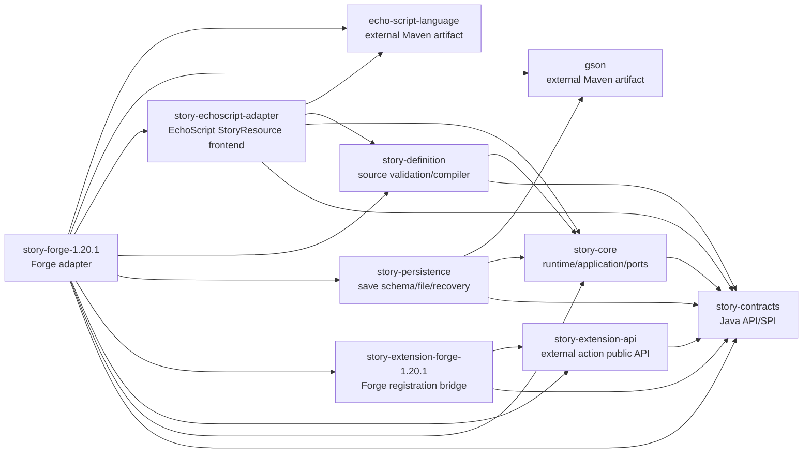

# Project Map

EA1: Story frontend lowers Sound.* through the external Java-only Echo Audio binder to
`echo_audio:cue`. Playback, location lookup, network, cleanup and interruption recovery live
in the independent Echo Audio Forge extension. Story core has no audio dependency.

## Identity

- Root project: `echo-story-engine`
- Artifact: `echo-story-engine`
- Mod ID: `echo_story_engine`
- Display name: `Echo Story Engine`
- Maven group and base package: `io.github.kxyr0.echostoryengine`

## Dependency Diagram

## `story-contracts`

Purpose: stable Java-friendly public API and data contracts.

Layer: public contracts.

Production type count: 16.

Allowed dependencies: Java standard library only.

Forbidden dependencies: core implementation, Forge, Minecraft, logging frameworks, serialization frameworks,
filesystem, networking, GUI, third-party mod APIs.

Public entrypoints and types:

- `StoryEngineApi`
- `StoryRuntimeInput`
- `StoryRuntimeResult`
- `StoryExecutionState`
- `StoryExecutionPhase`
- `ExternalCommand`
- `ExternalActionResultCategory`
- `StoryDiagnostic`
- `DiagnosticSubject`
- `DiagnosticSeverity`
- `StoryId`, `ExecutionId`, `ActionExecutionId`, `NodeId`, `NamespacedId`, `CompiledStoryFingerprint`

Threading model: contracts are immutable data or stateless interfaces.

Persistence responsibility: none; contracts are data boundaries only.

Diagnostic responsibility: define structured diagnostic data.

Status: M3 adds `CompiledStoryFingerprint` as the neutral durable compatibility token.

Related ADR: 0001, 0002, 0005, 0006, 0007.

## `story-core`

Purpose: story runtime use case, pure transition policy, immutable compiled story definition model, ports,
and diagnostic read model.

Layer: domain, application, ports.

Production type count: 20.

Allowed dependencies: `story-contracts`, Java standard library, test libraries in test source set.

Forbidden dependencies: Forge, Minecraft, filesystem, networking, logging frameworks, GUI, concrete game domains.

Important packages:

- `..story.core.domain`: `StoryDefinition`, `StoryNode`, `StoryNodeKind`, `RuntimeTransitionPolicy`,
  `ExternalActionOutputBinding`, `StoryDefinitionFingerprint`, `RuntimeDiagnostics`
- `..story.core.application`: `StoryRuntimeUseCase`, persistence result assembly
- `..story.core.port`: `DiagnosticSink`, `StoryClock`
- `..story.core.port.persistence`: `ExecutionStateRepository`, `ExecutionCheckpoint`, load/save result/status types,
  `PendingActionCheckpoint`
- `..story.core.diagnostic`: `InMemoryDiagnosticBuffer`

Threading model: application methods are called by the platform-owned authoritative context. Core does not start threads.

Persistence responsibility: define checkpoint repository port and save-before-dispatch application semantics,
not storage technology.

Diagnostic responsibility: emit structured diagnostics for runtime transitions, external action failures,
missing bound outputs, duplicate/unknown completions, and transition-budget failures; keep a bounded in-memory read
model.

Status: M3 uses explicit load/save result contracts, optimistic revisions, bounded duplicate completion state, and
suppresses command dispatch when checkpoint save fails. Post-M5 hardening adds generic external action output binding
without domain-specific Story semantics.

Related ADR: 0002, 0005, 0006, 0007, 0010, 0011.

## `story-definition`

Purpose: Story-owned neutral source definitions, validation, diagnostics, compiler boundary, and compilation into the
core compiled runtime model.

Layer: source processing.

Production type count: 14.

Allowed dependencies: `story-core`, `story-contracts`, Java standard library, test libraries in test source set.

Forbidden dependencies: Forge, Minecraft, filesystem I/O, networking, logging frameworks, GUI, concrete game domains,
third-party Minecraft mod APIs, source frontend parser implementations, serialization frameworks.

Important packages:

- `..story.definition.source`: `StorySourceInput`, `SourceStory`, `SourceNode`, `SourceNodeKind`, `SourceLocation`
- `..story.definition.validation`: `StructuralStoryValidator`, `SemanticStoryValidator`, `StoryValidationResult`
- `..story.definition.compile`: `StorySourceCompiler`, `SourceStoryCompiler`, `StoryCompilationResult`,
  `StoryCompileResult`
- `..story.definition.diagnostic`: `SourceDiagnosticCatalog`, `SourceDiagnosticContext`

Threading model: pure in-memory processing; callers own scheduling and lifecycle.

Persistence responsibility: none; M2 accepts source text supplied by tests or future adapters and does not load files.

Diagnostic responsibility: emit Story-owned `ESE-SOURCE-*` diagnostics for source frontend failures, structural
validation, semantic validation, and compilation invariant failures.

Status: M3.6 keeps neutral source validation/compiler logic and exposes `StorySourceCompiler` as the frontend
interface. The previous strict JSON production frontend was removed. Post-N1 adapter support adds `Npc.Move(...)` and
`Npc.Stop(...)` EchoScript sugar that compiles to external action nodes only.

Related ADR: 0001, 0002, 0005, 0007, 0011.

## `story-echoscript-adapter`

Purpose: Story-owned EchoScript `.es` frontend for the supported `StoryResource` profile.

Layer: source frontend adapter.

Production type count: 31.

Allowed dependencies: `story-definition`, `story-core`, `story-contracts`, Java standard library, and the published
`io.github.kxyr0.echoscript:echo-script-language` Maven artifact.

Forbidden dependencies: Forge, Minecraft, filesystem I/O, networking, logging frameworks, GUI, concrete game domains,
third-party Minecraft mod APIs, bundled EchoScript source, committed EchoScript jars, and DialogueResource semantics.

Important packages:

- `..story.echoscript`: `EchoScriptStorySourceCompiler`
- `..story.echoscript.binding`: StoryResource profile binding context and result assembly
- `..story.echoscript.diagnostic`: EchoScript diagnostic adapter and StoryResource binding diagnostic factory
- `..story.echoscript.intrinsic`: `Build`/`Nodes` intrinsic binders and shared node readers
- `..story.echoscript.intrinsic.actions|attachment|character|sleep|time|value`: responsibility-specific intrinsic
  lowering; directory and declared Java packages match, with no synthetic package split

Threading model: pure in-memory parsing and binding; callers own scheduling and lifecycle.

Persistence responsibility: none. The adapter returns compiled `StoryDefinition` values only. Save schema V1 stores
compiled execution state and fingerprints, not `.es` source or EchoScript AST objects.

Diagnostic responsibility: adapt EchoScript syntax/language diagnostics into `StoryDiagnostic` and emit Story-owned
semantic binding diagnostics for unsupported profiles, missing methods, invalid signatures, unsupported members,
unknown types, unknown intrinsics, argument shape errors, and missing lifecycle methods.

Status: `1.8.0` adds the ES2 high-level StoryResource profile: file-inferred Story identity, optional `Id(...)`, and
one ordered `OnStart()` intent section lowered to a strict internal start/action/finish graph. The legacy
`Build()` plus `Nodes()`/method `OnStart()` profile remains readable, and mixed profiles are rejected.

High-level authoring supports `Story.Set`, `Story.Require`, domain sugar, and generic
`Action(type: "...", output: "...", ...)` without manual node IDs or `next` links. `DialogueResource` remains outside
Story Engine core and is rejected at the adapter boundary.

The frontend also lowers `View.Arm`, `View.Disarm`, `View.WaitUntilOutOfView`,
`View.WaitUntilVisible`, `View.IsOutOfView`, `View.IsVisible`, and
`View.AssertStillOutOfView` to neutral `echo_visibility:*` external actions.
Visibility behavior remains owned by its independent Forge adapter.

The `Npc.EquipBackpack` and `Npc.UnequipBackpack` authoring sugar lowers to
`echo_npc_sophisticated_backpacks:*` recoverable external actions. Exact backpack behavior remains in the
independent Sophisticated Backpacks adapter.

Time authoring lowers `Time.Set`, `Time.Add`, `Time.WaitUntil`, `Time.WaitUntilDay`, and pause/resume operations to
neutral `echo_time:*` external actions. The adapter is grouped by action, attachment, character, linear-chain, sleep,
time, and value responsibilities; filesystem folders match declared Java packages.

`Dialogue.Load("namespace:id")` lowers to `echo_dialogue:play` without requiring author content to repeat a player
audience. The independent Story-Dialogue adapter resolves the current player from execution context; an explicit
`audienceId` remains an optional adapter-owned override.

Related ADR: 0011.

## `story-persistence`

Purpose: durable checkpoint schema, strict JSON encoding, portable file repository, and recovery planning.

Layer: persistence adapter and recovery boundary.

Production type count: 20.

Allowed dependencies: `story-core`, `story-contracts`, Java standard library, Gson inside `..story.persistence.schema`,
test libraries in test source set.

Forbidden dependencies: `story-definition`, Forge, Minecraft, logging frameworks, networking, GUI, concrete game
domains, third-party Minecraft mod APIs.

Important packages:

- `..story.persistence.schema`: save schema V1 DTOs, strict JSON reader/writer, checkpoint translator
- `..story.persistence.file`: `FileExecutionStateRepository`, snapshot index, primary/backup/temp read/write helpers
- `..story.persistence.file.layout`: safe storage key and primary/backup/temp file set
- `..story.persistence.recovery`: `ExecutionRecoveryPlanner`, `CompiledStoryCatalog`, recovery result/status
- `..story.persistence.diagnostic`: `PersistenceDiagnosticCatalog`

Threading model: synchronous Java file operations; callers own scheduling.

Persistence responsibility: own schema V1, deterministic UTF-8 JSON, safe filenames, optimistic revision checks,
atomic move fallback, one backup, corrupt primary fallback, and stale temp ignore policy.

Diagnostic responsibility: emit `ESE-PERSISTENCE-*` diagnostics without absolute paths or snapshot dumps.

Status: M5 adds execution-id listing for server-start recovery scans while keeping filesystem decisions inside the
file adapter.

Related ADR: 0012.

## `story-extension-api`

Purpose: loader-neutral public contract for external Story action providers.

Layer: public extension API.

Production type count: 14.

Allowed dependencies: `story-contracts`, Java standard library.

Forbidden dependencies: core implementation, Forge, Minecraft, EchoScript, persistence, filesystem, logging
frameworks, `CompletableFuture`, networking, GUI, concrete gameplay domains.

Important packages:

- `..story.extension.api.descriptor`: API version, extension descriptor, action descriptor, capabilities.
- `..story.extension.api.execution`: start/recovery/cancel requests, handler and server-scoped session contracts.
- `..story.extension.api.completion`: immutable completion data, completion sink, sink acceptance category.
- `..story.extension.api.outcome`: immediate handler invocation result/status.

Threading model: start/recover/cancel are called by the platform host on server thread; completion sink is thread-safe
and may be called by handler-owned worker threads.

Persistence responsibility: none; `ActionExecutionId` remains the idempotency key stored by existing runtime
checkpoint data.

Diagnostic responsibility: none directly; implementation modules translate outcomes into `StoryDiagnostic`.

Status: M5 public API version `1.0`.

Related ADR: 0014.

## `story-extension-forge-1.20.1`

Purpose: public Forge 1.20.1 registration bridge for independent adapter mods.

Layer: platform-facing public bridge.

Production type count: 4.

Allowed dependencies: `story-extension-api`, `story-contracts`, Java standard library, Forge/Minecraft APIs needed
for the registration event and server context.

Forbidden dependencies: runtime implementation, persistence, source loading, command tree, catalogs, client code,
concrete gameplay domains.

Important package:

- `..story.extension.forge`: `EchoStoryExtensionRegistrationEvent`, registrar, factory, and server context.

Threading model: engine posts one server-scoped registration event during host startup; late registration is rejected
by the bounded registrar.

Persistence responsibility: none.

Diagnostic responsibility: none directly; `story-forge-1.20.1` diagnoses registration outcomes.

Status: M5 bridge embedded into the production Forge jar and published for external adapter compilation.

Related ADR: 0014.

## `story-forge-1.20.1`

Purpose: Forge 1.20.1 platform host for server lifecycle, resource loading, world-bound persistence scheduling,
diagnostics, GameTest, and production packaging.

Layer: composition and infrastructure.

Production type count: 66.

Allowed dependencies: `story-contracts`, `story-core`, `story-definition`, `story-echoscript-adapter`,
`story-extension-api`, `story-extension-forge-1.20.1`, `story-persistence`, EchoScript language artifact, Gson,
Forge/Minecraft dependencies.

Forbidden dependencies: concrete gameplay subsystems and third-party mod integrations.

Entrypoints and adapters:

- `EchoStoryEngineMod`: thin Forge `@Mod` entrypoint.
- `ForgeStoryCompositionRoot`: creates diagnostics, clock, catalog, source compiler, and coordinator.
- `ForgeStoryRuntimeCoordinator`: subscribes to Forge reload, command, server lifecycle, and server tick events.
- `ForgeServerHost`: server-scoped runtime host with active-definition pinning, persistence queue orchestration, and
  extension completion input mapping.
- `..story.forge.host.execution`: active definitions and save-before-dispatch runtime flow.
- `..story.forge.host.recovery`: server-start recovery scan and recovered command dispatch.
- `ActiveStoryDefinitions`: tracks the compiled catalog entry pinned to each non-terminal execution.
- `..story.forge.host.catalog`: immutable compiled catalog snapshots replaced atomically, with latest
  reload status tracked for operator health output.
- `..story.forge.host.readmodel`: bounded read models for health,
  execution list, and execution detail commands.
- `ForgeStoryResourceReloadListener`: installs candidates produced from Forge resource discovery.
- `..story.forge.resource.discovery`: discovers UTF-8 `.es` resources from `echo_story/stories` and rejects resource
  folders with more than seven `.es` scripts.
- `StoryResourceCandidateCompiler`: compiles resource text through `StorySourceCompiler` into catalog candidates.
- `..story.forge.externalcontent`: initializes `<gameDir>/story/content-pack/jdh` from the installed
  `echo_story_content_pack` seed, registers that folder as a required server data pack, and leaves reload application
  to manual `/reload`. It does not register the external folder as `CLIENT_RESOURCES`.
- `ForgePersistenceRoot`: binds active world storage to `<world>/data/echo_story_engine/executions`.
- `BoundedPersistenceWorkQueue`: single-worker bounded background persistence scheduler.
- `DurableStoryRuntime`: splits load/transition/save/dispatch so commands are exposed only after save success.
- `ForgeDiagnosticsCommand`, `EchoStoryCommandTree`, and formatter: read-only `/echo_story` command tree.
- `..story.forge.extension.catalog`: validates extension descriptors, compatibility and duplicate owners, then builds
  the immutable active action catalog.
- `..story.forge.extension.lifecycle`: publishes the registration event and closes the bounded registrar.
- `..story.forge.extension.dispatch`: server-thread dispatch plus thread-safe bounded completion queue; extension
  completion outputs are forwarded to neutral runtime input.
- `..story.forge.extension.readmodel`: extension list/detail command read models.
- `ForgeRuntimeDiagnostics` and `..story.forge.diagnostic.catalog`: facade plus resource, host, persistence, and
  action/extension diagnostic catalogs.
- `ForgeDiagnosticSink`: maps structured diagnostics to the standard Forge/Minecraft logging pipeline.
- `ForgeStoryClock`: supplies platform time.
- `VolatileExecutionStateRepository`: retained non-production infrastructure adapter.

Threading model: Forge lifecycle and runtime state are server-thread owned. Persistence worker performs file I/O only
and returns immutable callbacks drained on server tick.

Persistence responsibility: world-bound durable file repository root, bounded queue scheduling, shutdown drain, and
save-before-dispatch preservation. The save schema and file format stay in `story-persistence`.

Diagnostic responsibility: one logical logger namespace, bounded in-memory read model, structured Forge diagnostics,
and read-only command formatting without raw source/snapshot/path dumps.

Packaging responsibility: the distributable Forge jar embeds Java-only Story Engine modules and EchoScript runtime,
while excluding Forge/Minecraft, Gson, and GameTest-only classes. ForgeGradle userdev adds external runtime jars
through `minecraft_classpath`, and the production Forge server uses the Gson already present in the Forge/Minecraft
runtime.

Status: M5 implements server-scoped external extension registration, compatibility/duplicate validation, handler
dispatch after durable save, bounded completion return to server thread, recovery scan for durable WAITING snapshots,
read-only extension commands, integration artifact publication, and a separate test adapter build. Post-M5 hardening
preserves `ActionCompletion.outputs()` through the Forge host boundary for generic Story output binding.

Related ADR: 0003, 0005, 0007, 0009, 0010, 0013, 0014.

ES2 feature authoring: `story-echoscript-adapter/.../intrinsic/features/FeatureActionIntrinsics` lowers Feature.Unlock/Lock/Set into the existing generic external-action contract. No Core/Forge gameplay dependency is introduced; runtime ownership stays with the Echo Core adapter.

## Архив внешнего content-pack

Echo Story Engine 1.10.0 поддерживает `story/content-pack/jdh/.archived`.
При наличии маркера external pack скрывается из SERVER_DATA и CLIENT_RESOURCES,
а seed extraction не добавляет отсутствующие файлы. Снятие маркера и перезапуск
возвращают рабочий pack. Снимки и переключение находятся в sibling content-pack:
`tools/Set-PrismStoryArchive.ps1`; ZIP хранится в `minecraft/story-archives`.
Configs, triggers, item-pack и сохранения мира имеют отдельный lifecycle.

EE1 inline: frontend допускает внешний class-level When(predicate, id: "stable") { ... }.
Тело не включается в Story graph. Echo Trigger компилирует и исполняет декларацию
через существующий EE1 dispatcher и integration actions; зависимостей в story-core нет.
