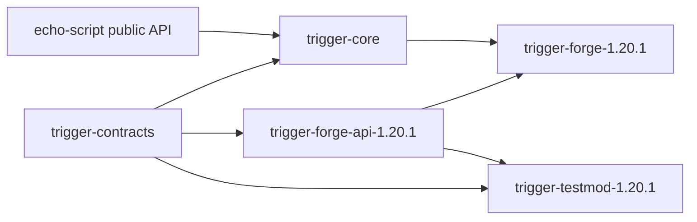

# Echo Trigger Project Map

## Modules

- `trigger-contracts`: immutable public IDs, policies, statuses, expression categories, typed vanilla IDs and results.
- `trigger-core`: plain Java EchoScript binding, expression catalog, sequence runtime, story subscription binding,
  spatial model, persistence DTOs and reload planning.
- `trigger-forge-api-1.20.1`: public Forge-facing service/query/catalog/provider contracts and runtime lookup bridge.
- `trigger-forge-1.20.1`: production Forge mod entrypoint, content roots, resource discovery, diagnostic commands and
  service facade.
- `trigger-testmod-1.20.1`: development-only test mod. It is not embedded into the production JAR.

## Provider Categories

| category | predicates | events | snapshot dependency | capture source | persistence codec | package |
| --- | --- | --- | --- | --- | --- | --- |
| inventory | `HasItem`, item counts, empty slot | item added/removed/pickup/drop/use/consume/full/freed | inventory revision | inventory diff and Forge item events | provider schema 2 metadata | `core.binding.vanilla` |
| hands | `Holding*` | hand changed | hand revision | carried stack diff | provider schema 2 metadata | `core.binding.vanilla` |
| equipment | `Wearing`, armor checks | equipped/unequipped/changed | equipment revision | equipment stack diff | provider schema 2 metadata | `core.binding.vanilla` |
| player state | health, food, movement flags | damage, heal, death, respawn, movement transitions | physical state revision | server player state diff and Forge events | provider schema 2 metadata | `core.binding.vanilla` |
| effects | active effect checks | effect added/removed/amplifier changed | effect revision | effect map diff | provider schema 2 metadata | `core.binding.vanilla` |
| progression | advancement and XP checks | advancement granted, level reached | progression revision | advancement/XP callbacks and diff | provider schema 2 metadata | `core.binding.vanilla` |
| blocks | none | interact/break/place/container/bed | block subscription index | Forge block events | provider schema 2 metadata | `core.binding.vanilla` |
| world | dimension, mode, time, weather | dimension/mode/time/weather transitions | world revision | server world state diff | provider schema 2 metadata | `core.binding.vanilla` |

## Event Flow

Forge event or snapshot diff -> provider event -> expression matcher -> `TriggerInstance` -> `TriggerOutcome` ->
callback invocation adapters such as Dialogue resume or NPC navigation.

## Story Subscription Flow

```text
TriggerResource Init
-> Subscribe(PlayerSleep.Confirmed(Scenario))
-> StartStory(StoryId)
-> TriggerStorySubscription
-> exact selector index in adapter
-> Trigger execution
-> Story claim
```

`trigger-contracts` stores `TriggerEventSelector` as provider/event/scenario strings. It does not import Sleep contracts.
`trigger-forge-api-1.20.1` exposes `TriggerServiceLookupEvent` under `forge.api.runtime` so adapters can reuse the
existing `ForgeTriggerServices` instance.

Manual sleep callbacks are rejected by the binder. Content must not use `PlayerSleepEvent event`, manual session
extraction, `GenericAction`, or a scenario `if` in place of the selector.

Diagnostic commands:

- `/echo_trigger subscriptions sleep`
- `/echo_trigger subscriptions inspect <subscription_id>`
- `/echo_trigger subscriptions conflicts`
- `/echo_trigger diagnostics`

## Predicate Flow

player snapshot revision -> dirty dependency -> predicate reevaluation -> `PREDICATE_TRUE` event -> waiting Trigger continues.

## Item Flow

Minecraft/Forge registry -> Item ID/tag matcher -> inventory snapshot -> `HasItem` / `ItemAdded`.

Echo Item Pack -> ordinary Forge Item registration -> Echo Trigger sees only the registry ID. Echo Trigger has no direct
dependency on Echo Item Pack.

## Dependency Map



Forbidden:

- `trigger-contracts` must not import Minecraft, Forge, Dialogue or Echo Item Pack.
- `trigger-core` must not import Minecraft, Forge, Dialogue or Echo Item Pack.
- Dialogue integration belongs to `echo-dialogue-trigger-adapter`.
- NPC navigation callback execution belongs to `echo-npc-navigation-adapter`.
- Provider implementations must not import Dialogue implementation classes.

## Runtime Evidence Fields

Snapshots expose trigger id, instance id, execution id, owner, status, outcome, sequence step and revision. T2 provider
events add expression category, expression name, provider schema, snapshot revision, baseline marker, result payload and
capture source to diagnostics/inspect output.
